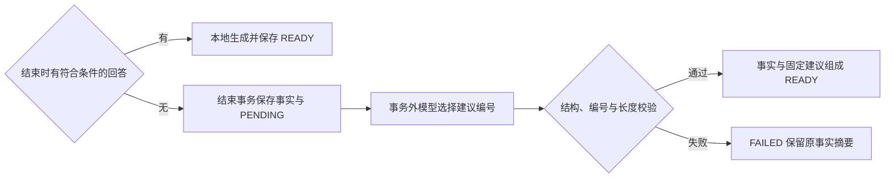

# 知芽接口契约

版本：v0.4；配套系统、数据库设计v1.1；状态：待团队评审。

会话 Cookie `zhiya_session` 使用 Secure、HttpOnly 和 SameSite=Lax。受保护的写请求须在 `X-CSRF-Token` 中提交可读 Cookie `zhiya_csrf` 的值。进入儿童模式时，在同一事务内吊销当前设备的家长 auth_sessions、签发 child_grants 及版本范围并绑定会话。恢复家长权限时重新验证账号密码，撤销儿童授权并签发全新家长凭证。

儿童设备的 Cookie 保留 24 小时。业务访问到 `expiresAt` 截止。持有未吊销儿童凭证的设备使用 API-021 验证所属家长密码，业务时限届满后仍可解锁。此时调用普通登录 API-002 返回 403 `FORBIDDEN`。

登录（API-002）后或页面刷新时，客户端通过 `GET /api/v1/auth/sessions/current` 查询当前 Cookie 的身份。家长和管理员返回 `accountId` 与 `role`，儿童仅返回 `role: CHILD` 以恢复交接页。无有效身份返回 401，成功响应使用 `Cache-Control: no-store`。API-003 允许管理员注销当前设备的账号会话。

管理员工作台通过 `GET /api/v1/admin/story-versions` 分页读取资料库各状态版本，包含正文与全部分支。该查询只对管理员开放，并排除家庭原创绘本。知识列表单独使用 API-029。两个页签均遵循每页最多 50 项的分页规则。

公共术语、标识语义与枚举见[公共术语表](../standards/glossary.md)。详细请求响应、错误及幂等规则见[接口示例](api-contract-v0.4.json)。

| 编号 | 方法与路径 | 权限 |
| --- | --- | --- |
| API-001 | POST /api/v1/auth/registrations | 匿名 |
| API-002 | POST /api/v1/auth/sessions | 匿名 |
| API-003 | DELETE /api/v1/auth/sessions/current | 家长、当前受限儿童或内容管理员 |
| API-004 | GET /api/v1/child-profiles | 已认证家长且归本人 |
| API-005 | POST /api/v1/child-profiles | 已认证家长 |
| API-006 | PATCH /api/v1/child-profiles/{profile_id} | 已认证家长且归本人 |
| API-007 | DELETE /api/v1/child-profiles/{profile_id} | 已认证家长且归本人 |
| API-008 | GET /api/v1/storybooks | 家长或绑定故事范围内儿童 |
| API-009 | GET /api/v1/story-versions/{version_id} | 家长或绑定故事范围内儿童 |
| API-010 | POST /api/v1/recommendations | 已认证家长 |
| API-011 | POST /api/v1/reading-sessions | 已认证家长且档案归本人 |
| API-012 | GET /api/v1/reading-sessions | 已认证家长且归本人 |
| API-013 | GET /api/v1/reading-sessions/{session_id} | 本人家长或绑定会话儿童 |
| API-014 | DELETE /api/v1/reading-sessions/{session_id} | 已认证家长且归本人 |
| API-015 | POST /api/v1/reading-sessions/{session_id}/events | 本人家长或绑定会话儿童 |
| API-016 | POST /api/v1/reading-sessions/{session_id}/questions | 本人家长或绑定会话儿童 |
| API-017 | POST /api/v1/reading-sessions/{session_id}/guidance | 本人家长或绑定会话儿童 |
| API-018 | POST /api/v1/reading-sessions/{session_id}/branches | 本人家长或绑定会话儿童 |
| API-019 | POST /api/v1/reading-sessions/{session_id}/completions | 本人家长或绑定会话儿童 |
| API-020 | PUT /api/v1/reading-sessions/{session_id}/mode-settings | 已认证家长且归本人 |
| API-021 | POST /api/v1/auth/parent-unlocks | 重新认证的家长 |
| API-022 | POST /api/v1/voice/transcriptions | 本人家长或绑定会话儿童 |
| API-023 | POST /api/v1/voice/syntheses | 本人家长或绑定会话儿童 |
| API-024 | GET /api/v1/media/{resource_key} | 有效会话且拥有资源访问权；内容管理员可核对资料库草稿、待审核和已发布版本的内页图 |
| API-025 | POST /api/v1/story-generations | 已认证家长 |
| API-026 | POST /api/v1/story-versions/{version_id}/approvals | 已认证家长且草稿归本人 |
| API-027 | POST /api/v1/admin/storybooks | 内容管理员 |
| API-028 | PATCH /api/v1/admin/story-versions/{version_id} | 内容管理员 |
| API-029 | GET /api/v1/admin/knowledge-items | 内容管理员 |
| API-030 | POST /api/v1/admin/knowledge-items | 内容管理员 |
| API-031 | PATCH /api/v1/admin/knowledge-items/{knowledge_id} | 内容管理员 |
| API-032 | GET /api/v1/health | 匿名 |

## G04 最小业务接口评审稿

2026-11-12，基线 `8c4172c`。下列 DCL-005～008 是供前端、业务后端、设计及 Agent 对照的候选约定。团队确认后同步到正式端点约束。JSON 中 `minimumBusinessReview` 对应本节，原接口目录的编号、方法、路径和权限继续适用。

### 首阶段字段与成功响应

资源 ID 采用公共整数范围，页码从 1 开始，`revision` 和 `expectedRevision` 用非负整数。JSON 成功响应使用 `{data, requestId}`，204 无响应体，API-024 成功返回二进制。登录成功由服务端设置会话 Cookie，受保护的写操作沿用公共 CSRF 约定。

| 接口 | 请求字段 | 成功响应 `data` |
| --- | --- | --- |
| API-001 / 002 注册与登录 | `account`、`password` 必填字符串。建议账号去除两端空白后 3～64 字符并保持大小写，密码 8～128 字符且原样提交 | 201，`accountId` |
| API-003 退出 | 无请求体。家长退出会撤销本机家长登录及该账号名下全部儿童授权，其他设备的家长登录继续有效。儿童退出只撤销当前儿童授权 | 204 |
| API-004 档案列表 | 无请求体 | 200，`items` 为档案对象数组 |
| API-005 新建档案 | `ageBand`、`preferredMinutes` 必填，`nickname` 和 `interests` 可省略 | 201，档案对象 |
| API-006 修改档案 | 路径 `profile_id`。至少提供 `nickname`、`ageBand`、`interests`、`preferredMinutes` 之一，省略字段保留原值 | 200，更新后的完整档案对象 |
| API-007 删除档案 | 路径 `profile_id`，无请求体 | 204，删除范围按现行数据清理策略 |
| API-008 绘本列表 | 可选查询 `ageBand`、`topic`、`scope=mine`、`page`、`pageSize`。页码默认 1，每页默认 20、最多 50 | 200，`items` 为绘本版本对象数组，附 `page`、`pageSize` |
| API-009 绘本详情 | 路径 `version_id`，无请求体 | 200，绘本版本对象 |
| API-011 创建共读会话 | `childProfileId`、`storyVersionId`、`mode=PARENT_CHILD` 必填。续写切换参数见下文 | 201，普通会话为 `CREATED`、`revision=0`，切换后的会话为 `IN_PROGRESS`、`revision=1` |
| API-012 会话列表 | 可选 `page`、`pageSize`，规则同 API-008 | 200，`items` 为会话对象数组，附 `page`、`pageSize` |
| API-013 读取或恢复会话 | 路径 `session_id`。可选查询 `view` 默认为 `reading`。家长可选 `deletion-status` 核对删除结果 | 默认返回 200 及 `session`、`events`、`report`，未生成小结时 `report=null`。删除核对返回 200 及布尔值 `data.exists`，响应带 `Cache-Control: no-store` |
| API-015 开始与翻页 | 路径 `session_id`。必填 `eventType=STARTED/PAGE_CHANGED`、`pageNumber`、`expectedRevision`、`clientEventId`（1～64 字符） | 首次 201，`interactionEventId`、更新后的 `revision`。同键成功重放 200 |
| API-019 结束 | 路径 `session_id`。必填 `reason=USER_FINISH`、`expectedRevision`、`clientEventId`（1～64 字符） | 首次和成功重放均为 200，`session`、`report` |
| API-024 媒体 | 路径 `resource_key`，可选查询参数 `variant=thumbnail` 或 `variant=reading`，无请求体 | 200，资源二进制及实际 `Content-Type` |

API-013 的 `view=deletion-status` 按 API-014 的家长归属规则查询。本人名下仍存在的记录返回 `exists=true`，包括绘本已撤回的记录。记录已删除或不属于当前家长时统一返回 `exists=false`。该视图仅返回布尔值。未认证请求返回 401，有效儿童凭证返回 403。普通会话读取继续按版本可见范围返回内容。

### DCL-005 封面与媒体

API-008/009 保留现有版本对象字段 `storybookId`、`storyVersionId`、`versionNumber`、`title`、`status`、`pages`、`branches`。`coverRef` 为受控资源键或 null。原创绘本没有专用封面时，取按页码顺序第一张可用的内页资源键作为封面。馆藏封面沿用原映射。`pages` 项包含 `pageNumber`、`text`、`imageRef`、`defaultNextPageNumber`，后继页为空时为 null。封面或内页缺图时对应字段返回 null，前端显示本地占位图。有素材时返回服务端分配、绑定该版本的资源键，由 API-024 读取。封面导入可按[封面映射](../../data/seed/cover_mapping.json)的 `storybook_id` 找到素材，仓库路径和种子占位值仅用于导入。素材可用性、授权和发布仍按 DCL-002。

API-008/009 的绘本版本对象提供 `ageMin` 与 `ageMax`（整数，包含两端），标准年龄段同时提供 `ageBand`，其他范围的 `ageBand` 为 null。团队原创馆藏的 `author` 为稳定的展示笔名，按馆藏来源和书名匹配随应用发布的种子映射。没有已知署名时返回 null。

数据库的 `story_pages.image_ref` 保持 `TEXT NOT NULL`。API-008/009 校验版本访问权后，按版本和页号解析该字段。仅当引用能解析为该版本中已核验可用的图片时，`imageRef` 才返回受控媒体键。种子中的 `/assets/placeholder.png`、旧版页面的画面描述，以及确认缺少素材的引用，都序列化为 `imageRef=null`。解析依赖暂不可用时返回下表的 503。API-024 仍逐次核验版本和资源访问权，过期或不可访问的资源键按现有规则处理。

API-024 处理图片时，`thumbnail` 和 `reading` 分别尝试生成最长边不超过 480 和 1280 像素的 WebP，保持宽高比且不放大。服务端仅在转码后更小时发送派生图。省略参数、动图或转码失败时返回原图。响应沿用 `private, no-store`，音频响应沿用现有规则。

### DCL-006 结束并发与幂等

通过鉴权、资源归属及请求格式校验后，先查会话内的 `clientEventId`。同键同请求重放已保存的原响应数据，同键不同请求（包括修订号不同）返回 409 `IDEMPOTENCY_CONFLICT`。新键遇到 `FINISHED` 时返回已有终态及当前小结，缺少小结时返回 null。新键对 `IN_PROGRESS` 会话首次结束，需在事务内比较 `expectedRevision` 并原子写入终态、递增修订号、事实摘要、小结和重放记录。其他会话状态、或翻页先提交导致修订号不匹配时，返回 409 `SESSION_CONFLICT`，前端读取 API-013 再决定是否以新键提交。若结束先提交，随后的新翻页请求返回 409。成功重复结束和重放均沿用小结生命周期约定。

### DCL-026 小结事实与内容安全（2026-11-17 实现约束，待评审）

API-019 首次结束时先保存 PENDING 小结。含有效回答时，本地摘要注明实际阅读页及本次已读页中最近一条回答，并保留回看活动。续写切换结束源会话仍保存原有本地小结。

结束事务提交后，百炼文本模型根据实际已读路径、已展示过的问题及通过本地匹配提取的绘本线索补充小结。回答原文留在服务端，不进入模型请求。API-013 读取最新状态，同键重放和新键重复结束沿用幂等约定。

模型返回 JSON，包含既有 `suggestionId`，可附上 `storyMoment`。服务端只接受已读正文中逐字匹配、通过安全检查的 4 至 60 字情节，组合摘要不超过 500 字。成功时保留已有的作答摘要和活动，再补充核验后的情节及活动。模型失败时，有作答摘要的小结沿用本地内容并置 READY，其余保留事实摘要并置 FAILED。

只发布通过校验的故事片段及服务端构造的内容。外部字段、数据库结构和状态枚举不变，历史 READY 小结保持原版本。验证范围见[小结安全检验](../testing/report-safety-checks.md)。

### DCL-007 错误结构与前端反馈

JSON 错误统一使用 `{error: {code, message, retryable}, requestId}`。前端按状态和错误码分支，展示面向用户的提示。公共错误表中已有的错误语义继续适用。下面为首阶段映射建议。

| HTTP | 场景及错误码 | 前端处理 |
| --- | --- | --- |
| 401 | 受保护接口无有效凭证 `AUTH_REQUIRED`，API-002 凭证错误 `INVALID_CREDENTIALS` | 恢复认证或提示检查凭证 |
| 403 | 已认证但角色或儿童模式受限 `FORBIDDEN`，写操作校验失败 `CSRF_INVALID` | 提示权限受限或刷新认证上下文 |
| 404 | API-006/007/009/011/013/015/019/024 引用的资源不存在或不可访问 `RESOURCE_NOT_FOUND` | 提示资源不可用，媒体使用本地占位 |
| 409 | API-001 重复账号 `ACCOUNT_EXISTS`。API-015/019 状态或修订冲突 `SESSION_CONFLICT`，同键不同请求 `IDEMPOTENCY_CONFLICT`，同键执行中 `REQUEST_IN_PROGRESS` | 冲突时先读取会话。执行中按 `Retry-After` 原样重发 |
| 422 | 字段格式、枚举或必填项不符合约定 `VALIDATION_ERROR` | 提示检查表单或请求字段 |
| 429 | API-002 登录受限 `RATE_LIMITED` | 按 `Retry-After` 等待后再尝试 |
| 503 | 依赖暂不可用 `DEPENDENCY_UNAVAILABLE`，沿用 API-032 的错误码 | 提示稍后重试。读取可重试，已知未提交的写入可由用户重试 |
| 504 | 写入结果不明 `REQUEST_OUTCOME_UNKNOWN` | 查询会话，保留原请求标识，不自动创建新请求 |

上述场景中 `REQUEST_IN_PROGRESS`、`RATE_LIMITED` 和可重试的 503 读取响应使用 `retryable=true`，其余默认 false。API-032 健康检查继续返回现有的 503 和 `retryable=true`。API-015/019 的写入结果不明时返回 504 `REQUEST_OUTCOME_UNKNOWN`，由前端先查询会话状态。查不到私有资源和资源不属于当前账号使用相同的 404。

### DCL-008 档案与断线恢复

档案对象包含 `childProfileId`、`nickname`（可空）、`ageBand`（`AGE_3_4/AGE_4_5/AGE_5_6`）、`interests`（字符串数组，可为空）、`preferredMinutes`（1～30 整数）。建议昵称去除两端空白后 1～32 字符，创建省略时返回 null，修改时显式 null 清除昵称。兴趣最多 10 项，每项去除两端空白后 1～32 字符。创建省略兴趣时用空数组，修改传空数组清除兴趣。

会话对象包含 `readingSessionId`、`storyVersionId`、`currentPage`、`visitedPageNumbers`、`mode`、`status`、`revision`、`expiresAt`（UTC ISO 8601 字符串或 null）。断线恢复以 API-013 返回的固定版本、当前页、状态及修订号为准。首阶段开始和翻页的 `events` 示例使用 `interactionEventId`、`eventType`、`pageNumber`。已保存完整响应的 API-017 引导事件还返回 `outputText`、`strategyType` 和事件写入后的 `revision`，实际反馈另含 `feedback`，可用于刷新后恢复问题及跳过状态。家长可查看含 `readingSessionId`、`summary`、`activities`、`status` 的小结。儿童只接收授权范围内的必要交互和进度，API-013 及 API-019 的 `report` 均建议为 null，重放前仍校验调用者权限并按当前角色投影。客户端下一次新写入使用服务端修订号。网络失联或返回 `REQUEST_IN_PROGRESS` 时，可使用原键和原请求体查询式重发。收到明确的 504 后先读取 API-013，由用户根据会话状态决定下一步。

儿童在进行中的会话读取 API-013 时，`data.answerOptions` 列出当前页可以提交的作答文案。选项来自当前会话、绘本版本和页面上最近一道可展示的问题，包括首次 `QUESTION` 和理解反馈 `FEEDBACK` 中已保存的追问。跳过、拦截和没有正文的事件不算作提问。API-017 为儿童模式生成可用“是／不是／不知道”回答的问题，无知识及超时回退也遵守这一约定。该题的最终响应 `data.answerOptions` 保存实际选项，刷新和作答校验使用同一份数据。旧问题省略该字段时提供“是”“不是”“不知道”。页面尚无可展示的问题时，沿用该页已审核的分支选项文案。返回空数组表示当前没有可提交的选项。

API-017 的“已理解／未理解”围绕当前页最近实际展示的问题进行。在首题生成期间，家长可用新事件键和当前修订号提交 `SKIPPED`。跳过先提交即递增修订号，随后返回的旧提问记为可重放的 409 `SESSION_CONFLICT`。模型超时可保存安全回退。模型未配置、鉴权失败或限流等 `API_ERROR` 返回 503 `DEPENDENCY_UNAVAILABLE`，执行记录为 `FAILED`，会话修订号保持原值。同键重放该错误，依赖恢复后可用新键重新提问。

亲子共读时，只有本人家长的 API-013 在 `ANSWER` 事件上返回作答原文、已保存的芽芽回应 `replyText` 和有追问时的 `followupQuestion`，并使用 `private, no-store`。旧回答可省略 `replyText`；从旧记录恢复的追问须与已保存回应的后缀一致。API-015 先保存答案和规则回应。有有效问题时，文本模型可根据年龄、当页正文、已读前文、已审核知识、正文线索及本地提取的动作顺序、否定范围、因果依据等受控信号选择适龄回应。只有当页正文支持的细节可作为事实引用，作答原文留在服务端。共读回应发送给模型的正文与知识条目也会经过敏感内容检查。API-017 结合当前正文、最近三个实际读过的前文页面、当前问题和反馈。家长共读仅把当前次 `STARTED`、`PAGE_CHANGED` 或 `BRANCH_CHOSEN` 到达之后保存的题目作为当前问题。对 API-015 附带的最新追问提交理解反馈时，以该追问为当前问题，可从生成该追问的同一 ANSWER 事件提取当页线索；若当前问题来自 QUESTION 或 FEEDBACK，则只查找本次到达中在该问题之后保存的最新回答。旧题与旧追问可回看，但不会被新一次到达自动选中。百炼视觉模型可额外参考当前授权插画的缩图，围绕可见角色、位置、颜色、动作或数量提问。缺图或模型仅支持文本时使用已有文本引导。家长提交理解反馈时，只将与原文匹配的线索发送给模型。模型可提出联系前文与当前页的问题，两处引文分别来自实际已读前文和当页正文。儿童自主阅读沿用经过核验的固定作答选项。

API-016 接收家长已确认的本页问题 `inputText`（1～200 字符）。儿童凭证可以提交“这一页发生了什么？”或“故事里有谁？”，其他文本返回 422。新问题携带当前页码、修订号与事件键。亲子共读的回答可以使用相关正文句子，或由支持视觉的百炼模型识别当前授权插画中的可见细节。服务端在模型调用前及结果入库前核对会话，成功提交一条 `ASK` 并递增修订号。API-013 读回该回答的文字、策略、事件编号及修订号。API-023 以本次到达当前页后保存的 `interactionEventId` 合成已保存的可播放回答。安全拦截返回家长接管提示，不提供回答音频。

API-015 在同一写事务内重新计算允许的选项。儿童的 `ANSWER.inputText` 去除两端空白后须精确匹配其中一项，超出范围返回 `422 VALIDATION_ERROR`。家长在亲子共读时可提交 1～200 字符的文本。成功时随事件和新修订号返回 `data.replyText`，有追问时另返回 `data.followupQuestion`。为兼容旧客户端，`data.replyText` 保留追问后缀；使用独立字段显示追问的客户端可去除同一后缀。模型在事务外运行，回答生成的总时限为 5 秒。执行记录从占位起保留 25 秒的处理窗口。处理期间同键返回 `409 REQUEST_IN_PROGRESS`。模型失败、页面修订已推进或执行超时后，最终回应沿用已保存的规则文本。完成后同键重放返回相同回应和可选追问。同一会话、同一绘本版本、同一页每次到达最多保存两条不同的芽芽主动追问；翻页或经分支回到同一页时，本次到达的追问重新计数。模型返回追问编号 0 或降级为规则回应时不保存主动追问。同键重放不增加计数。跳转剧情分支使用 API-018。

## 本期有限续写范围

用户确认本期纳入有限续写；范围限亲子模式、固定源快照、审核新版本和原子切换，整本及各阅读路径仍为4～6页。
确认日期：2026-11-04；范围：本期纳入验收；优先级：P1。
设计修订者：林鑫（102401115）；M05：业务后端与领域Agent沿用现有角色分工；不据此指定具体实现成员。
验收用例：TC-FR17-04 续写原子切换、TC-FR17-05 切换失败恢复；接口链 API-025 → API-026 → API-011。
普通主链路无需触发续写即可完成档案、选书、阅读、互动和结束记录；续写为本期有明确边界的P1流程。
用户范围确认已记录；组长确认及设计PR审核、合并仍待实际完成，不以本文代替正式审批。

API-013 默认阅读详情仅向家长返回 `data.session.childProfileId`（源会话所属儿童档案）和 `data.session.sourceType`（`ORIGINAL` 或 `LIBRARY`）。家长可从本人仍在进行的亲子会话续写已审核私人原创，包括已退役的原创版本。API-011 切换使用源会话的儿童档案；API-025 返回 `CONTINUATION_STALE` 后重新读取源进度，由家长确认是否再次生成。

API-008/009 返回已授权的续写版本时，儿童可以读取页面和已审核分支。只有家长的版本对象包含 `sourceStoryVersionId` 和 `continuation` 源进度快照。

API-025 默认选择覆盖整个请求年龄段的授权模板，按新增页数配图，可提供相同数量插画的模板优先匹配主题。使用自定义媒体目录时，续写遇到模板不足或单张文件暂不可读，对应新增页的 `imageRef` 返回 null，其余可用插画保留。生成时固定图片内容，API-025 新草稿的 `coverRef` 指向第一张可用的内页资源键，无可用图片时为 null。家长可通过 API-024 预览本人待审核原创草稿的封面和内页，API-026 批准时沿用固定图片。续写草稿的封面可能引用已冻结的前文图，批准后返回目标版本的资源键。旧草稿首次预览某页时固定该页插画，批准时核对整本并固定其余页。若生成时已返回资源键的插画暂时缺失，该页预览和整本批准返回可重试的 503，其他可用页仍可预览。素材恢复后可重试原操作。成功生成请求的同键重放也会检查目标版本，已撤回时返回 404 `RESOURCE_NOT_FOUND`。

已确认的 FR-19 可选扩展见 [DCL-033](../standards/design-change-log.md)。家长可在 API-025 提交可选布尔字段 `generateIllustrations: true`，为新增正文逐页生成 AI 插画。省略或传 false 时使用授权模板，同键摘要与历史模板请求保持兼容。续写前文的配图始终沿用已冻结的内容。

启用 AI 插画时，文本模型在同一请求中为每个新增页提供一条独立的画面描述。服务端校验描述数量和内容后，将对应描述与所选主题、场景、故事模型明确声明的当页出场角色及共享外观合成单场景提示。角色标签供文本模型确定故事设定，“家人”按具体亲属处理。生图只使用当页明确出场的角色。书名、正文和完整角色标签均不传给生图模型。服务端验证并固定生成图片，使用 API-024 的受控资源键返回。AI 插画页另有 `imageSource: "AI_GENERATED"`。图片必须和正文一起经本人家长审核，批准时沿用草稿图片。生图预算为 45 秒，整次请求占位 115 秒，未配置或生成失败返回可重试的 503。失败时不创建草稿，已开始执行的原请求键只重放结果。服务端不会自动重发生图请求。

API-026 只批准同一绘本的续写。源快照中相邻的两页必须由源版本的默认后继或已审核分支连接。快照修订号不得超前，与源会话修订号相同时，当前页和已读路径也须一致。源会话已推进时，按该修订号之前及当次的阅读事件还原路径。与当时实际进度一致的旧快照仍可批准并从头阅读。按源路径逐页继承正文与已冻结的配图，每个决策节点至少有两个不同的目标页。配图对应的内容摘要随版本审批提交。

API-011 普通创建须省略 `sourceReadingSessionId` 和 `expectedRevision`。可提交非空 `clientRequestId`，在结果未确认时用原参数和原键核对。同一家长同键同请求返回原会话，参数不一致返回 409 `IDEMPOTENCY_CONFLICT`，原会话已不可访问时返回 404 `RESOURCE_NOT_FOUND`。切换须同时提交这三个非空字段，缺项或显式传 `null` 返回 422 `VALIDATION_ERROR`。遇到已过期的源进度返回 409 `CONTINUATION_STALE`，源会话已经切换则返回 409 `CONTINUATION_ALREADY_SWITCHED`。同键同请求仍重放原结果。切换自动写入的 STARTED 事件不占用客户端的会话事件键。

后继会话保留完整导航路径。阅读小结和成长统计只计入有效路径中从 `startPageNumber` 起的页面。删除源会话后，后继仍返回起读页和继承页数，同时清理与源关联的创建执行记录。删除源快照时，仍依赖它的 `DRAFT` 和 `PENDING_REVIEW` 续写在同一事务内转为 `CHECK_FAILED`。后续审批返回 409 `SESSION_CONFLICT`。此前已批准的版本仍按冻结配图独立阅读。

## 小结、历史版本与知识修订

儿童模式按服务端时限结算。家长的请求仅处理本人家庭，儿童的请求仅处理当前授权。会话已开始且绘本仍可读时，到期记为 `FINISHED / TIME_LIMIT`，结束时间取授权截止时刻。在提交终态、事实和小结后才派发模型任务。待开始会话到期记为 `INTERRUPTED / GRANT_REVOKED`。若未终结会话的绘本已撤回，记为 `INTERRUPTED / CONTENT_WITHDRAWN`。这两种中断均不生成小结。API-013 为儿童返回绑定会话当前页的事件和 `report=null`，家长可查看本人会话的全部事件及小结。

首次结束阅读在同一事务保存会话终态、事实记录、PENDING 小结和供同键重放的原响应。事务外补充小结，模型成功时置 READY，失败时有本地作答小结则沿用该内容，其余置 FAILED。
单工作进程启动时，遗留的 PENDING 小结若已有本地作答活动则直接恢复为 READY，其余标记 FAILED。恢复保留摘要、终态和原结束响应，无模型调用。
API-013读取当前小结。READY返回已生成内容；PENDING或FAILED返回事实摘要及空活动数组。FALLBACK仅用于模型/互动结果，不是ReadingReport.status。
同键重放原结束响应，可能仍含PENDING；新键重复结束只返回既有终态及当前小结，不再次调用模型。本阶段不提供失败小结重新生成入口。

默认书架及推荐仅选择有权访问的当前PUBLISHED或APPROVED_PRIVATE版本。每个storybookId至多一个当前生效版本，不限制本人可复读的已审核私有历史版本数。
RETIRED退出当前默认列表；只有storybooks.source_type=ORIGINAL、owner_guardian_id等于当前家长账号且story_versions.reviewed_by_id和reviewed_at均非空的本人私有历史版本，才允许从scope=mine读取并创建新会话。
LIBRARY的RETIRED版本不允许新建会话；仍有权访问的既有有效会话可以继续读取。
儿童访问另要求有效且未到期的授权、同家庭归属和allowedStoryVersionIds包含确切版本ID；不能借历史入口扩大授权。
WITHDRAWN立即拒绝新建会话、既有会话内容、正文和媒体访问；scope=mine和历史记录不能绕过。所有内容入口与媒体入口使用同一版本权限规则。
API-028的发布操作仅适用于许可完备的LIBRARY版本，须由内容管理员执行。发布时在同一事务记录服务端鉴权得到的管理员账号ID为reviewed_by_id、服务器时间为reviewed_at，并将版本置为PUBLISHED。新库初始化时，仓库已审核的 20 本课程原创由不可登录的种子发布身份记录审核并上架。发布范围见[种子说明](../../data/seed/README.md)。

API-027 默认建立新资料库绘本。传入已有资料库的 `storybookId` 时在同一本书下建立下一版草稿，保留旧版。图片引用填写受控素材目录中的相对路径。API-028 发布时复核全书可达、无环的路径、正文、分支、许可和每页实际可解码的图片，再固定图片内容。缺图返回 422，保留原草稿和现行发布版。导入种子的封面沿用入库时绑定的素材。

API-027、028、030、031 支持可选 `Idempotency-Key` 请求头（1～64 个可见 ASCII 字符）。后台页面对结果未确认的同次操作沿用原键。同一管理员在同键、同方法、路径与请求体下重放已成功写入的结果时返回 200 和原数据；同键请求内容不同返回 409 `IDEMPOTENCY_CONFLICT`。新操作使用新键。回执和内容变更在同一事务保存。

知识版本与标识的含义见公共术语表。所有PATCH均插入新行及新ID，版本号由服务端原子分配递增。草稿内容修改和仅审核状态变更均遵循此规则。旧行内容、来源及历史event_evidence引用不变。

知识ageBand的取值见公共术语表。API-030必须提供该字段；API-031省略时沿用路径所指版本的值，显式传null时新版本适用全龄。API-029至API-031响应中的全龄知识返回ageBand: null。
taskTypes为知识适用标签数组，取值见公共术语表的知识适用标签。task_types_json使用相同的UPPER_SNAKE_CASE值，标签按精确值匹配。
领域知识检索仅使用APPROVED版本。按具体年龄段初筛时仅匹配该年龄段与全龄知识，不扩展到其他年龄段。候选还须符合主题及知识适用标签筛选，再按关键词相关度取有限片段；候选不足时沿用该任务的安全回退。
提交status=APPROVED须由有权内容管理员完成新内容与来源审核，服务端校验并记录reviewed_at，不将客户端状态值本身视为已批准。激活新APPROVED行与退休同itemKey旧APPROVED行在一个事务内完成；新DRAFT行不退休当前APPROVED版本。
API-031停用请求只提交status=RETIRED，混入其他字段返回422。路径必须指向该itemKey当前APPROVED版本；已存在但不再是当前APPROVED的ID返回409。服务端在同一事务内按目标ID和status=APPROVED条件更新为RETIRED，须恰好更新一行，再插入同itemKey的RETIRED新版本。新版本复制内容和来源，响应返回新ID。任一步失败则回滚；成功后该itemKey退出新检索，历史引用继续指向实际使用的版本。
API-030创建806/v1(APPROVED)，API-031以806为来源修订得到807/v2(APPROVED)，同itemKey=guided-observation；806转RETIRED，已有event_evidence.knowledge_item_id仍为806，新检索使用807。继续对807提交仅含status=RETIRED的请求后，807转RETIRED、返回808/v3(RETIRED)，该itemKey不再有批准版本，已有引用仍指向806。

## 语音偏好扩展草案

2026-11-11，林鑫 / G08，DCL-013；关联 FR-08/12。以下是待团队评审的增量建议，未冻结、未实现公开路由或档案存储，不改变上表和 v0.4 JSON 的既有接口。内部实现与模型目录见[交接说明](speech-preferences-handoff.md)。

- 候选 `GET /api/v1/voice/options`，接口编号待团队分配，仅已认证家长。服务端使用当前模型的 `get_speech_options(model)`，按既有 `data` / `requestId` 包装返回；不调用付费服务。`data.voices` 为 `{voiceId, displayName, description, category, languages, dialects, scenarios}` 数组，`data.speechRates` 为支持的语速枚举数组，`data.defaultSpeechRate` 为 `NORMAL`。旧模型不再提供可选项；未配置合成时业务层应返回不可用状态，不能把静态目录当作服务可用证明。
- API-006 候选新增 `speechPreferences` 对象，例如 `{"speechPreferences":{"voiceId":"wenhuaiqing_v3.1","speechRate":"SLOW"}}`；API-004 返回同结构。只允许本人家长修改，沿用安全 Cookie、写入防跨站请求与归属校验；他人档案按既有不可见规则返回 404，儿童授权不能写设置。省略整个对象表示不改；提供时两个字段均必填，null、未知字段、未知/跨模型声线和无效语速返回 422，整次修改不部分落库。
- `speechRate` 为 `SLOW` / `NORMAL` / `FAST`，含义是模型合成语速；`voiceId` 是受支持声线的供应商原值，按第三方命名例外保留。前端中文标签由界面映射，不向家长展示底层枚举。
- API-023 沿用已授权事件或页面。页面朗读可设 `preload: true`，仅限已确认的本次当前页，当页的提问或作答写入不使已准备的音频失效。已保存的 `ASK` 回答也可在本次访问当前页期间播放。翻页、退出授权或绘本撤回后仍重新校验。录音继续要求当前修订号。
- 档案持久化候选为 `child_profiles.voice_id`、`child_profiles.speech_rate`，与上述字段一一映射；约束、默认值和存量迁移由业务后端随数据库设计评审实现。本轮无建列或迁移。新模型默认温怀清 / NORMAL；已有不支持的偏好须明确迁移或提示重选，不能悄悄替换声线。

DCL-014（2026-11-11）目录元数据草案：category 取 MULTILINGUAL_DIALECT（多语种与方言）、CHINESE（精品中文）、ENGLISH（精品英文）、OTHER_SYSTEM（其他系统声线）、OTHER_LANGUAGE（其他语言），旧模型兼容项为 LEGACY。languages、dialects、scenarios 均是显示用中文字符串数组，不是供应商请求参数或适龄认证；空数组表示官方未明确，不代表支持所有语言。displayName 不保证唯一（不同语言可同名），选择、保存和列表键必须使用精确 voiceId，保留其大小写。新增信息只用于目录展示，档案仍只保存 voiceId / speechRate，不增加数据库列。

DCL-017（2026-11-12）范围调整：当前仅保留温怀清、叶知晴、龙牛牛、龙闪闪、龙杰力豆、龙泡泡六种声线，按此顺序返回；对应 voiceId 见交接说明。旧模型与其余声线不可选，原 DCL-014 全量目录仅为历史决策。已有不支持的偏好须重选，不能静默替换；字段结构不变。

DCL-020（2026-11-12）实现进展：API-022/023 与 API-024 音频分支已在本地实现，业务认证未接入时默认拒绝。此处声线选项及档案偏好扩展仍待评审和实现；格式转换与接口边界见[公开语音交接](voice-api-handoff.md)，未修改 v0.4 JSON。

DCL-021（2026-11-12，历史记录，依赖码及读取重试语义已由 DCL-022 更新）G08 错误码调整：同会话语音在途返回 409 `VOICE_REQUEST_IN_PROGRESS`，区别于 v0.4 JSON 中带幂等记录的业务 `REQUEST_IN_PROGRESS`；全局并发仍返回 429 `VOICE_BUSY`。当时资源不可见使用 `RESOURCE_NOT_FOUND`，数据库不可用采用 #28 早期候选名 `SERVICE_UNAVAILABLE`，均为 retryable=false。

DCL-022（2026-11-14）对齐 #28 合并提交 `16bb85c` 的依赖错误约定：API-022/023/024 音频实现统一使用 503 `DEPENDENCY_UNAVAILABLE`。媒体 GET 的依赖读取失败为 retryable=true，仅允许重试原资源读取并重新校验权限，不触发音频合成；识别/合成 POST 在调用前后遇到数据库故障均保持 retryable=false，不自动再次调用供应商。404 `RESOURCE_NOT_FOUND`、语音并发及其他专用码不变，不添加 Retry-After。当前范围不实现图片业务、认证或档案存储；完整错误边界见[公开语音交接](voice-api-handoff.md#语音错误码与重试边界dcl-021)。

DCL-023（2026-11-16）引入 PR #30 的 G07 首批实现（903695e）：共同应用现包含注册、家长登录/退出、档案列表/创建/修改和绘本列表/版本详情。API-022/023/024 音频分支默认复用其真实家长 Cookie/CSRF 校验；数据库就绪时匿名返回 401 AUTH_REQUIRED，写请求缺失或错误 CSRF 返回 403 CSRF_INVALID。读取/写入的依赖失败仍按 DCL-022 区分；新业务响应统一 requestId。不新增语音输入字段、数据库列或儿童认证入口，阅读会话创建、互动持久化、图片分派和偏好存储仍待业务实现。来源、兼容性及验证边界见[交接文档](voice-api-handoff.md#与最新-pr-30-的接入核对)。
