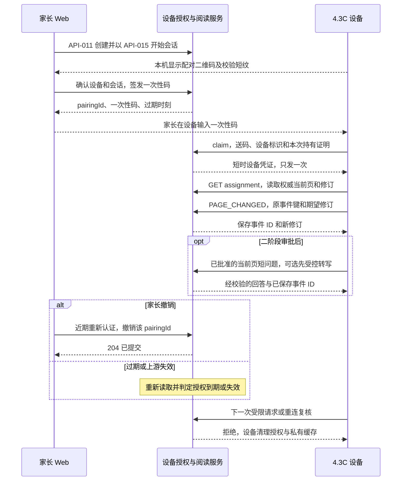

# H09 设备授权接口草案

> **DRAFT / 待团队评审 / 未实现** · 2026-11-27 · main `48844b2ee267bc539ed0580a358470beca13e449`
>
> 关联 DCL-025、H00 D-HW-03，兼容 DCL-002、DCL-007、DCL-022、DCL-023、DCL-027 和 DCL-031。H00 已合并，D-HW-03 待业务后端和团队确认。本文全部设备路径、字段、额度与行为均为评审候选。正式 API 继续见 [v0.4 文档](api-contract.md)和 [v0.4 JSON](api-contract-v0.4.json)。

## 基线和现状审查

核对了根目录协作规范和 README、[SRS](../requirements/软件需求规格说明书.md)、[设计变更日志](../standards/design-change-log.md)、接口契约与评审说明、11 月 27 日项目和硬件交接、硬件详细设计与任务路线 v1.1、[H00](../../hardware/docs/h00-interface-decisions.md)、[H04](../../hardware/docs/ui-flow.md)、[H05](../../hardware/docs/mock-contract.md)，以及下列源码、DDL、迁移、种子、测试与桌面/移动端入口。H00 的逐项实现表基于旧 SHA，按下表校准。远程 [#31](https://github.com/MumLauds/202610-zhiya/pull/31)（会话）、[#43](https://github.com/MumLauds/202610-zhiya/pull/43)（儿童模式）、[#48](https://github.com/MumLauds/202610-zhiya/pull/48)（受控图片）、[#34](https://github.com/MumLauds/202610-zhiya/pull/34)（H00/H01）、[#39](https://github.com/MumLauds/202610-zhiya/pull/39)（H02）、[#45](https://github.com/MumLauds/202610-zhiya/pull/45)、[#94](https://github.com/MumLauds/202610-zhiya/pull/94)、[#95](https://github.com/MumLauds/202610-zhiya/pull/95)（本地资源及 Mock）已合并。执行时开放的 [#93](https://github.com/MumLauds/202610-zhiya/pull/93) H07 和 [#98](https://github.com/MumLauds/202610-zhiya/pull/98) H06 为 Draft，[#97](https://github.com/MumLauds/202610-zhiya/pull/97) Agent 2.0 待合并。H08 有本地分支。H09 仅依赖 H00。若 #97 先进入主线，H10 要复查互动事件、Agent 及来源校验。

下表的测试列是已读到的仓库覆盖。执行记录见 [H10 交接](../../hardware/docs/h09-h10-handoff.md)。

| 层及接口 | 源码证据与实际行为 | 现有测试 | H09 缺口与决策 |
| --- | --- | --- | --- |
| 认证与统一错误 | [main.py](../../backend/app/main.py) 注册 auth、profiles、storybook、reading、guidance、voice 路由，安装错误处理与 requestId。 [auth.py](../../backend/app/api/v1/auth.py) `set_session_cookies`、`_identify`、`authorized_db` 以 Secure/HttpOnly/SameSite=Lax 的 `zhiya_session` 认证，`zhiya_csrf` 可由 Web 读取并作为 `X-CSRF-Token` 回传。每次按摘要、时限、撤销、角色查库。ADMIN 仅在明确允许的入口。 | `test_auth_profiles.py` 注册、登录、注销、CSRF、过期及 ADMIN 隔离 | 当前 principal 只有 GUARDIAN / CHILD / ADMIN。设备走独立鉴权入口和明确的专属投影，复用同一业务授权规则。 |
| API-008 / 009 书架与详情 | [storybooks.py](../../backend/app/api/v1/storybooks.py) `list_storybooks`、`readable_story_version`、`version_object` 对本人私有内容和 CHILD grant 过滤。书架轻量。详情含页和已审核分支，家长有额外续写数据。已固定、审核过的退役版本可按现有会话/授权规则读取，WITHDRAWN 拒绝。 | `test_storybooks.py` 书架可见性、退役、隔离，`test_child_mode.py` 授权书单 | A 仅投影一个固定版本的当前页，排除 Web 书架、完整详情和编辑预览。 |
| API-011 / 013 创建与恢复 | [reading_sessions.py](../../backend/app/api/v1/reading_sessions.py) `create_session` 仅 GUARDIAN + CSRF，核对本人档案和合格版本，普通创建支持 `clientRequestId`，另有续写原子切换。 `get_session`、`owned_session` 检查会话归属、版本及 CHILD 的 grant+profile+version。CHILD 读取当前页事件及可选答案，家长可读历史、小结、档案 ID。 | `test_storybooks.py` 创建/恢复/历史，`test_continuations.py` 续写，`test_child_mode.py` 当前页投影 | A 由 Web 启动会话；设备恢复经 assignment，省去历史、报告、档案 ID。续写新会话须重新授权。 |
| API-015 事件 | `ReadingEvent`、`save_reading_event`、`replay_execution` 支持 STARTED、PAGE_CHANGED、ANSWER、FEEDBACK。STARTED 只能从 CREATED；PAGE_CHANGED 只能到当前页 `defaultNextPageNumber`。ANSWER/FEEDBACK 与当前页及状态相关，儿童答案受选项限制。写入记录事件及 revision，重放查 `request_executions`。 | `test_storybooks.py` 同键、并发、未知结果，`test_answer_revision.py` 修订，`test_interactions.py` 互动 | A 建议仅设备 PAGE_CHANGED。HW-02 上一页需评审，当前不能用 PAGE_CHANGED 任意回退。 |
| API-016 / 017 / 018 问答、引导与分支 | [guidance.py](../../backend/app/api/v1/guidance.py) `process_question_or_guidance`、`finish_guidance` 校验当前页/修订/状态，保存 ASK/QUESTION/FEEDBACK。亲子自由问题先筛隐私及安全，CHILD 只接受两个受限短问题。[reading_agent.py](../../backend/app/services/reading_agent.py) `answer_question`、`run_agent` 约束适龄及阅读语境。 `choose_branch` 仅接受本页、同固定版本的已审核分支。 | `test_interactions.py` 选择、页面、敏感输入、晚到结果及模型重放，`test_reading_agent.py` 内容规则 | 问答候选只开放短题且由家长监督。引导、回答、反馈和剧情分支各自保持拒绝，列作扩展评审。 |
| API-019 结束 | `finish_session` 依赖会话归属、revision、clientEventId。客户端 reason 只接受 USER_FINISH。TIME_LIMIT 由服务端结算，CONTINUED 是续写切换结果。既有家长和有效 CHILD 有各自的响应投影。 | `test_storybooks.py` 重放及结束/翻页竞争，`test_child_mode.py` 到期结算 | 设备退出是本地操作。Web 家长控制结束。设备业务完成权单独待决，撤销不应触发结束。 |
| API-020 / 021 设儿童模式与家长解锁 | `update_mode_settings` 仅家长 + CSRF，CREATED 时创建 grant 和获准版本，转换至 CHILD_SOLO、吊销该家长 Web session、签发 CHILD cookie；另一有效家长会话可缩短授权。 `parent_unlock` 使用 CHILD cookie+CSRF、所属家长密码和限流，允许已到期但未撤销的 child grant 作为解锁上下文，撤销 grant 并签发新家长 cookie。注销及解锁调用 `revoke_grant_and_interrupt`。 | `test_child_mode.py` 角色门槛、缩短、过期、解锁、注销 | 设备不能切换模式/解锁。A 首发限定 PARENT_CHILD，若批准 CHILD_SOLO 扩展则引用原 grant、版本白名单及期限。 |
| API-022 ASR | [voice.py](../../backend/app/api/v1/voice.py) `transcribe` 只收 multipart 的 `file/readingSessionId/pageNumber/revision`，认证后验证会话、页面、修订；转换和供应商调用前后复核，回复 `text/status/reliable`。 [audio_conversion.py](../../backend/app/audio_conversion.py) 当前上限 4 MiB、120 秒并支持格式转换。 | `test_voice_api.py` 边界/并发/失效，`test_voice_auth_integration.py` Cookie/CSRF 和撤销 | 候选缩短设备录音上限；现有 API-022 没有持久的同键去重收据，H13 前先决策计费与未知结果。 |
| API-023 TTS | `synthesize` 通过 [schemas/voice.py](../../backend/app/schemas/voice.py) 只收事件 ID 或会话、页、修订三件套（Web 页来源可选 preload）。 [voice_access.py](../../backend/app/services/voice_access.py) 检查版本、状态、grant、来源。成功/降级并具输出的 ASK/QUESTION/ANSWER/FEEDBACK 可作有效事件来源，ASK 受本次到页约束。返回 `audioUrl/expiresAt`。 | `test_voice_api.py` 来源、并发及撤回，`test_interactions.py` ASK 音频 | 设备仅允许当前页和经批准的本次到页 ASK 源。禁任意 text、预加载及其余事件源。 |
| API-024 受控媒体 | `media` 对图片走 `_read_story_image` 的 Web 鉴权，对音频走 [voice_auth.py](../../backend/app/services/voice_auth.py) 的 VoicePrincipal、[voice_media.py](../../backend/app/services/voice_media.py) 的进程内音频（TTL 300 秒）及来源复核。图片由 [story_media.py](../../backend/app/services/story_media.py) 校验并固定资源。支持预览、可选变体与原图回退；二进制均 `private, no-store`。缺图可为 null。图片 key 的现行语义是版/页，暂无设备会话约束。 | `test_controlled_media.py` 快照、图片鉴权/撤回、变体，`test_voice_api.py` 音频过期和跨主体 | 设备媒体必须同时绑定授权、会话、版与当前页/事件。图片的单独 Web 入口和仅携带 guardian/grant 的 VoicePrincipal 都不足以作为设备授权。 |
| 数据库和种子 | [schema.sql](../../database/schema.sql) 以 `child_profiles.guardian_id` 表示家庭归属，`child_grants` 有签发 Web session、摘要、有效期和撤销字段，`child_grant_books` 固定允许版本，会话以 grant/profile 与 grant/version 复合外键约束 CHILD。事件、`request_executions` 保存幂等与修订；`event_evidence`、`admin_write_receipts` 用途各异。 [connection.py](../../backend/app/db/connection.py) 开启外键，[初始化](../../database/init_db.py)和[导种](../../database/import_seed.py)校验并固定媒体，[迁移说明](../../database/migrations/README.md)记录旧库行为。 | `database/tests/test_database.py`、`test_continuation_migration.py`、`test_controlled_media.py` | 没有设备、配对、凭证撤销或设备审计模型。把上游引用和设备操作标记作为 H10 提案。 |
| 桌面/移动端 | 桌面 [client.js](../../frontend/src/api/client.js)、[auth.js](../../frontend/src/api/auth.js)、[useZhiya.js](../../frontend/src/stores/useZhiya.js) 管理 Web Cookie、CSRF、角色恢复、儿童模式与解锁。移动 [App.vue](../../frontend/mobile/App.vue) 管理目录和会话入口，[client.js](../../frontend/mobile/api/client.js)、[readingSessions.js](../../frontend/mobile/api/readingSessions.js) 复用 Cookie/CSRF，[readingSessionMachine.js](../../frontend/mobile/services/readingSessionMachine.js) 以原键、修订和会话读回恢复。 | `frontend/src/api/client.test.js`、`frontend/src/stores/useZhiya.test.js`、`frontend/tests/readingSessionMachine.test.js`、`frontend/mobile/App.test.js` | Web 家长增加授权/撤销入口。设备独立处理状态与原键恢复，不共享浏览器认证。 |
| H04/H05 | [ui-flow](../../hardware/docs/ui-flow.md) 是交互设计。[mock/server.py](../../hardware/mock/server.py) 加载 5 个固定 fixture，`demoOnly=true`。H03/H05 已有 104 个本地内页和 `localPageAsset` 映射，仍可能显示缺图占位。 | `hardware/tests/mock/test_mock.py`、`hardware/tests/assets/test_page_assets.py` | 本地资源路径不能映射为正式媒体 key。H09 样本独立于 H05 server 和固件。 |

## 方案比较

| 评审维度 | A 家长先开会话，设备领取限权授权 | B 持久设备绑定及任务 |
| --- | --- | --- |
| 架构与数据 | 一个授权引用一个真实会话和固定版本，复用 Web 选择/创建及现有访问谓词。新增配对、凭证状态、小范围 adapter。 | 新增设备注册、持久关系、任务模型、切换、管理及迁移。可授予已批准的版本集合，必要时允许显式选书、建会话。 |
| 家长和设备交互 | 由家长端选书、开读、核对设备并确认。设备显示领取和当前页。更换任务或到期时由家长重新授权。 | 家长另有设备列表、家庭转移、儿童档案/版本或任务管理；设备有受限书架和任务选择。 |
| 最小权限与设备丢失 | 限单会话及操作，撤销或到期切断访问，丢失风险随短时窗口收敛。家庭更换只发新授权。 | 持久身份、任务与访问 token 都要分层撤销，丢失时查资产归属，儿童和设备授权的交集更复杂。 |
| 儿童、并发与结束 | 家长 Web 参与，首发 PARENT_CHILD，单设备槽、Web 可并行，结束后设备失效，续期重配。CHILD_SOLO 需 grant 扩展。 | 持久绑定可配置儿童任务、多设备和家庭转移，但仍须复核 grant、已审版本及会话有效期。完整解绑还需清理全部令牌、旧任务及媒体。 |
| 成本与延展 | 首发降低后端、Web 及设备改动量，优先验证权限和会话同步。 | 适合长期绑定及跨次自助阅读，需额外身份治理、运维与迁移。 |

**推荐待决**　A，先允许 assignment、受控当前页图片及向前翻页。由家长在 Web 开始并结束会话。问答和语音用独立开关与审批，所有未知操作默认拒绝。B 可在持久绑定和多任务成为明确需求后另行评审。

| 需求 | A 的支持范围 |
| --- | --- |
| HW-01 | H10/H11 交付后可从家长选定会话读取绘本、固定版本和当前页。 |
| HW-02 | 能覆盖当前页图文、缺图占位和合法下一页。上一页的服务器事件语义、分支节点操作及实板解码仍待确认。 |
| HW-03 | 候选二阶段受控 ASR，须完成限额、计费幂等、短录音和设备真联调。 |
| HW-04 | 候选二阶段仅当前页朗读或受限、已保存的当页 ASK；真实回答和播报依赖 H13。 |
| HW-05 | 候选第一阶段支持设备翻页写入同一会话并供家长读回，以及撤销后拒绝访问。设备问答记录依赖二阶段，Web 如何标记设备来源待决。 |

## 候选流程与状态

设备本机先产生随机 `deviceId`（每次安装生成，允许重置）和本次配对随机秘密。二维码只显示标识与秘密的摘要 `deviceCommitment`，设备显示由摘要导出的校验短纹，家长在 Web 核对并显式确认再签发。家长发出的短码在设备输入，服务端以短码定位绑定至该摘要的 pending 记录，领取同时核验随机秘密。二维码短纹用于现场比对，不作凭证。公开标识、MAC、序列号和固件常量均不能证明物理板卡身份。此流程确认的是本次秘密的持有和家长选定关系。证书、出厂信任或签名持有证明需要单独评审。二维码无法扫描时可在 H10 评审替代的等强流程，首版不以裸短码退化。

| 事件 | 权威授权与设备界面 |
| --- | --- |
| 无记录/新装，或用户本机退出 | 无本次授权可用。设备显示未授权，退出清理本地状态。已发行授权只有 Web 撤销或到期才在服务端终止。 |
| 家长确认并签发 | PENDING；设备显示等待领取。码只在有效期限内进入一次兑换。 |
| 成功 claim | ACTIVE；设备收到凭证，经 assignment 复核后进入阅读。 |
| 超过期限 | EXPIRED；设备有可信时间锚时本地先停用，无时间锚时停止直至可信在线复核。 |
| 家长撤销或终态/上游权限失效 | REVOKED 或按实时条件拒绝；设备收到终态拒绝后停止任务、清理凭证和私有缓存。 |
| 失联 | 服务端状态照常按时间及事件演进；设备显示失联、隐藏私有页，暂停受限操作。重连先 GET assignment，核对原未确认写入才允许新操作。 |
| 重新授权/更换家庭 | 新配对代次及凭证；旧代次清理，已有有效槽先由原家长撤销或等到期。新家庭不能查看或替换旧授权。 |

## 候选端点与 DTO

下列均为 **DRAFT / 未实现**。JSON 成功 `{data, requestId}`，错误 `{error:{code,message,retryable},requestId}`；204 无体，媒体成功二进制。敏感响应 `Cache-Control: private, no-store`。所有字段必填且非 null，除表中另述。拒绝未知字段；`Id` 表示严格整数 1～9007199254740991；页码同范围且按有效页面限制；`Rev` 是 0～9007199254740991 的严格整数。 `storyVersionId` 是版本主键，`versionNumber` 是同书版本的业务序号（正整数），`readingSessionId` 是会话主键，`revision` 随会话事件变化。时间为 UTC RFC 3339。设备/配对标识为不透明字符串，候选 16～64 Base64URL 字符，非业务 ID。新端点及 adapter 的路径和编号须正式登记。

| 方法与候选路径 | 身份、请求与前置条件 | 成功投影 | 失败、竞态与审计 |
| --- | --- | --- | --- |
| POST `/api/v1/devices/pairing-sessions` | GUARDIAN + Cookie/CSRF，显式确认本机短纹和本人 IN_PROGRESS PARENT_CHILD 会话。JSON `readingSessionId:Id, deviceId:string, deviceCommitment:string, clientRequestId:string(1–64)`。摘要候选为 32 字节的 Base64URL 表示（43 字符）。 | 201 `pairingId:string, pairingCode:string, expiresAt:time`（码期限）。码候选 8 位数字串，保留前导零。 | 401/403/404/409/422/429。签发先核对权威归属，事务内占用设备和会话槽。原键同内容重复用 409 `PAIRING_ALREADY_ISSUED`（不再显示码），异内容 409 幂等冲突。记签发/拒绝与请求标识。 |
| POST `/api/v1/devices/pairings/claim` | 只接受专用兑换。JSON `deviceId:string, pairingCode:string, deviceProof:string`，证明为本次随机 32 字节 Base64URL（43 字符），服务端比较其摘要。拒绝携带 Cookie 的兑换请求。 | 201 `deviceId:string, accessToken:string, expiresAt:time`。不透明 token 候选 32 字节随机值，Bearer，仅响应中交付。 | 无效、过期、已消费、错设备/证明统一 404 `RESOURCE_NOT_FOUND`；结构错误 422、限流 429。复核上游后原子消费和发证。记录成功/拒绝及限流，丢失响应由家长撤销原代次并重配。 |
| GET `/api/v1/devices/me/assignment` | 设备 Bearer，无请求体或资源选择查询。重新检查授权及 `assignment:read`。 | 200 最小投影见下。 | 401 无效/过期/撤销、403 缺 scope、404 无可见目标、503 依赖；幂等读。按需要审计拒绝，重复成功读只聚合必要指标。 |
| DELETE `/api/v1/devices/pairing-sessions/{pairing_id}` | GUARDIAN + CSRF、近期登录验证和授权所有权，空体；建议 5 分钟内交互式重登。API-002 可重登签发 Web 会话；main 暂无可检查的签发/重认证时间，需要 H10 增加服务端证据。 | 204，覆盖 pending 取消或 active 撤销。 | 本人同代次重复撤销仍 204；不存在/跨家庭 404、近期登录不足 403 `REAUTH_REQUIRED`。与 claim 串行；若 claim 先提交，则撤销其 token。记录一次状态转移。 |
| POST `/api/v1/devices/me/events` | Bearer + `reading:page-change`。JSON `eventType:"PAGE_CHANGED", pageNumber:Id, expectedRevision:Rev, clientEventId:string(1–64)`，只许当前页的合法后继。 | 201 `interactionEventId:Id, revision:Rev`。 | 401/403/404/409/422/503/504。与 Web 共用会话操作和事务。按设备授权代次隔离回放权限，记录对应该事件的设备操作。 |
| POST `/api/v1/devices/me/questions`（二阶段） | Bearer + `reading:ask`。JSON `pageNumber:Id, expectedRevision:Rev, clientEventId:string(1–64), inputText:string(1–200)`，首轮只允许「这一页发生了什么？」或「故事里有谁？」。 | 201 `interactionEventId:Id, revision:Rev, status:"GENERATED"|"FALLBACK"|"BLOCKED", outputText:string`。BLOCKED 使用安全提示内容，不返回可播事件能力。 | 校验失败 422，状态冲突 409，结果未知 504。付费调用前后查授权及到页，按原键执行；审计仅记状态及计费调用标记。 |
| POST `/api/v1/devices/me/voice/transcriptions`（二阶段） | Bearer + `voice:asr`。multipart `file` 二进制，`readingSessionId/pageNumber/revision` 十进制字段，另候选 `Idempotency-Key` 头（1–64 字符）。设备短录音候选 10 秒、384 KiB；最终格式和限额由 H07/H13 与后端核定。 | 200 `text:string, status:"RECOGNIZED", reliable:boolean`。低可信或非允许短题不自动派发问答。 | 401/403/404/409/413/415/422/429/503/504，复用语音错误映射及同键计费占位，禁止从未知结果自动重发。录音不入审计。 |
| POST `/api/v1/devices/me/voice/syntheses`（二阶段） | Bearer + `voice:tts`，同上候选幂等头。JSON 恰为 `{interactionEventId:Id}`（本设备授权中当前次到页的可播 ASK）或 `{readingSessionId:Id,pageNumber:Id,revision:Rev}`。无 text、preload、声线选择。 | 201 `audioUrl:string, expiresAt:time`，URL 为对应设备媒体相对路径，期限取媒体及有效授权中较早者。 | 401/403/404/409/422/429/503/504。核验来源、同键计费和媒体授权，记录受控事件/页来源及结果。 |
| GET `/api/v1/devices/me/media/{resource_key}` | Bearer + `media:image` 或 `media:audio`，空体。候选资源键为服务端不透明引用，1～128 ASCII 安全字符，登记为授权/会话/版本/页或当前到页事件范围。图片变体由固件/媒体负责人决定，草案无 query。 | 200 二进制与真实 `Content-Type`，`private, no-store`；图片格式和大小由 H12 核定。 | 401/403/404（错会话/页/版本、过期、失效来源）/503 安全读；同键须实时复核。审计拒绝与聚合读取，无原始 key。 |

A 省略持久 `/devices/{device_id}/binding`、常驻 heartbeat 和家庭书架。撤销按代次定位。任务字段 `childProfileId` 与 `grantId` 仅服务端使用。设备 DTO 如下，均必填，只有明示字段可为 null。

| 字段 | 含义与约束 |
| --- | --- |
| `deviceId, readingSessionId, storybookId, storyVersionId, versionNumber` | 不透明设备标识、正整数业务 ID、版本序号。 |
| `mode, status, expiresAt, currentPage, revision` | 首阶段固定 PARENT_CHILD、IN_PROGRESS；返回有效授权截至时间及权威页/修订。 |
| `page.text, page.imageRef, page.defaultNextPageNumber` | 当前页正文（候选上限 16 KiB UTF-8，超限由 H11 评审降级）；受控图片引用或 null；合法后继页或 null。先校验设备当前页，缺图用占位。 |
| `lastDeviceEvent` | null 或 `{clientEventId, interactionEventId, revision}`，仅该授权代次最近一次成功设备事件的最小回执。Web 并行写入不覆盖它。设备同一时刻仅一个待确认写入；其他设备及家长事件、文本、报告均不投影。 |

### 兼容及失败恢复

- 401 `AUTH_REQUIRED` 用于设备凭证无效/过期/撤销，停止调用并清理；403 `FORBIDDEN` 用于已识别但动作超范围，Web CSRF 仍用 `CSRF_INVALID`。有效授权查询他人或不可见业务资源用不泄漏存在性的 404 `RESOURCE_NOT_FOUND`。设备路径中 Web Cookie 不建立设备身份，混用 Cookie 和 Bearer 拒绝。设备 Bearer 不能进入原 Web 路由。
- 409 `SESSION_CONFLICT` 先读 assignment 并按权威页和修订重绘；需要新操作时使用新键，由用户明确触发。409 `REQUEST_IN_PROGRESS` 可按 `Retry-After` 有界查询原请求或取回原键已完成的收据；409 `IDEMPOTENCY_CONFLICT` 拒绝同键异内容。配对用 `PAIRING_ALREADY_ISSUED`、`PAIRING_CONFLICT` 均待决；冲突响应不暴露占槽家庭。限流 429 `RATE_LIMITED`，附 `Retry-After`。
- 504 `REQUEST_OUTCOME_UNKNOWN` 或断线先看 assignment 的本代次回执和权威进度。已确认提交时使用返回的修订。缺少收据只能视为未确认。没有经审批的无扣费恢复语义时，保持未确认并交由家长处理；禁止换键自动补发和语音/Agent 自动重试。API-022/023 当前进程内并发保护/TTS 缓存与 H10 候选持久计费幂等有不同覆盖范围。
- 503 `DEPENDENCY_UNAVAILABLE` 的只读短退避可沿用现有语义。写入仅当能够证明未进入副作用，且明确获准，才可引导重试。原键回放也须满足实时授权；跨主体以原键查回执不得泄露另一个主体的响应。通用错误码与新增候选码按正式审批的路径登记。
- HW-02 上一页、STARTED、结束、分支、反馈、任意问答与跨会话访问需要单独批准。轻量方案中的设备“返回/退出”停止本地显示或播放。允许的下一页和问答均提交现有业务事件，家长用 API-013 读回；H10 评审增加最小设备归因。
- [安全模型](../../hardware/docs/security.md)、[合同样本与验收矩阵](../../hardware/tests/contract/device-draft/acceptance.md)、[H10 交接](../../hardware/docs/h09-h10-handoff.md)补充安全控制和后续验收。
