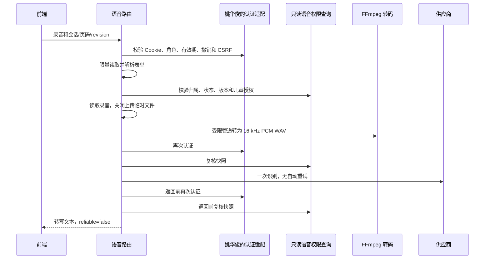

# G08 公开语音接口与录音转换交接

版本：v0.2；日期：2026-11-12；实现负责人：林鑫。当前提交草稿 PR 供团队对接评审，不代表成员已确认、已经合并或完整业务上线。关联 FR-08/12/13、NFR-04/05/06/08、API-022/023/024、DCL-020。此前验证记录中的“本地未提交 / 不提交 PR”描述当时状态；本轮用户已明确授权提交草稿 PR，历史证据不改写。

自动语音识别（Automatic Speech Recognition，ASR）、语音合成（Text-to-Speech，TTS）、脉冲编码调制（Pulse-Code Modulation，PCM）、波形音频文件格式（Waveform Audio File Format，WAV）、跨站请求伪造（Cross-Site Request Forgery，CSRF）。

## 已实现的接口与边界

接口字段与来源选择按 [v0.4 契约](api-contract-v0.4.json) 实现，没有新增登录方式、Cookie 名称、令牌摘要算法或业务数据库列。契约示例中的 reliable=true 不是置信度保证，本实现缺乏可用置信度证据，固定返回 false，须由前端确认/回退。契约“上传前校验会话”需团队明确为“解析会话字段后、转码和供应商调用前校验”；当前未改写 v0.4 JSON。API-024 整体仍包含待接的图片分支，本轮音频分支已实现并测试 WITHDRAWN 阻断。

| 接口 | 输入与输出 | 本轮行为 |
| --- | --- | --- |
| API-022 POST /api/v1/voice/transcriptions | multipart/form-data：file、readingSessionId、pageNumber、revision；200 data={text,status:RECOGNIZED,reliable} | 先认证与 CSRF，再限量读取并解析上传；文件读取/转码前检查会话，付费识别前及返回前再次认证和检查数据；reliable 仍为 false |
| API-023 POST /api/v1/voice/syntheses | JSON：仅 interactionEventId，或仅 readingSessionId/pageNumber/revision；201 data={audioUrl,expiresAt} | 两种来源互斥，拒绝客户端正文、模型名、地址及声线覆盖；读取页面或已保存有效回答，合成前后重新检查授权与内容快照，缓存命中也再次认证 |
| API-024 GET /api/v1/media/{resource_key} | 二进制 audio/wav，非 JSON 包 | 本轮只实现本服务生成的 audio- 资源；每次认证并复核所属会话、版本和进度，不返回供应商链接，不替代图片资源接口 |

公开接口注册在同一个应用。**业务认证未接入时，三条接口统一返回 503 VOICE_AUTH_NOT_CONFIGURED，不转换录音、不调用供应商。** 这不是已完成登录端到端的证明。



HTTP 身份认证发生在读取请求体之前。现有契约把会话字段放在 multipart 内，只有解析到这些字段后才能做会话归属检查；不声称在收到任何上传字节前已完成会话检查。整个请求体上限为 4 MiB+64 KiB，文件本身上限为 4 MiB；解析后文件在调用转换器/供应商前关闭。前端不得把分段录音块单独提交为完整录音。

## 录音转换由林鑫负责

- 接受 audio/webm（可含 codecs 参数）、audio/ogg、audio/mp4、audio/mpeg、audio/wav、audio/x-wav；文件类型由实际解码验证，不信任文件名。
- 转成 16 kHz、单声道、16 位 PCM WAV；最长 120 秒，超限整段拒绝，不静默截断。已符合要求的 WAV 不依赖 FFmpeg。
- FFmpeg 使用固定解复用器、仅 pipe 协议、一个音轨、单线程和 10 秒转换期限；标准输出限量读取，标准错误不回传或记录。无需转换临时文件，不通过媒体内容访问网络或外部文件。
- 超时、输出超限、取消均终止并回收子进程；网页请求断开会取消正在进行的转换/供应商协程。取消供应商连接不能保证上游未计费。
- 上传失败/非法文件：413、415 或 422；转换器未安装：503 AUDIO_CONVERTER_UNAVAILABLE；转换超时：504 AUDIO_CONVERSION_TIMEOUT。
- Docker 镜像安装 FFmpeg；Windows 直接运行需要系统 PATH 中可用的 FFmpeg。本轮不更改个人机器全局安装或 .env。

离线转换不读 .env、不调用模型，输出目录须已存在，输出文件不得存在：

```powershell
.\.venv\Scripts\python.exe -X utf8 backend/smoke_voice.py convert D:/samples/input.webm D:/samples/input-16k.wav --format webm
```

`smoke_voice.py asr ... --format webm` 会先调用同一转换器，再发起一次真实识别；该命令会产生供应商用量。供应商网关仍只接收已规范化音频，不重复实现转码。

上传接收最多 10 秒，转换另限 10 秒；供应商识别/合成使用 VOICE_TIMEOUT_SECONDS（默认且最大 20 秒），合成 POST 与下载共用该期限，分别返回 ASR_TIMEOUT / TTS_TIMEOUT（504），没有自动重试。

## 鉴权、数据与媒体规则

`create_app(..., voice_auth=adapter)` 接入 `VoiceAuthenticator.authenticate(request, write=...)`。姚华俊的适配器须实时验证服务端 Cookie、角色、到期/撤销状态；write=true 还须验证 CSRF；返回 `VoicePrincipal(guardian_id, child_grant_id=None)` 或对应的儿童 grant_id。不得从客户端提交的 guardianId、请求头声明或测试桩构造身份。本轮默认适配器永远拒绝，测试中的假认证只用于隔离测试。

只读查询复用现有 SQLite 表，检查家庭归属、IN_PROGRESS、当前页和 revision、内容状态以及儿童授权/确切版本范围。WITHDRAWN、未审核草稿、他人私有版本、失效儿童授权拒绝。已有有效会话可读取允许的 RETIRED 内容。事件必须与当前会话版本/页/进度一致，结果为 SUCCESS/FALLBACK 且有正文；FAILED 和非回答类型拒绝。**事件写入方仍须保证正文已经完成内容校验**，语音层不能凭结果枚举替代安全审核。

语音层不改变阅读进度、写事件或迁移偏好字段。当前 API-023 使用服务端默认声线及 NORMAL；六声线选择及 0.9/1/1.2 内部能力保留。档案偏好持久化与公开设置仍待姚华俊、张陈雨菲按草案接入，不能把客户端任意正文转交供应商。

当前合成正文仍限去除首尾空白后 1～600 字符；超长页面/回答返回 422，不截断或自动拆分为多次收费调用。是否由内容侧控制页面长度或另设分段朗读协议，需团队明确后再实现。

生成音频只保存在单进程内存，最多 32 MiB，最长五分钟；应用 lifespan 运行期每三十秒清理过期项，容量满时淘汰最早项，关停/重启即清空。资源键随机、不可由路径访问任意文件；响应带 private/no-store，读取仍检查身份、内容和当前进度。相同身份、来源快照、声线、语速和模型在缓存有效期内复用同一资源；同会话并发语音请求返回 409，全局最多四个在途请求，超出返回 429。

这是单 worker 的短期资源复用与并发限制，不是跨进程/重启持久化的付费幂等。接口未新增幂等字段或修改 request_executions；缓存失效、内容变化或重启后的新请求可能再次计费。媒体过期/被淘汰后返回 404；不承诺 expiresAt 之前一定保留缓存，前端不得自动重新合成。

## 与 PR #28 的核对及未决差异

2026-11-12 补充核对 [PR #28](https://github.com/MumLauds/202610-zhiya/pull/28)，head 为 `9158c8cf91f17b3e57ad44e07fc0f81df5dc6fa5`，base 为 `8c4172c`。该 PR 处于 Draft，只有三份文档变更，DCL-005～008 均待团队确认；JSON 只新增 minimumBusinessReview，既有正式定义不变。此前实现与运行检验基于 main 和 #27，并未以 #28 为依据；本节是提交草稿前的补充对照，不代表已采用其全部候选规则或与真实 G04/G07 联调通过。

| #28 候选约定 | 本轮 G08 实际情况 | 具体对接与待确认 |
| --- | --- | --- |
| DCL-005：coverRef/imageRef 可空、媒体键绑定版本、API-024 返回实际类型二进制 | 音频键已绑定来源版本且逐次授权；只识别 audio- 键、返回 WAV，不实现 asset- 图片或缺图占位 | 姚华俊与林鑫共用一个 API-024 路由并分派图片/音频，统一撤回与归属校验；吴怡霏/卢志勇实现缺图占位，张楠确认资源许可。不得复制两条相同路径路由后依赖注册顺序 |
| DCL-006：API-015/019 使用 expectedRevision、clientEventId 与事务幂等 | 语音使用既有 API-022/023 的 revision，只读校验当前进度；没有 clientEventId 执行账本，不等于结束/翻页幂等 | 姚华俊保证开始/翻页/结束原子递增与提交；吴怡霏在成功或 API-013 恢复后取最新 currentPage/revision，再发语音；陈烨婷确认事件保存后的 revision。旧音频因状态/进度改变可被拒绝，前端停止旧播放 |
| DCL-007：API-024 的 404 RESOURCE_NOT_FOUND、503 SERVICE_UNAVAILABLE | 当前语音层为 404 NOT_FOUND、数据库不可用为 503 DEPENDENCY_UNAVAILABLE，另有语音专用错误码 | 姚华俊与林鑫确认统一公共映射及保留内部错误码的边界，吴怡霏按确认后的表处理；当前不得声称已符合 #28 候选错误码 |
| DCL-007：REQUEST_IN_PROGRESS / RATE_LIMITED 可重试并带 Retry-After | 当前同会话语音在途返回 REQUEST_IN_PROGRESS，但 retryable=false、无 Retry-After；全局繁忙为 VOICE_BUSY。语音没有持久付费幂等，超时可能已产生上游用量 | 姚华俊、林鑫、吴怡霏须确定端点级重试规则，避免按同名错误码给语音自动重发；ASR_TIMEOUT/TTS_TIMEOUT 也不能直接当作已实现 REQUEST_OUTCOME_UNKNOWN 的业务账本恢复 |
| DCL-008：档案已有 nickname/ageBand/interests/preferredMinutes；API-013 是断线恢复事实来源 | #28 尚无 speechPreferences；本轮仅内部六声线/三档，公开合成默认温怀清或服务端配置/NORMAL | 张陈雨菲、姚华俊、林鑫共同评审 API-004/006 增量字段、默认值、清空/省略和迁移；吴怡霏恢复后重取会话状态，不能重放旧页语音。API-013 中 STARTED/PAGE_CHANGED 示例不作为可朗读回答事件 |

Cookie/CSRF、整数标识、响应包、版本撤回等方向相符，但 #28 没有冻结 Cookie 名、令牌摘要算法或提供可复用认证实现，不能据此取消默认拒绝。刘俊延须在真实业务实现接入后验证媒体撤回、恢复后的语音、结束并发与收费重试；黄锦培组织确认以上差异。两条分支共同修改 api-contract.md 和 design-change-log.md；提交前无工作树改动的 merge-tree 检查可自动合并，但文本可合并不代表语义已统一，合并时保留 DCL-005～008 与 DCL-009～020 两组记录。

## 按仓库分工的具体交接

成员依据：[项目博客 §4.4 分工安排](../../blogs/妈妈夸我说的队_项目原型设计+概要设计_博客.md#44-分工安排)。岗位来自仓库；下表的实施细分和待确认项是本次提案，尚未代替成员确认。

| 成员 | 要做什么、怎么接 | 必须共同确认 |
| --- | --- | --- |
| 林鑫（后端2，G08/G13/G15） | 维护转码、API-022/023、音频资源分支、供应商适配及部署；提供成功/错误样例和验证材料 | 音频两分钟上限、五分钟短期资源、当前页限制及正式部署单 worker 是否满足本期 |
| 姚华俊（后端1，G04/G07） | 实现并注入实时 Cookie/CSRF 认证适配；复用本轮只读权限查询或接入统一 Repository；接档案偏好和 API-024 图片分支 | Cookie/CSRF 的具体实现、认证返回身份、撤销与会话规则、API-024 唯一路由归属；持久媒体/付费幂等是否另立需求 |
| 吴怡霏（前端2，G12） | 录音停止后提交完整 Blob 和当前会话/页码/revision；亲子模式展示并确认/修正转写；按 audioUrl 正常播放 | 浏览器支持格式；reliable=false 的重录/按钮回退；409 刷新、413 缩短、415 更换格式、503/504 文字回退；切换后忽略旧响应 |
| 张陈雨菲（前端1，G11） | 家长设置六声线和三档，按 API-004/006 草案保存/恢复；儿童界面不能修改 | speechPreferences 字段、默认温怀清/NORMAL、保存失败处理、旧偏好迁移；当前语音路由尚未读取档案偏好 |
| 陈烨婷（Agent 工程，G05/G10） | 调用 ModelAdapter，构造最终 AgentResult；安全校验完成后交业务后端保存，再请求合成事件 | INITIAL 空 user_input、TIMEOUT/API_ERROR 的最终降级；SKIPPED 不调用模型；识别未确认不得自动生成 |
| 张智文（Agent 知识，G09） | 提供已核验页面/知识上下文、适龄提示词和结果核验规则 | 上下文预算、资料不足回退；复核已记录的无上下文编造和安全表达问题 |
| 张楠（知识工程，G02/G14 配合） | 提供审核后的测试绘本、页面正文、知识来源与授权 | 哪些具体版本可用于真实联调，草稿不得绕过发布审核 |
| 刘俊延（测试，G06/G14/G15 独立验收） | 用授权测试身份验证录音→确认→回答→合成→受控播放；检查跨家庭、撤销、超时与取消 | 测试账号/版本、目标浏览器、端到端验收标准；模拟成功与真实效果分别记录 |
| 黄锦培（组长） | 协调上述接口决策、评审合并及阶段验收 | 认领人、依赖交付时间和上线验收范围；本轮仅提交草稿 PR，合并与正式验收须另行确认 |

卢志勇继续按仓库分工提供 UI/展示素材，本轮无新增后端接口依赖。建议先由姚华俊完成认证接入，与林鑫跑通一份固定已审核页面的合成及取音频；再接吴怡霏录音与陈烨婷的已保存回答，最后接档案偏好。

技术依据：[FFmpeg 参数](https://ffmpeg.org/ffmpeg.html)、[协议白名单](https://ffmpeg.org/ffmpeg-protocols.html#Protocol-Options)、[Starlette 上传与表单](https://starlette.dev/requests/)。实现同时按本地安装版本验证，不直接以网页文档代替测试。
