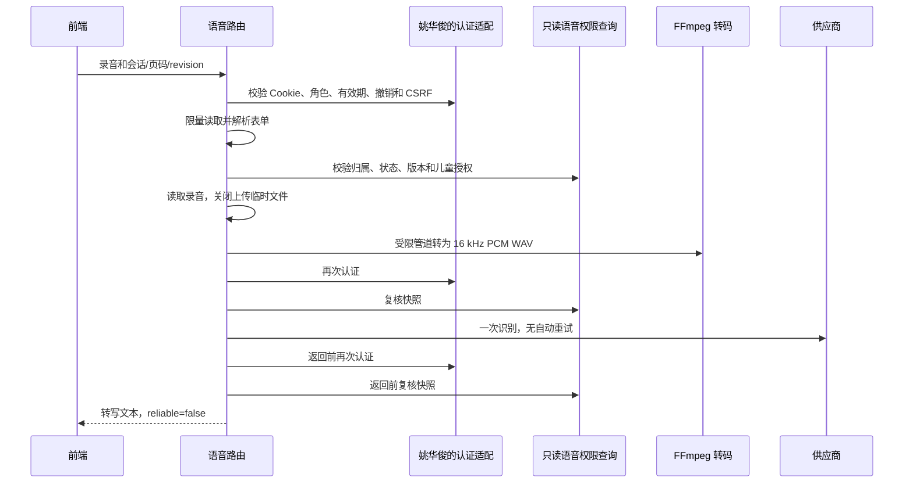

# G08 公开语音接口与录音转换交接

版本：v0.4；日期：2026-11-12；实现负责人：林鑫。本文为 PR #29 的交接材料，不代表成员已确认、已经合并或完整业务上线。关联 FR-08/12/13、NFR-04/05/06/08、API-022/023/024、DCL-020。此前验证记录中的“本地未提交 / 不提交 PR”描述当时状态；本轮用户已明确授权提交草稿 PR，历史证据不改写。

自动语音识别（Automatic Speech Recognition，ASR）、语音合成（Text-to-Speech，TTS）、脉冲编码调制（Pulse-Code Modulation，PCM）、波形音频文件格式（Waveform Audio File Format，WAV）、跨站请求伪造（Cross-Site Request Forgery，CSRF）。

## 已实现的接口与边界

接口字段与来源选择按 [v0.4 契约](api-contract-v0.4.json) 实现，没有新增登录方式、Cookie 名称、令牌摘要算法或业务数据库列。契约示例中的 reliable=true 不是置信度保证，本实现缺乏可用置信度证据，固定返回 false，须由前端确认/回退。契约“上传前校验会话”需团队明确为“解析会话字段后、转码和供应商调用前校验”；当前未改写 v0.4 JSON。API-024 整体仍包含待接的图片分支，本轮音频分支已实现并测试 WITHDRAWN 阻断。

| 接口 | 输入与输出 | 本轮行为 |
| --- | --- | --- |
| API-022 POST /api/v1/voice/transcriptions | multipart/form-data：file、readingSessionId、pageNumber、revision；200 data={text,status:RECOGNIZED,reliable} | 先认证与 CSRF，再限量读取并解析上传；文件读取/转码前检查会话，付费识别前及返回前再次认证和检查数据；reliable 仍为 false |
| API-023 POST /api/v1/voice/syntheses | JSON：仅 interactionEventId，或仅 readingSessionId/pageNumber/revision；201 data={audioUrl,expiresAt} | 两种来源互斥，拒绝客户端正文、模型名、地址及声线覆盖；读取页面或已保存有效回答，合成前后重新检查授权与内容快照，缓存命中也再次认证 |
| API-024 GET /api/v1/media/{resource_key} | 二进制 audio/wav，非 JSON 包 | 本轮只实现本服务生成的 audio- 资源；每次认证并复核所属会话、版本和进度，不返回供应商链接，不替代图片资源接口 |

公开接口注册在同一个应用。**业务认证未接入时，三条接口统一返回 503 VOICE_AUTH_NOT_CONFIGURED，不转换录音、不调用供应商。** 这不是已完成登录端到端的证明。



HTTP 身份认证发生在读取请求体之前。现有契约把会话字段放在 multipart 内，只有解析到这些字段后才能做会话归属检查；不声称在收到任何上传字节前已完成会话检查。整个请求体上限为 4 MiB+64 KiB，文件本身上限为 4 MiB；解析后文件在调用转换器/供应商前关闭。前端不得把分段录音块单独提交为完整录音。

## 录音转换由林鑫负责

- 接受 audio/webm（可含 codecs 参数）、audio/ogg、audio/mp4、audio/mpeg、audio/wav、audio/x-wav；文件类型由实际解码验证，不信任文件名。
- 转成 16 kHz、单声道、16 位 PCM WAV；最长 120 秒，超限整段拒绝，不静默截断。已符合要求的 WAV 不依赖 FFmpeg。
- FFmpeg 使用固定解复用器、仅 pipe 协议、一个音轨、单线程和 10 秒转换期限；标准输出限量读取，标准错误不回传或记录。无需转换临时文件，不通过媒体内容访问网络或外部文件。
- 超时、输出超限、取消均终止并回收子进程；网页请求断开会取消正在进行的转换/供应商协程。取消供应商连接不能保证上游未计费。
- 上传失败/非法文件：413、415 或 422；转换器未安装：503 AUDIO_CONVERTER_UNAVAILABLE；转换超时：504 AUDIO_CONVERSION_TIMEOUT。
- Docker 镜像安装 FFmpeg；Windows 直接运行需要系统 PATH 中可用的 FFmpeg。本轮不更改个人机器全局安装或 .env。

离线转换不读 .env、不调用模型，输出目录须已存在，输出文件不得存在：

```powershell
.\.venv\Scripts\python.exe -X utf8 backend/smoke_voice.py convert D:/samples/input.webm D:/samples/input-16k.wav --format webm
```

`smoke_voice.py asr ... --format webm` 会先调用同一转换器，再发起一次真实识别；该命令会产生供应商用量。供应商网关仍只接收已规范化音频，不重复实现转码。

上传接收最多 10 秒，转换另限 10 秒；供应商识别/合成使用 VOICE_TIMEOUT_SECONDS（默认且最大 20 秒），合成 POST 与下载共用该期限，分别返回 ASR_TIMEOUT / TTS_TIMEOUT（504），没有自动重试。

## 鉴权、数据与媒体规则

`create_app(..., voice_auth=adapter)` 接入 `VoiceAuthenticator.authenticate(request, write=...)`。姚华俊的适配器须实时验证服务端 Cookie、角色、到期/撤销状态；write=true 还须验证 CSRF；返回 `VoicePrincipal(guardian_id, child_grant_id=None)` 或对应的儿童 grant_id。不得从客户端提交的 guardianId、请求头声明或测试桩构造身份。本轮默认适配器永远拒绝，测试中的假认证只用于隔离测试。

只读查询复用现有 SQLite 表，检查家庭归属、IN_PROGRESS、当前页和 revision、内容状态以及儿童授权/确切版本范围。WITHDRAWN、未审核草稿、他人私有版本、失效儿童授权拒绝。已有有效会话可读取允许的 RETIRED 内容。事件必须与当前会话版本/页/进度一致，结果为 SUCCESS/FALLBACK 且有正文；FAILED 和非回答类型拒绝。**事件写入方仍须保证正文已经完成内容校验**，语音层不能凭结果枚举替代安全审核。

语音层不改变阅读进度、写事件或迁移偏好字段。当前 API-023 使用服务端默认声线及 NORMAL；六声线选择及 0.9/1/1.2 内部能力保留。档案偏好持久化与公开设置仍待姚华俊、张陈雨菲按草案接入，不能把客户端任意正文转交供应商。

当前合成正文仍限去除首尾空白后 1～600 字符；超长页面/回答返回 422，不截断或自动拆分为多次收费调用。是否由内容侧控制页面长度或另设分段朗读协议，需团队明确后再实现。

生成音频只保存在单进程内存，最多 32 MiB，最长五分钟；应用 lifespan 运行期每三十秒清理过期项，容量满时淘汰最早项，关停/重启即清空。资源键随机、不可由路径访问任意文件；响应带 private/no-store，读取仍检查身份、内容和当前进度。相同身份、来源快照、声线、语速和模型在缓存有效期内复用同一资源；同会话并发语音请求返回 409，全局最多四个在途请求，超出返回 429。

这是单 worker 的短期资源复用与并发限制，不是跨进程/重启持久化的付费幂等。接口未新增幂等字段或修改 request_executions；缓存失效、内容变化或重启后的新请求可能再次计费。媒体过期/被淘汰后返回 404；不承诺 expiresAt 之前一定保留缓存，前端不得自动重新合成。

## 与 PR #28 的核对及未决差异

2026-11-12 补充核对 [PR #28](https://github.com/MumLauds/202610-zhiya/pull/28)，head 为 `9158c8cf91f17b3e57ad44e07fc0f81df5dc6fa5`，base 为 `8c4172c`。该 PR 处于 Draft，只有三份文档变更，DCL-005～008 均待团队确认；JSON 只新增 minimumBusinessReview，既有正式定义不变。此前实现与运行检验基于 main 和 #27，并未以 #28 为依据；本节是提交草稿前的补充对照，不代表已采用其全部候选规则或与真实 G04/G07 联调通过。

| #28 候选约定 | 本轮 G08 实际情况 | 具体对接与待确认 |
| --- | --- | --- |
| DCL-005：coverRef/imageRef 可空、媒体键绑定版本、API-024 返回实际类型二进制 | 音频键已绑定来源版本且逐次授权；只识别 audio- 键、返回 WAV，不实现 asset- 图片或缺图占位 | 姚华俊与林鑫共用一个 API-024 路由并分派图片/音频，统一撤回与归属校验；吴怡霏/卢志勇实现缺图占位，张楠确认资源许可。不得复制两条相同路径路由后依赖注册顺序 |
| DCL-006：API-015/019 使用 expectedRevision、clientEventId 与事务幂等 | 语音使用既有 API-022/023 的 revision，只读校验当前进度；没有 clientEventId 执行账本，不等于结束/翻页幂等 | 姚华俊保证开始/翻页/结束原子递增与提交；吴怡霏在成功或 API-013 恢复后取最新 currentPage/revision，再发语音；陈烨婷确认事件保存后的 revision。旧音频因状态/进度改变可被拒绝，前端停止旧播放 |
| DCL-007：API-024 的 404 RESOURCE_NOT_FOUND、503 SERVICE_UNAVAILABLE | 当前语音层为 404 NOT_FOUND、数据库不可用为 503 DEPENDENCY_UNAVAILABLE，另有语音专用错误码 | 姚华俊与林鑫确认统一公共映射及保留内部错误码的边界，吴怡霏按确认后的表处理；当前不得声称已符合 #28 候选错误码 |
| DCL-007：REQUEST_IN_PROGRESS / RATE_LIMITED 可重试并带 Retry-After | 当前同会话语音在途返回 REQUEST_IN_PROGRESS，但 retryable=false、无 Retry-After；全局繁忙为 VOICE_BUSY。语音没有持久付费幂等，超时可能已产生上游用量 | 姚华俊、林鑫、吴怡霏须确定端点级重试规则，避免按同名错误码给语音自动重发；ASR_TIMEOUT/TTS_TIMEOUT 也不能直接当作已实现 REQUEST_OUTCOME_UNKNOWN 的业务账本恢复 |
| DCL-008：档案已有 nickname/ageBand/interests/preferredMinutes；API-013 是断线恢复事实来源 | #28 尚无 speechPreferences；本轮仅内部六声线/三档，公开合成默认温怀清或服务端配置/NORMAL | 张陈雨菲、姚华俊、林鑫共同评审 API-004/006 增量字段、默认值、清空/省略和迁移；吴怡霏恢复后重取会话状态，不能重放旧页语音。API-013 中 STARTED/PAGE_CHANGED 示例不作为可朗读回答事件 |

Cookie/CSRF、整数标识、响应包、版本撤回等方向相符，但 #28 没有冻结 Cookie 名、令牌摘要算法或提供可复用认证实现，不能据此取消默认拒绝。刘俊延须在真实业务实现接入后验证媒体撤回、恢复后的语音、结束并发与收费重试；黄锦培组织确认以上差异。两条分支共同修改 api-contract.md 和 design-change-log.md；提交前无工作树改动的 merge-tree 检查可自动合并，但文本可合并不代表语义已统一，合并时保留 DCL-005～008 与 DCL-009～020 两组记录。

## 按仓库分工的具体交接

以《知芽团队分工与Git交付方案》（2026-10-22，第 4～6 页）为本节任务归属依据；[项目博客 §4.4](../../blogs/妈妈夸我说的队_项目原型设计+概要设计_博客.md#44-分工安排)仅补充岗位说明。v0.4 修正此前“只对接三人”的表述，区分当前 G08 交付与后续 G13、G15 职责；以下安排不代表接收人已确认可用或相关阶段已经完成。

### 当前：G08 模型与语音接入交接

**林鑫负责，依赖 G05；方案指定的接收人为张智文、陈烨婷、吴怡霏、刘俊延。** 本次交付模型、上传与音频转换、ASR/TTS、超时处理、依赖与配置示例、运行说明和 infra 部署初稿。林鑫负责维护这些能力并修复本模块问题。

| 接收人 | 具体怎么接 | 需要确认什么 |
| --- | --- | --- |
| **张智文（G09 检索与内容生成）** | 接收 ModelAdapter 调用说明、Schema 和请求/响应样例，在检索、提示词及生成模块中复用 G08 模型接口 | 上下文及 user_input 的传入方式、输出与失败处理能否满足 G09；检索、提示词和生成结果核验由其模块负责，不重复接入供应商 |
| **陈烨婷（G05/G10 Agent 接口与流程）** | 接收已按 #27 Schema 接入的 ModelAdapter；复用已交付的超时、无知识、安全阻断、SKIPPED 四类降级约定，不重新设计既有契约 | 补齐 #27 未明确的 INITIAL 空 user_input 和 API_ERROR 映射；工作流接入时核对识别确认、姚华俊保存事件后的 revision 与朗读顺序。Schema/策略文档完成不等于完整工作流运行验收 |
| **吴怡霏（G12 互动共读页面）** | 停止录音后提交完整 Blob 和会话/页码/revision；确认或修正转写，按 audioUrl 以 1 倍速播放；切页取消旧播放并忽略旧响应 | 浏览器录音格式；reliable=false 的确认/重录；409/413/415/503/504 回退；从 API-013 恢复最新进度，过期音频不得自动触发收费重合成 |
| **刘俊延（测试验收）** | 接收可复现命令、脱敏样例、已有验证记录及未覆盖项，对已可用模块同步独立测试，无需等完整业务链路才开始 | 明确版本、真实服务与测试桩范围、异常用例和缺陷记录；真实认证/业务接入后补权限、媒体撤回、恢复与收费重试验证，不将本轮局部结果视为完整 G08 或公网验收 |

**与姚华俊的当前协作属于 G04/G07 业务依赖对接。** 他不是方案列出的 G08 接收人，但真实语音接口接入需要双方共同完成：姚华俊实现 `VoiceAuthenticator.authenticate(request, write=...)`，通过 `create_app(..., voice_auth=adapter)` 注入真实 Cookie/CSRF、角色、到期及撤销校验；林鑫配合适配器接入和语音侧验证。双方结合上节 #28 候选约定，确认身份返回结构、会话/事件读取、API-024 图片与音频共用入口、公共错误码及端点级重试。登录、业务数据保存和图片业务仍由姚华俊负责。

林鑫提供共同资料：明确的分支/提交、运行与配置说明、请求/响应及错误样例、验证记录和限制（4 MiB/120 秒、正文 600 字符、当前页/revision、临时媒体 300 秒、单 worker）。技术说明与脱敏摘要进入 Git，大量录音、日志和视频按方案通过 QQ 交接，凭据单独提供。接收人按说明检查可用性，问题记录在 Issue/PR；完成评审合并后由黄锦培更新任务状态，不能以“已推送分支”代替完成交接。

### 后续：G13 系统联调

**启动条件：G07～G12 已有可接入提交。林鑫组织，各开发成员修复各自模块，刘俊延和黄锦培接收核对。** 这是林鑫后续应承担的职责，不列为本次 G08 已完成事项，也不转交组长代为组织。

林鑫届时汇总可接入版本和接口阻塞，组织用真实后端及 AI 服务跑通“选书 → 共读 → 互动 → 语音 → 小结保存”；通过 PR 交付 `docs/integration.md` 和必要集成代码，保留可重复执行的步骤。问题进入 Issue，由对应负责人修复并关联修复 PR；林鑫负责组织衔接与复测，不代写其他成员模块。

### 后续：G15 部署与公网验收

**启动条件：G13 后准备部署，与 G14 并行，验收使用同一候选版本。林鑫部署、姚华俊配合、刘俊延独立验收；黄锦培和卢志勇接收核对。**

林鑫届时交付 `infra/` 配置、`docs/deployment.md`、验收记录和网址，演示凭据单独交接；姚华俊配合业务后端与数据库部署。刘俊延在手机、电脑浏览器独立验证完整流程、语音、数据权限及异常提示，阻断问题由所属模块修复并回归后，由黄锦培确认发布版本。当前 Docker 验证只作为部署初稿的依据，不等于已完成 G15 公网验收。

### 其他模块的协作边界

张陈雨菲负责家长设置页面，与姚华俊确认档案偏好保存规则后，林鑫接入六声线/三档偏好读取；张楠负责内容、标签及使用许可；卢志勇负责样式和展示材料。黄锦培负责范围、跨模块决策、PR 评审合并与阶段把关。上述模块任务不转为林鑫的开发待办；到 G13/G15 时，林鑫仍按方案承担联调组织和部署职责。

技术依据：[FFmpeg 参数](https://ffmpeg.org/ffmpeg.html)、[协议白名单](https://ffmpeg.org/ffmpeg-protocols.html#Protocol-Options)、[Starlette 上传与表单](https://starlette.dev/requests/)。实现同时按本地安装版本验证，不直接以网页文档代替测试。
