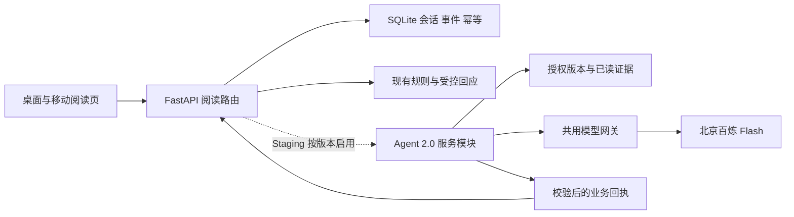

# 架构审查

## 正式入口与实验边界

`create_app` 的 lifespan 管理网关和报告恢复任务，Uvicorn 启动及健康检查配置在 Dockerfile/Compose。建议在同一 FastAPI 进程内组合 service、证据读取、投影和网关，沿用身份、DB 和媒资控制。实验 `Coreading` 是内存会话服务，`DeadlineGenerator` 是本地演示时限，`BailianProvider` 是合成文本指纹 allowlist 的实验客户端。生产实现从实验复用验证过的纯逻辑与测试口径。

### 后端生命周期

| 已观察的实际入口 | 生产接入审查 |
|---|---|
| `owned_session`、`authorized_db`、`get_session` | 继续从 principal 导出家长和儿童权限。固定 session、story version、访问路径、当前页及授权到期，不接收客户端声明的角色/归属。读取保留家长与儿童不同的字段投影 |
| `save_reading_event` → `generate_answer_reply` → `finalize_answer_reply` | 答案和旧版规则回应先落库。模型在事务外。回执再核验会话、修订号、进度和 execution token。5 秒生成预算、25 秒占位属于现有 API-015 合同。新模块需明确取消后持久化结果与浏览器恢复 |
| `replay_execution`、`record_execution` | 相同键与相同内容复用。请求内容不同报冲突。过期 RUNNING 已保存的作答可回到旧版回应，其他路径保留未知结果核对。新路径需要同等负面测试 |
| `answer_context`、`parent_visit_turns` | 正式共读已有当前页、最多三个近邻已读前页及同次访问上下文。v7 索引可用于受控扩展，翻回旧页时用到达记录切出可见前缀，证据授权和阅览版本需要独立验证 |
| `ModelGateway`、`ModelAdapter` | 网关有连接池、总时限和 HTTP 分类。适配器只回传 TIMEOUT/API_ERROR，缺分原因及 Token 回执。语音已有断开检测参考。阅读生成核心路径未读到等价的 `request.is_disconnected` 预算联动 |
| `finish_session`、`recover_pending_reports` | 保留新旧会话结束、报告恢复及事实摘要语义。成功事件和真实已读页作为小结输入 |

源文件 [阅读路由](../../backend/app/api/v1/reading_sessions.py) · [阅读 Agent](../../backend/app/services/reading_agent.py) · [应用生命周期](../../backend/app/main.py) · [语音路由](../../backend/app/api/v1/voice.py) · [Uvicorn 镜像](../../infra/Dockerfile)。

### 桌面与移动

| 审查问题 | 现状与验收要求 |
|---|---|
| 能否显示最终回复 | 桌面 `answerReply` 和移动 `savedAnswer` 从已保存事件取 `replyText`，按 `followupQuestion` 处理后缀。两端已有页面发问结果与相应 TTS。新回执需要合同和真实页面证明 |
| REPLY_ONLY | 模拟映射为有完整 `replyText`、无追问，保持当前已保存问题语义。旧字段路径可承载正文，默认恢复规则仍需验证 |
| LISTEN、PAUSE、CONTINUE、CLOSE_TOPIC | 产品有阅读会话状态与等待/交互状态。四种会话内对话动作的按键、恢复和视觉提示待定义。CLOSE_TOPIC 收束一个话题并保留阅读能力 |
| 旧回复覆盖新页面 | 桌面 `answerViewKey` 和 `pendingAnswerView` 保护提交展示，移动 `requestGeneration`、访页状态以及 session machine 防陈旧结果。语音通过 AbortController 及当前事件约束。翻页、回翻、同页再次进入与跨设备并发需用同一对抗矩阵回归 |
| 重复点击与刷新 | 有 pending 防抖、revision、事件键与 API-013 恢复。必须验证同键 200、冲突 409、504 后读会话与可重复恢复。撤权、弱网和刷新中 TTS 需要实测 |
| 文字与语音 | ASR 预览由用户确认后走同一回答/提问提交。仅朗读已保存且有访问权的事件。验证浏览器 MIME、拒绝麦克风、播放取消及文字备用流程 |

源码 [桌面 ReaderPage](../../frontend/src/pages/ReaderPage.vue) · [移动 ReaderView](../../frontend/mobile/components/ReaderView.vue) · [移动会话机](../../frontend/mobile/services/readingSessionMachine.js) · [正式 API 契约](../design/api-contract.md)。

## 候选架构与迁移边界

正式阅读路由继续负责身份、归属、幂等和修订号。2.0 服务的 BookEvidenceIndex 与 StoryTimeline 从本次授权绘本的当前页和实际已读前文构建长度受控上下文。续读仅携带阅读事实，候选引导不读取来源 Session 的对话。Flash 草稿在服务内存完成校验，最终回执交现有事务。2.0 儿童模式使用受控本地引导。生产架构目标是在观察期和审批后收束到一条 2.0 共读链路。 [候选代码](../../backend/app/services/yaya_agent.py) · [退役条件](deployment-and-rollback.md)

## PR #97 审查修订

亲子共读的授权家长提交自由文本时，2.0 可以把本轮脱敏表达放在模型的 user 消息。系统规则保持独立，书证和孩子表达均是输入数据。人物、动作、对象、属性、事件状态和原文引用来自与来源标识、页码及逐字正文绑定的仓库标注。适配目前包含合成《松鼠的纸风车》和团队自研《小狐狸的雨伞》的部分页。无匹配标注时输出 sentence 证据等级，不填猜测的结构化事实。
