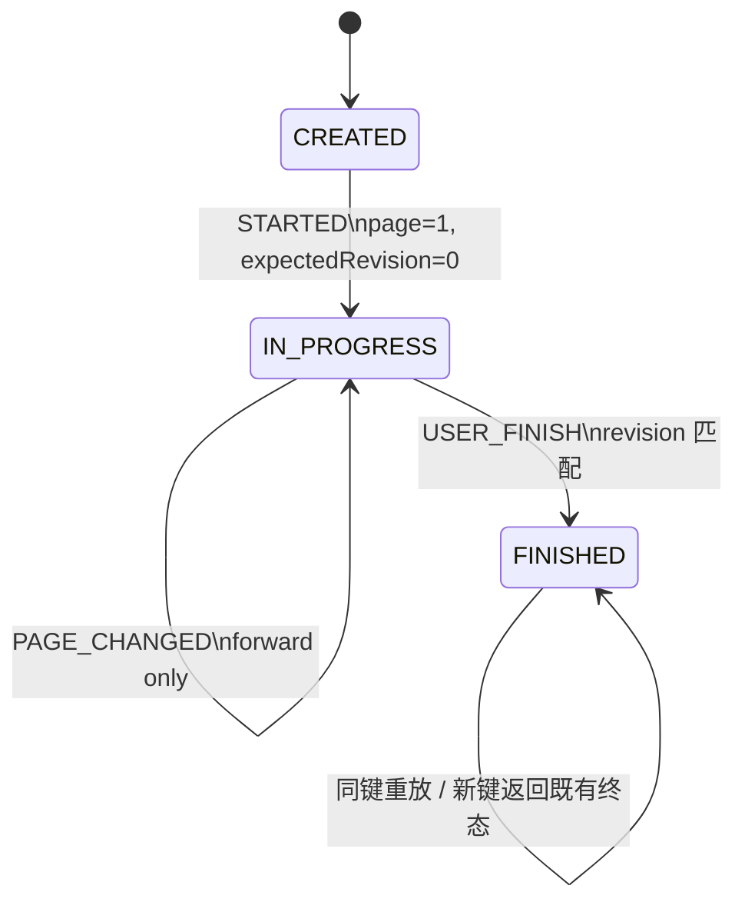
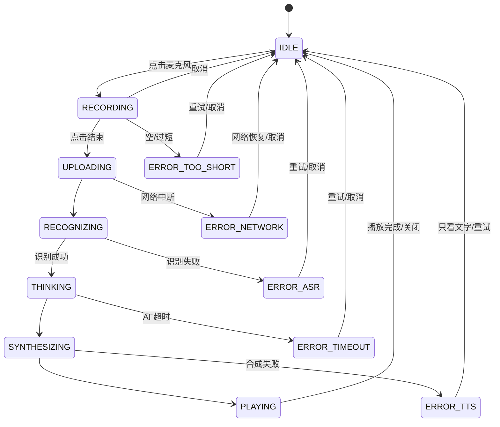

# H05 硬件 DEMO 数据与 Mock 接口契约

## 0. 文档说明

| 项目 | 内容 |
| --- | --- |
| 任务 | H05：ESP32-S3 4.3C 硬件端 DEMO 数据、Mock 测试接口与自动化测试 |
| 设备 | Waveshare ESP32-S3-Touch-LCD-4.3C，SKU 33799，无外壳版；800×480、16 MiB Flash、8 MiB PSRAM |
| 固件基线 | ESP-IDF v5.5.5；H02 正在实现 LCD、GT911 和 LVGL 底层适配 |
| UI 依据 | `hardware/docs/ui-flow.md`（H04） |
| 素材依据 | `hardware/docs/media-format.md`、`hardware/assets/generated/assets-manifest.json`（H03） |
| 数据依据 | `data/seed/storybooks.json`、`story_versions.json`、`story_pages.json`、`cover_mapping.json` |
| 接口依据 | `docs/design/api-contract.md`、`docs/design/api-contract-v0.4.json` |
| 本文版本 | 2026-11-18，H05 初版 |
| 适用范围 | 本地 DEMO、离线自动化测试、H06 UI 联调准备；不替代真实后端、设备认证、真机解码或上板验收 |

本文描述的是**本地 Mock 层**，不是新增正式 API 契约。所有响应和 fixtures 都标记 `demoOnly=true`；不得把 Mock 的成功结果写成真实后端联调成功，也不得把 H03 本地封面路径写成 API-024 的受控媒体 `resource_key`。

## 1. 目的、范围与限制

### 1.1 目的

H05 让 H06 在没有真实后端、没有云端 ASR/TTS/LLM、没有 ESP32 实板的情况下，能够重复完成以下链路：

```text
开机 → DEMO 首页 → 绘本书架 → 绘本详情 → 开始阅读 → 翻页 → AI 互动状态展示 → 结束阅读
```

同时提供：

- 由仓库真实种子和 H03 manifest 自动生成的数据，而不是手写 20 条记录；
- 可注入 401/403/404/409/422/429/503/504 和空数据、缺封面的 Mock HTTP 服务；
- 可重复的会话状态和幂等行为，用于验证 H04 数据流；
- 不依赖 Pillow、真实模型或实板的离线测试。

### 1.2 明确不负责

- 不绘制 LVGL 页面，不实现触摸屏驱动；这些属于 H02/H06。
- 不实现 API-022 的真实 multipart ASR，不实现 API-023 的真实 TTS，不实现 API-024 的媒体读取。
- 不模拟正式设备认证、家长 Cookie/CSRF、儿童档案服务端授权；H05 的 401/403 只是错误注入。
- 不生成真实录音、真实音频、真实模型回答、真实阅读报告或模型评测结果。
- 不把 `DRAFT` 绘本当成已发布内容，也不把封面当成 104 页正文插画。
- 不验证 JPEG 在 ESP32-S3/LVGL 上的解码兼容性；该结论必须由 H06 实板确认。

## 2. 数据来源与转换规则

### 2.1 输入

`hardware/mock/build_fixtures.py` 只读以下文件：

| 文件 | 用途 |
| --- | --- |
| `data/seed/storybooks.json` | 原始绘本记录与标题、年龄段、主题 |
| `data/seed/story_versions.json` | 版本、`storybook_id`、`version_no`、`status`、授权/年龄字段 |
| `data/seed/story_pages.json` | 正文、`page_no`、`default_next_page_number`、原始 `image_ref` |
| `data/seed/cover_mapping.json` | 20 条书号、`storybook_id`、封面源路径 |
| `hardware/assets/generated/assets-manifest.json` | H03 的 THUMBNAIL/DETAIL 资源、SHA-256、尺寸和 `devicePath` |

源文件只读；构建过程不会重命名、覆盖、删除或重新压缩任何原图。

### 2.2 选取规则

- 只选 `cover_mapping.json` 中的 20 条原创绘本，`book_no` 为 `B-002`～`B-021`。
- 排除 `storybookId=1` 的旧版联调绘本《逃家小兔》（6 页）。
- 通过 `story_versions.json` 的 `storybook_id` 查找**恰好一个**版本；不按数组下标，也不假设 `storybookId == storyVersionId`。
- 每条详情页必须从 1 开始连续编号，最后一页的 `default_next_page_number` 必须为 `null`。
- 只使用种子已有的正文和页面数；不编造 104 页之外的分页正文或插画。
- `status` 原样保留为 `DRAFT`；fixtures 的 `demoOnly` 和 `notice` 明确标识为本地演示。
- `coverRef` 和 `imageRef` 输出为 `null`。H03 的本地封面只放在 `localCover`，不让它看起来像服务端受控媒体键。
- `story-details` 中每页的 `imageStatus` 为 `MISSING_INNER_ILLUSTRATION`，提示 H06 使用占位图，不用封面顶替正文插画。

### 2.3 结果计数

实际构建输出：

| 指标 | 值 |
| --- | --- |
| 原创绘本 | 20 本（`storybookId 2～21`） |
| 原创正文 | 104 页 |
| 年龄分布 | 3～4 岁 7 本、4～5 岁 7 本、5～6 岁 6 本 |
| 封面资源引用 | 40 个（20 本 × THUMBNAIL/DETAIL） |
| 版本状态 | 20 个均为 `DRAFT` |
| 原始页面总数 | 110 页（含旧版 6 页）；H05 不选旧版 |
| fixtures 文件 | 5 个，共 92,967 B |

H03 清单的 `assetBytes=806,090`、`sourceBytes=117,248,465`、`compressionRatio=0.006875` 只描述文件体积，不等于解码后的内存。H05 不重复做 H03 的图像审计。

### 2.4 确定性和源文件可追溯

- JSON 使用 UTF-8、`sort_keys=True`、2 空格缩进和固定换行。
- 通过同目录临时文件 + `os.replace` 写出，避免半截文件。
- `storybooks.json` 和 `story-details.json` 根节点的 `sourceFiles` 记录 5 个输入文件的仓库相对路径及 SHA-256。
- `python hardware/mock/build_fixtures.py --check` 只对比重新计算的内容，不写入。
- 同一输入重复生成应得到相同业务内容；`requestId` 只在 HTTP 响应中随机生成，不进入 fixtures。

## 3. Fixtures JSON

所有路径使用仓库相对 POSIX 路径；不写开发者电脑绝对路径。

`storybooks.json` 只承载书架元数据，不包含 `pages` 或 `branches`；完整分页和正文只从 `story-details.json` / `GET /api/v1/story-versions/{id}` 读取，避免书架响应携带全部正文。

### 3.1 `storybooks.json`：书架元数据

根节点：

```json
{
  "schemaVersion": "1.0",
  "kind": "zhiya-hardware-demo-storybooks",
  "notice": "本地 DEMO 数据……",
  "demoOnly": true,
  "sourceFiles": [
    {"path": "data/seed/storybooks.json", "sha256": "……"}
  ],
  "items": []
}
```

每个 `items` 条目（字段节选）：

```json
{
  "storybookId": 2,
  "storyVersionId": 2,
  "versionNumber": 1,
  "title": "小狐狸的雨伞",
  "status": "DRAFT",
  "ageMin": 3,
  "ageMax": 4,
  "ageBand": "AGE_3_4",
  "topics": ["勇气", "亲子依恋"],
  "pageCount": 6,
  "totalPages": 6,
  "coverRef": null,
  "localCover": {
    "thumbnail": {
      "assetRole": "THUMBNAIL",
      "assetPath": "hardware/assets/generated/book-b002-thumb.jpg",
      "devicePath": "/assets/covers/book-b002-thumb.jpg",
      "width": 213,
      "height": 160,
      "format": "JPEG",
      "fileSize": 12011,
      "sha256": "ae20451a……"
    },
    "detail": {
      "assetRole": "DETAIL",
      "assetPath": "hardware/assets/generated/book-b002-detail.jpg",
      "devicePath": "/assets/covers/book-b002-detail.jpg",
      "width": 400,
      "height": 300,
      "format": "JPEG",
      "fileSize": 38105,
      "sha256": "69a4af33……"
    }
  },
  "demoOnly": true
}
```

字段说明：

| 字段 | 类型 | 说明 |
| --- | --- | --- |
| `storybookId` | integer | 绘本逻辑 ID，不等于版本 ID |
| `storyVersionId` | integer | 由 `storybook_id` 查询得到的版本 ID |
| `versionNumber` | integer | 版本序号；不是会话 `revision` |
| `status` | string | 本数据全部为 `DRAFT`，不能作为正式发布标识 |
| `pageCount` / `totalPages` | integer | 本种子中两者相同；H06 仍应以 `pages` 实际数据为准 |
| `coverRef` | null | 服务端受控封面引用；DEMO 中为空 |
| `localCover` | object | H03 本地封面，仅用于 DEMO 书架和详情 |
| `demoOnly` | boolean | 所有层级必须为 `true` |

### 3.2 `story-details.json`：版本详情与分页

每个条目在书架字段基础上增加：

```json
{
  "pages": [
    {
      "pageNumber": 1,
      "text": "下雨了。小狐狸站在门口，看着外面的雨。",
      "imageRef": null,
      "defaultNextPageNumber": 2,
      "imageStatus": "MISSING_INNER_ILLUSTRATION"
    },
    {
      "pageNumber": 6,
      "text": "雨停了。小狐狸收起伞，笑了。",
      "imageRef": null,
      "defaultNextPageNumber": null,
      "imageStatus": "MISSING_INNER_ILLUSTRATION"
    }
  ],
  "branches": [],
  "summary": null
}
```

- 页码从 1 开始。
- 末页 `defaultNextPageNumber=null`，不能把数组长度当作永远可连续翻页。
- `imageRef=null` 表示本 DEMO 没有逐页插画；H06 显示占位，不得拿封面冒充正文插画。
- `storyVersionId` 与 `storybookId` 是两个字段；H06 不得用后者替换前者。

### 3.3 `demo-session.json`：初始 DEMO 会话

```json
{
  "demoOnly": true,
  "profile": {
    "childProfileId": 1,
    "nickname": "本地演示",
    "ageBand": "AGE_3_4",
    "preferredMinutes": 10,
    "demoOnly": true
  },
  "session": {
    "readingSessionId": 1,
    "storyVersionId": 2,
    "currentPage": 1,
    "visitedPageNumbers": [],
    "mode": "PARENT_CHILD",
    "status": "CREATED",
    "revision": 0,
    "expiresAt": null,
    "demoOnly": true
  }
}
```

这是 Mock 的初始内存会话；重启 Mock 后由 `demo-session.json` 恢复。它不是服务端真实会话。

### 3.4 `voice-scenarios.json`：语音 UI 状态

根节点包含：

- `states`：H04 的 7 个主状态 `IDLE/RECORDING/UPLOADING/RECOGNIZING/THINKING/SYNTHESIZING/PLAYING`；
- `errorStates`：`ERROR_ASR/ERROR_TIMEOUT/ERROR_TTS/ERROR_NETWORK/ERROR_TOO_SHORT`；
- `scenarios`：8 个可注入场景。

每个场景字段：

| 字段 | 说明 |
| --- | --- |
| `scenarioId` | 注入标识，如 `success`、`ai_timeout` |
| `states` | 时间线，每项含 `state`、`label`、`hint`、`delayMs`、`isError` |
| `finalState` | 场景结束状态 |
| `outcome` | `SUCCESS/CANCELLED/NETWORK_LOST/...` |
| `asrText` / `answerText` | 固定测试文本；不是真实 ASR/模型结果 |
| `reliable` + `reliableIsSimulated` | 仅用于演示；`success` 的 true 是模拟值，真实 API-022 当前固定 false |
| `consumer` | `PARENT_CONFIRMED` 或 `CHILD`；儿童模式不得自动消费不可信结果 |
| `tts` | `{status: "SIMULATED", audioUrl: null, playbackMode: "SIMULATED", durationMs}` |
| `recoverTo` | 错误态建议恢复到 `IDLE` |
| `demoOnly` | 固定 true |

### 3.5 `error-scenarios.json`：错误注入

共 13 个场景。字段：

```json
{
  "scenarioId": "SESSION_CONFLICT",
  "status": 409,
  "code": "SESSION_CONFLICT",
  "message": "Mock 会话修订冲突，请先读取会话",
  "retryable": false,
  "appliesTo": ["/api/v1/reading-sessions/*/events"],
  "mode": "error",
  "demoOnly": true
}
```

`mode=payload` 的 `NO_BOOKS` 和 `COVER_MISSING` 返回 200 数据变形，不返回错误；`COVER_MISSING` 的 `action=stripLocalCover` 会把 `localCover` 置为 `null`。`VOICE_BUSY` 额外带 `retryAfter=1`。

## 4. Mock HTTP 服务

### 4.1 启动

```powershell
python hardware/mock/build_fixtures.py
python hardware/mock/server.py
# 指定端口
python hardware/mock/server.py --port 8765
```

默认监听 `127.0.0.1:8765`。只有显式传入非回环 `--host` 才允许受控局域网演示；不得开放公网。服务没有账号、Cookie、设备 token、CSRF 或云端 API Key，也不会调用 DeepSeek/Qwen-ASR/TTS。

### 4.2 响应封装

成功：

```json
{"data": {}, "requestId": "mock-7f3a9c2b1d4e"}
```

错误：

```json
{
  "error": {"code": "SESSION_CONFLICT", "message": "会话修订号已变化，请先读取会话", "retryable": false},
  "requestId": "mock-7f3a9c2b1d4e"
}
```

`requestId` 为 `mock-` + 12 位十六进制随机串；同键重放会保留原响应数据，但当前响应仍使用新的 `requestId`。服务响应头包含 `X-Mock-Server: zhiya-h05` 和 `Cache-Control: no-store`。

### 4.3 路径

| 方法 | 路径 | Mock 语义 | 对应真实接口/说明 |
| --- | --- | --- | --- |
| GET | `/api/v1/health` | Mock 健康检查 | 不是 API-032 的正式实现 |
| GET | `/mock/meta` | 数据计数、模式、`demoOnly` | Mock 专用 |
| GET | `/api/v1/storybooks` | 20 本轻量书架元数据，支持 `ageBand/topic/page/pageSize` | API-008 的 DEMO 投影 |
| GET | `/api/v1/story-versions/{version_id}` | 版本详情和分页 | API-009 的 DEMO 投影 |
| GET | `/api/v1/reading-sessions` | 列出内存会话 | API-012 的 DEMO 投影 |
| POST | `/api/v1/reading-sessions` | 创建初始会话 | API-011 的 DEMO 投影 |
| GET | `/api/v1/reading-sessions/{id}` | `session/events/report` | API-013 的 DEMO 投影 |
| POST | `/api/v1/reading-sessions/{id}/events` | STARTED/PAGE_CHANGED | API-015 的 DEMO 投影 |
| POST | `/api/v1/reading-sessions/{id}/completions` | USER_FINISH | API-019 的 DEMO 投影 |
| POST | `/api/v1/reading-sessions/{id}/questions` | 固定模板问答 | API-016 的 Mock 投影，不是完整 G10 |
| GET | `/mock/voice/scenarios` | 全部语音场景 | H04 UI 演示数据 |
| GET | `/mock/voice/scenarios/{id}` | 单个场景 | H04 UI 演示数据 |
| POST | `/mock/voice/simulate` | 返回时间线，`audioUrl=null` | **不是** API-022/023/024 |
| GET | `/mock/errors` | 错误场景列表 | Mock 专用 |
| POST | `/mock/reset` | 重置内存会话和 fixtures 状态 | Mock 专用，测试使用 |

`scope=mine` 会返回 403 `FORBIDDEN`，因为 H05 没有实现家长历史书架；这不是正式权限实现。

`GET /api/v1/storybooks` 只返回 `storybooks.json` 的轻量元数据，**不包含 `pages` / `branches`**；H06 进入详情页时必须再请求 `GET /api/v1/story-versions/{id}`。Mock 的会话、书籍和计数读取都通过 `RLock` 取快照，避免与 `/mock/reset` 或并发写入互相撕裂。

### 4.4 示例

书架：

```http
GET /api/v1/storybooks?ageBand=AGE_5_6
```

```json
{
  "data": {
    "items": [
      {
        "storybookId": 2,
        "storyVersionId": 2,
        "title": "小狐狸的雨伞",
        "status": "DRAFT",
        "coverRef": null,
        "localCover": {"thumbnail": {"assetRole": "THUMBNAIL", "devicePath": "/assets/covers/book-b002-thumb.jpg"}},
        "demoOnly": true
      }
    ],
    "page": 1,
    "pageSize": 20,
    "total": 6
  },
  "requestId": "mock-..."
}
```

> 示例为字段节选；完整条目还包含 `ageMin/ageMax/ageBand/topics/pageCount/totalPages` 和 `localCover.detail`。

开始阅读：

```http
POST /api/v1/reading-sessions/1/events
Content-Type: application/json

{"eventType":"STARTED","pageNumber":1,"expectedRevision":0,"clientEventId":"demo-start-001"}
```

```json
{"data": {"interactionEventId": 1, "revision": 1}, "requestId": "mock-..."}
```

错误：

```json
{"error":{"code":"SESSION_CONFLICT","message":"会话修订号已变化，请先读取会话","retryable":false},"requestId":"mock-..."}
```

错误注入：

```http
GET /api/v1/health
X-Mock-Error: AUTH_REQUIRED
```

或：

```http
GET /api/v1/storybooks?mockError=NO_BOOKS
```

`X-Mock-Error` 优先于查询参数。未知场景返回 422 `VALIDATION_ERROR`。只有路径命中 `appliesTo` 才生效；`NO_BOOKS`/`COVER_MISSING` 是数据变形，不是 HTTP 错误。

## 5. 阅读会话状态机



### 5.1 初始状态

`demo-session.json` 和 `POST /api/v1/reading-sessions` 都产生：

```text
status=CREATED, currentPage=1, visitedPageNumbers=[], revision=0
```

### 5.2 事件规则

| 请求 | 允许条件 | 成功效果 |
| --- | --- | --- |
| `STARTED` | `CREATED`、`pageNumber=1`、`expectedRevision=0` | `IN_PROGRESS`、currentPage=1、visited 增加 1、revision +1 |
| `PAGE_CHANGED` | `IN_PROGRESS`，目标等于当前页的 `defaultNextPageNumber` | currentPage=目标、visited 追加、revision +1 |
| `USER_FINISH` | `IN_PROGRESS`，`expectedRevision` 匹配 | `FINISHED`、revision +1、生成 `report` |

- `expectedRevision` 不匹配：409 `SESSION_CONFLICT`。
- `FINISHED` 后新键翻页/提问：409 `SESSION_CONFLICT`。
- 目标页不存在、非当前页后继、或试图回到已访问旧页：409 `SESSION_CONFLICT`。
- 页码小于 1、字段类型错误：422 `VALIDATION_ERROR`。
- 会话不存在：404 `RESOURCE_NOT_FOUND`。

`PAGE_CHANGED` 必须与正式 API-015 一致，只接受当前页的 `defaultNextPageNumber`。H04 的“返回上一页”是 H06 阅读器的本地回看行为：本地改显示页即可，**不能伪装成已被服务端接受的翻页事件**；如果要重新进入正式同步，应由 H06 按自身业务决定后续动作，不能复用旧页的 `PAGE_CHANGED`。

### 5.3 幂等与重放

幂等键是**每个会话内**的 `clientEventId`，摘要由 `kind + 规范化请求体` 计算：

| 情况 | 结果 |
| --- | --- |
| 同键、同请求体 | 返回原状态码（事件首次 201；结束 200），不重复递增 revision |
| 同键、不同请求体（包括修订号不同） | 409 `IDEMPOTENCY_CONFLICT` |
| 不同键、错误 revision | 409 `SESSION_CONFLICT` |
| 新键在 `FINISHED` 后结束 | 200，返回既有终态和 `report`，不再改 revision |
| 504 结果未知 | 客户端先 `GET` 会话，保留原键；不得自动创建新事件 |

### 5.4 读取与恢复

`GET /api/v1/reading-sessions/{id}` 返回：

```json
{
  "data": {
    "session": {"readingSessionId": 1, "storyVersionId": 2, "currentPage": 2, "visitedPageNumbers": [1, 2], "status": "IN_PROGRESS", "revision": 2, "mode": "PARENT_CHILD", "expiresAt": null, "demoOnly": true},
    "events": [{"interactionEventId": 1, "eventType": "STARTED", "pageNumber": 1}],
    "report": null
  },
  "requestId": "mock-..."
}
```

Mock 没有真实角色投影；`report` 是演示对象，H06 不得在儿童界面展示完整报告。正式 API-013 的儿童投影建议 `report=null`，服务端权限仍以真实后端为准。

### 5.5 问答

`POST /api/v1/reading-sessions/{id}/questions` 仅用于验证 UI 数据流：

- 要求 `IN_PROGRESS`、`pageNumber` 等于当前页、`expectedRevision` 等于当前 revision；
- 返回固定 `outputText`、`status=GENERATED`、`strategyType=CONTEXT_QUESTION`、`sources=[]`、`demoOnly=true`；
- 追加一条 `eventType=ASK` 的内存事件，但**不递增** session revision；
- 这不是 API-016/G10 的真实结果，不保存真实互动记录，也不调用模型。

正式链路应为：API-022 识别（`reliable=false` 时儿童不自动进入问答；家长确认或后端可信策略）→ API-016/G10 生成并持久化互动事件 → 必要时 API-023 合成 → API-024 读取。H05 仅模拟 UI 状态，不把该链路写成已完成。

### 5.6 并发与快照

`MockState` 用一把 `threading.RLock` 保护共享可变状态：

- `reset()` 在锁内整体替换 books、details、voice、error scenarios 和 sessions；
- `POST /events`、`POST /completions`、`POST /questions` 在锁内校验 revision、幂等键并更新会话；
- `GET /reading-sessions/{id}` 在锁内复制 session、events、report 后再发送；
- `GET /reading-sessions`、`GET /api/v1/storybooks`、`/mock/meta`、语音场景接口在锁内取快照/计数；
- `create_session` 在锁内检查版本并分配 ID。

HTTP 响应在释放锁后写出，避免慢客户端长期占用状态锁。并发回归测试覆盖：

- 8 个相同 `STARTED` 请求同时到达：只递增一次 revision，其余按幂等重放；
- 读取会话、列表、书架与 `/mock/reset` 交错执行：不出现 500、空会话或半更新响应。

## 6. 语音状态模拟

### 6.1 状态



主状态 7 个：`IDLE/RECORDING/UPLOADING/RECOGNIZING/THINKING/SYNTHESIZING/PLAYING`。`success` 时间线含首尾两个 `IDLE`，所以是 8 个时间线条目，不是 8 个主状态。

### 6.2 场景

| `scenarioId` | 结束状态 | 用途 |
| --- | --- | --- |
| `success` | `IDLE` | 家长确认后的目标链路；显示固定识别/回答文本 |
| `reliable_false_child` | `ERROR_ASR` | `reliable=false` 时儿童重录 |
| `asr_failed` | `ERROR_ASR` | 识别失败 |
| `ai_timeout` | `ERROR_TIMEOUT` | AI 响应超时 |
| `tts_failed` | `ERROR_TTS` | 合成失败 |
| `cancelled` | `IDLE` | 录音取消 |
| `network_lost` | `IDLE` | 上传时断网并恢复 |
| `too_short` | `ERROR_TOO_SHORT` | 空/过短录音 |

### 6.3 模拟边界

- 所有场景 `audioUrl=null`，`tts.playbackMode=SIMULATED`；不得当作 API-023 的真实音频。
- `success` 的 `reliable=true` 只是 Mock 字段，`reliableIsSimulated=true`；真实 API-022 当前 `reliable` 固定为 false。
- 不生成可播放音频，不创建真实互动事件，不写真实会话记录。
- 动画建议只使用 H04 的低资源 spinner/呼吸圈；H05 不规定帧率、延迟或内存指标。
- 儿童模式不能因为场景显示“成功”就自动进入下一问；真实权限和 `reliable` 必须由服务端返回。

## 7. 错误码与恢复

| HTTP | `code` / 场景 | `retryable` | H05 示例 | 客户端动作 |
| --- | --- | --- | --- | --- |
| 401 | `AUTH_REQUIRED` | false | `X-Mock-Error: AUTH_REQUIRED` | 进入授权失效提示；不伪造登录 |
| 403 | `FORBIDDEN` | false | `FORBIDDEN` | 受限页/返回；不显示受控内容 |
| 404 | `RESOURCE_NOT_FOUND` | false | 版本 999、会话 999 | 占位或返回书架 |
| 409 | `SESSION_CONFLICT` | false | 错误 revision、结束态翻页 | 读取 API-013/GET 会话后再决定 |
| 409 | `IDEMPOTENCY_CONFLICT` | false | 同键不同请求 | 保留原键，先核对原请求；不重放新键 |
| 409 | `SESSION_ENDED` | false | 结束页后的翻页 | 进入结束页，不继续普通阅读 |
| 422 | `VALIDATION_ERROR` | false | 页码 0、字段缺失 | 修正输入；不自动重试 |
| 429 | `VOICE_BUSY` | true（带 `Retry-After`） | `X-Mock-Error: VOICE_BUSY` | 等待后重试；不并发发语音 |
| 503 | `DEPENDENCY_UNAVAILABLE` | true（读取场景） | `DEPENDENCY_UNAVAILABLE` | 读取可提示稍后重试；写入按真实契约 |
| 504 | `REQUEST_OUTCOME_UNKNOWN` | false | `REQUEST_OUTCOME_UNKNOWN` | 先 GET 会话；不自动提交新事件 |
| 200 | `NO_BOOKS` | — | `?mockError=NO_BOOKS` | 空书架页 |
| 200 | `COVER_MISSING` | — | `?mockCover=missing` | 使用本地占位，不伪造封面 |

`INVALID_PAGE` 的 HTTP 状态是 422，`code` 仍为 `VALIDATION_ERROR`；`SESSION_ENDED` 的 `code` 仍为 `SESSION_CONFLICT`。不要按 `scenarioId` 直接展示给儿童，只用于测试和日志。

## 8. DEMO 与 ONLINE 边界

| 维度 | DEMO / Mock | ONLINE / 正式 |
| --- | --- | --- |
| 数据来源 | `hardware/mock/fixtures/*.json`、内存会话 | 业务后端、数据库、真实媒体 |
| 绘本状态 | 20 本均 `DRAFT`，`demoOnly=true` | 仅服务端授权范围内的已发布/已批准内容 |
| 身份 | 无真实认证；`childProfileId=1` | 家长登录、儿童档案、设备绑定/凭证 |
| 封面 | H03 本地 JPEG + `localCover` | API-024 受控媒体 `resource_key` |
| 内页插画 | `imageRef=null` + 占位 | 服务端真实 `imageRef`；无图仍占位 |
| 语音 | `/mock/voice/*` 状态时间线 | API-022/023/024 + 真实 ASR/TTS/媒体 |
| 结束报告 | 固定 DEMO 文案 | API-019 + 服务端小结 |
| 错误注入 | 请求头/查询参数 | 真实 401/403/404/409/422/503/504 |
| 结果可信度 | 只验证 UI/数据流 | 必须通过真实服务端和实板验收 |

任何 UI 页面都必须在 DEMO 模式显示明确标识；Mock 的 `demoOnly` 不能当作发布授权，也不能替代家长确认。

## 9. H06 交接

### 9.1 统一数据提供者

H06 应通过一个适配层消费数据，不要把 `fixtures/*.json` 的字段访问散落在每个 LVGL 页面：

```text
HardwareDataSource
├── listBooks(filter) -> BookPage
├── getBookDetail(storyVersionId) -> StoryDetail
├── createSession(childProfileId, storyVersionId, mode) -> Session
├── getSession(readingSessionId) -> SessionSnapshot
├── submitEvent(sessionId, eventType, pageNumber, expectedRevision, clientEventId) -> EventAck
├── finishSession(sessionId, expectedRevision, clientEventId) -> CompletionAck
├── submitQuestion(sessionId, inputText, pageNumber, expectedRevision, clientEventId) -> QuestionAck
└── getVoiceScenario(scenarioId) -> VoiceScenario
```

DEMO 实现读取 fixtures 或调用 Mock HTTP；ONLINE 实现使用正式 API 客户端。两者返回同一套内部 DTO；页面只依赖 DTO，不直接判断“当前是 Mock 还是 HTTP”。

### 9.2 页面与数据

| 页面 | 使用字段 | 说明 |
| --- | --- | --- |
| HW-UI-01 开机/网络 | `/api/v1/health`、`/mock/meta` | DEMO 标识；不把它当成正式 API-032 |
| HW-UI-03 首页 | `storybooks.items[].localCover.detail` | 继续阅读卡只用 DETAIL；无图占位 |
| HW-UI-04 书架 | `storybooks.items[].localCover.thumbnail`、`status` | 20 本 DRAFT 仅 DEMO；正式书架不得展示 DRAFT |
| HW-UI-05 详情 | `story-details`、`localCover.detail` | `storybookId` 与 `storyVersionId` 分开显示/传参 |
| HW-UI-06 阅读 | `pages[].text/pageNumber/defaultNextPageNumber` | `imageRef=null` 用占位；不用封面当正文 |
| HW-UI-07 语音 | `voice-scenarios.json` / `/mock/voice/*` | 只演示状态和文案；`audioUrl=null` |
| HW-UI-08 结束 | `completions` 返回的 `session/report` | 儿童端不展示完整报告；`report` 为 DEMO |
| HW-UI-09 异常 | `error-scenarios.json` | 至少覆盖 401/403/404/409/422/503/504、空书架、缺封面 |
| HW-UI-10 家长锁 | 无真实凭据 | 只做界面保护；真实身份由服务端验证 |

### 9.3 素材挂载

- H03 `devicePath` 形如 `/assets/covers/book-b002-thumb.jpg` / `/assets/covers/book-b002-detail.jpg`。
- H06 可将这些逻辑路径映射到 Flash 资源分区；具体分区由 H06 决定，H05 不修改 `firmware/partitions.csv`。
- `THUMBNAIL` 只用于书架卡；`DETAIL` 用于详情/继续阅读；阅读页内页只用 `imageRef` 或占位。
- 缺图、缺封面、解码失败统一显示占位；不得用封面冒充正文插画。

### 9.4 事件边界

LVGL 事件回调只更新 UI 状态或投递到应用状态机；不得在回调中执行阻塞式 HTTP、文件解码或云端调用。推荐：

```text
touch event -> UI intent -> controller/state machine -> data provider (async) -> UI state update
```

## 10. 安装、运行与验证

### 10.1 生成和一致性

```powershell
Set-Location D:\zhiya-h05
python hardware/mock/build_fixtures.py
python hardware/mock/build_fixtures.py --check
```

实际输出（Windows，Python 3.13.18）：

```text
写出 storybooks.json: hardware/mock/fixtures/storybooks.json
写出 story-details.json: hardware/mock/fixtures/story-details.json
写出 demo-session.json: hardware/mock/fixtures/demo-session.json
写出 voice-scenarios.json: hardware/mock/fixtures/voice-scenarios.json
写出 error-scenarios.json: hardware/mock/fixtures/error-scenarios.json
H05 fixtures 完成：5 个文件，20 本 / 104 页 / 40 个封面资源
```

`--check` 实际输出：

```text
H05 fixtures 一致：hardware/mock/fixtures
```

### 10.2 启动 Mock

```powershell
python hardware/mock/server.py --port 8765
```

另开终端执行：

```powershell
Invoke-RestMethod http://127.0.0.1:8765/api/v1/health
Invoke-RestMethod http://127.0.0.1:8765/api/v1/storybooks
Invoke-RestMethod -Method Post -Uri http://127.0.0.1:8765/api/v1/reading-sessions/1/events `
  -ContentType 'application/json' `
  -Body '{"eventType":"STARTED","pageNumber":1,"expectedRevision":0,"clientEventId":"smoke-start"}'
```

### 10.3 测试

```powershell
python -m unittest discover -s hardware/tests/mock -v
```

实际结果：

```text
Ran 25 tests in 3.585s
OK
```

覆盖范围：

- 20 本原创绘本、104 页、40 个 H03 引用；
- 书号、`storybookId`、`storyVersionId`、`sourcePath` 映射；
- 页码 1 开始、末页 null、`imageRef=null`；
- 书架/详情一致；书架列表不包含 `pages` / `branches`；
- H03 40 个资源存在、SHA/大小/JPEG；
- `STARTED`、前进、错误返回旧页、跳过页、最后一页、结束态；
- 幂等重放、同键不同请求冲突、重复 STARTED；
- 问答模板不递增 revision、错误页码；
- 语音 7 主状态、8 场景、错误恢复、无真实音频；
- 401/403/404/409/422/429/503/504、空书架、缺封面；
- 重复生成确定性、`--check`、源文件未修改、`/mock/reset`；
- 并发相同 `STARTED` 幂等、读取/列表/重置交错一致性。

### 10.4 只读边界

测试和构建都只读 `data/seed/`、`hardware/assets/generated/`；不修改 H02 固件、H03 脚本/图片、H04 UI 文档、前端、后端、数据库或正式 API 契约。

## 11. 已验证、未验证与契约差异

### 11.1 已验证

- fixtures 由真实种子生成：20 本、104 页、40 个资源引用。
- `storyVersionId` 按 `storybook_id` 查找，不按数组下标或 ID 等值假设。
- 所有原创版本保留 `DRAFT`；`coverRef/imageRef=null`；H03 本地封面只出现在 `localCover`。
- Mock 服务的阅读会话、幂等、冲突、结束态、错误注入和并发快照通过 25 项离线测试。
- `GET /api/v1/storybooks` 只返回轻量元数据，不携带 `pages` / `branches`；详情由 API-009 投影单独读取。
- `PAGE_CHANGED` 只接受当前页 `defaultNextPageNumber`，错误的后向翻页返回 409，不增加 revision。
- 测试不依赖 Pillow、FastAPI、数据库、云端模型或 ESP32 板卡。
- 原图和种子在构建/测试后 SHA-256 未变化；H03 40 个资源与 manifest 一致。

### 11.2 未验证 / 待 H06

- JPEG 在 ESP32-S3 4.3C + LVGL 上的真实解码、颜色空间、解码耗时和内存占用。
- LVGL 9.2.0 的图片缓存、PSRAM 使用、帧率和触摸延迟；本文不声称任何实测数字。
- Flash 资源分区、H03 JPEG 烧录/挂载路径、真机启动后的资源可读性。
- API-022 真实 ASR、API-023 真实 TTS、API-024 图片分派和设备认证；H05 没有实现这些。
- API-016/G10 的真实问答持久化与 `interactionEventId` 语义；H05 只是模板。
- 家长/儿童角色投影、家长锁安全强度、设备绑定 API；H05 的 401/403 是模拟。
- 104 页正文插画：当前全部缺失；H05 只用 `imageRef=null`，不生成插画。

### 11.3 与正式契约的已知差异

1. **问答**：Mock 的 `/questions` 返回固定模板，不调用 G10、不递增 revision；正式 API-016 结果和持久化仍待实现。
2. **语音**：Mock 的 `/mock/voice/*` 不是 API-022/023/024；`success` 的 `reliable=true` 是模拟，真实 API-022 固定 false。
3. **角色投影**：Mock 无真实身份，不实现儿童 `report=null` 投影；H06 不能把 Mock 的 `report` 直接展示给儿童。
4. **书籍列表字段**：Mock 额外返回 `total`，正式 API-008 只规定 `items/page/pageSize`；这是测试辅助字段。
5. **状态**：Mock 的 20 本均为 `DRAFT`，正式书架只能展示服务端授权的已发布/已批准内容。
6. **媒体**：`localCover.assetPath/devicePath` 不是 API-024 `resource_key`；正式媒体必须由 API-024 逐次校验权限。
7. **健康检查**：Mock `/api/v1/health` 不是正式 API-032 实现，不能作为生产健康检查结论。

## 12. H06 验收建议

最小验收（DEMO，无实板也可做）：

1. 启动 Mock，`GET /api/v1/storybooks` 返回 20 本、`DRAFT` 和 DEMO 标识。
2. 书架只使用 `THUMBNAIL`；详情只使用 `DETAIL`；缺图显示占位。
3. 开始阅读、前进、末页和结束使用 `revision`；返回旧页仅本地回看，不发送 `PAGE_CHANGED`，不把 `versionNumber` 当 `revision`。
4. 同键重放不重复递增；错误 revision 显示冲突恢复提示；结束后不继续普通翻页。
5. 语音覆盖 7 主状态；失败态可回 `IDLE`；`audioUrl=null` 时不调用真实播放。
6. 断网时保留当前页；恢复后先读取会话，不假设自动补写成功。
7. 401/403/404/422 不显示受控内容；504 先读取会话，不自动创建新事件。

实板验收（H06）：

1. H03 JPEG 能被真机解码，书架/详情/占位实际可见；记录实测分辨率、解码耗时和内存。
2. 资源分区、挂载路径和 `devicePath` 映射由 H06 验证；H05 未修改分区。
3. 触摸、滚动、点击、返回与 H04 坐标一致；JPEG 解码不阻塞 LVGL 事件。
4. 断网、缺图、授权失败、语音失败的屏幕表现与 H04 一致。
5. 不把 Mock JSON 的成功当成真实后端/正式授权/正式发布验收。

> H05 的完成标准是“数据与 Mock 层可运行、可测试、边界清晰”；不是“JPEG 已能在真机显示”或“完整 AI 语音问答已实现”。
