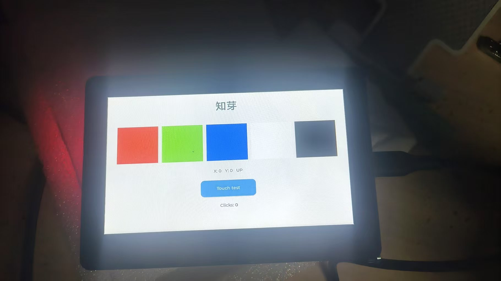

# 知芽 H01/H02 实板调试与验收报告

- 团队：妈妈夸我说的队
- 项目：知芽——幼儿绘本学习智能体
- 硬件负责人：黄锦培
- 测试日期：2026 年 11 月 24 日
- 版本：v1.0

## 1. 调试目标

本阶段完成知芽硬件端从工程初始化到实板显示、触摸交互的基础验证。H01 主要检查开发环境、固件烧录、芯片启动及 Flash、PSRAM；H02 主要验证 4.3C 板级显示和触摸驱动、LVGL 基础界面及初始化内存余量。通过分阶段验证，为后续绘本阅读、音频和联网功能建立可用的硬件基础。

## 2. 测试环境与版本

| 项目 | 配置 |
| --- | --- |
| 开发板 | Waveshare ESP32-S3-Touch-LCD-4.3C，SKU 33799，无外壳版（选型记录）；实物 PCB 丝印待补录 |
| 芯片 | ESP32-S3，revision v0.2，双核，运行频率 160 MHz |
| Flash / PSRAM | 16 MiB / 8 MiB Octal PSRAM |
| 显示与触摸 | 800×480 RGB565 LCD，GT911 电容触摸 |
| 开发环境 | Windows 11、VS Code、PowerShell |
| SDK / 图形库 | ESP-IDF v5.5.5 / LVGL 9.2.0（H02） |
| 烧录工具 | esptool v4.13.0，460800 baud |
| 串口监视 | esp-idf-monitor 1.11.0，COM5，USB Serial/JTAG，115200 baud |
| H01 基线 | `feat/hw-scaffold`，`9c27a7c`；实板验证版本在本地增加了临时心跳日志 |
| H02 基线 | `feat/hw-bsp-4-3c`，`d48086a`（迁移交接记录及 PR #39）；归档前本地工作树干净，HEAD 与 PR #39 一致。烧录时未独立留存 Git 状态 |

工程位于 `D:\zhiya-hardware-workspace\worktrees\`，使用已有 `Build-ZhiyaFirmware.ps1` 构建，不复用迁移前的 CMake 缓存。

## 3. H01 工程初始化与实板验证

### 3.1 构建及烧录过程

先核对 H01 工作树、ESP-IDF 路径及 Python 环境，确认 SDK 版本为 v5.5.5。使用统一构建脚本完成固件编译，随后通过 USB Type-C 数据线连接开发板。更换数据线后，插拔对比确认新增串口 COM5。

通过 esptool 的 `flash_id` 命令检测到 ESP32-S3、16MB Flash 和 8MB 嵌入式 PSRAM 特征。首次烧录完成后，Bootloader、应用程序和分区表均通过 Hash 校验。

首次构建目录：`temp\h01-20261124-220950-2354\build`，应用镜像 172336 B。增加临时心跳日志后重新构建，目录为 `temp\h01-20261124-224138-7043\build`，应用镜像 172464 B；两次构建均退出 0，烧录均通过数据校验。

### 3.2 调试问题及处理

| 问题 | 排查与处理 | 结果 |
| --- | --- | --- |
| 原数据线连接后屏幕亮，但无新增 COM 口 | 对比插拔前后端口；更换支持数据传输的线材 | 新增 COM5，芯片识别和烧录正常。原线具体故障原因未进一步检测 |
| VS Code 扩展部分配置命令不可用 | 复用已安装的 ESP-IDF SDK、Python 环境及 PowerShell 构建脚本 | 无须重新安装整套环境，H01/H02 均编译成功 |
| 初次烧录后没有收到应用日志，串口监视器出现写入超时和重连提示 | 确认 COM5 存在，检查实际 `sdkconfig` 中 `CONFIG_ESP_CONSOLE_USB_SERIAL_JTAG=y`，使用 Python 只读串口验证连接；在 H01 `app_main()` 加入 2 秒心跳循环后重新编译烧录 | 成功捕获完整自检结果和持续心跳。初始现象可能与启动日志时机及 USB 重连相关，未单独确定根因 |

心跳日志仅用于诊断，保留原有 Flash 和 PSRAM 自检逻辑，使用 FreeRTOS `vTaskDelay(pdMS_TO_TICKS(2000))`，避免忙等待。无限循环会改变 app_main 的生命周期。临时改动保留在本地工作树并另存补丁，正式固件不包含该循环。

### 3.3 实际运行结果

```text
I (518) zhiya_boot: Flash: 16777216 bytes (physical)
I (518) zhiya_boot: PSRAM initialized: 8388608 bytes
I (518) zhiya_boot: H01 startup checks passed
I (518) zhiya_boot: H01 heartbeat: Flash=OK, PSRAM=OK
I (2518) zhiya_boot: H01 heartbeat: Flash=OK, PSRAM=OK
I (4518) zhiya_boot: H01 heartbeat: Flash=OK, PSRAM=OK
I (16518) zhiya_boot: H01 heartbeat: Flash=OK, PSRAM=OK
```

以上为实际日志节选。完整已提供的心跳记录从 518ms 至 16518ms，每隔 2000ms 输出一次。Flash 容量与 PSRAM 初始化结果符合 N16R8 配置，H01 启动自检及本次约 16 秒的心跳观测通过。

## 4. H02 显示与触摸适配

### 4.1 板级驱动与固件构建

依据 PR #39 的板级设计，H02 使用 `board_4_3c` 组件，实现 RGB565 LCD、背光控制、GT911 单点触摸轮询及 LVGL 刷新与互斥。测试界面包含知芽标题、五色色块、触摸坐标和点击计数按钮。

本次实板构建完成 1203 步，退出码 0，应用镜像为 462944 B（0x71060，约 452.1 KiB），占 4 MiB 应用分区约 11.04%，余 3731360 B。该空间为应用分区余量，并非资源分区或运行内存余量。

H02 构建目录：`temp\h02-20261124-224647-9084\build`。Bootloader、分区表与应用镜像均成功烧录并通过 Hash 校验。



*图 1 H02 实板测试界面（2026-11-24）*

### 4.2 功能测试

| 测试项目 | 测试操作及结果 | 状态 |
| --- | --- | --- |
| 背光及颜色 | 界面成功显示，五色色块、标题、布局可辨；照片无明显整体错位 | PASS（现场观察） |
| 四角触摸 | 依次触摸四角，检查坐标方向及响应 | PASS（现场观察；具体坐标值待补录） |
| 按钮事件 | 连续点击 Touch test 20 次，检查计数 | PASS（现场观察） |
| 长按及抬手 | 按住按钮至少 5 秒后松开，检查 DOWN/UP 与计数 | PASS（现场观察） |
| 多指与恢复 | 双指触摸、释放后恢复单点操作 | PASS（现场观察）；建议补录先松一指的细分场景 |
| 连续拖动 | 横向、纵向及画圈连续操作约 1 分钟 | PASS（现场观察） |
| 系统启动 | 捕获 H01 自检及 H02 初始化日志 | PASS |
| RST 与冷启动 | 分别按 RST、完全断电后上电，检查计数归零和交互恢复 | NOT_TESTED；现有记录为烧录后的启动 |
| 堆内存 | 对比初始化前后的 PSRAM、内部 RAM、DMA 堆信息 | PASS（初始化快照）；连续操作后的堆统计为 NOT_TESTED |

测试中未报告明显触摸失灵、重复计数或界面卡死。单次照片不能排除动态扫描撕裂；长期稳定性、异常 I2C/刷新故障的真机恢复尚未验证。

### 4.3 启动日志分析

完整启动日志显示 Flash 实际使用 QIO、80MHz，PSRAM 为 8MB、80MHz，SPI SRAM 内存测试通过。GT911 于启动日志 864ms 时成功识别，H02 于 994ms 时完成初始化。关键日志如下：

```text
I (117) esp_psram: Found 8MB PSRAM device
I (550) esp_psram: SPI SRAM memory test OK
I (564) zhiya_boot: Flash: 16777216 bytes (physical)
I (564) zhiya_boot: PSRAM initialized: 8388608 bytes
I (564) zhiya_boot: H01 startup checks passed
I (564) zhiya_boot: Starting H02 display and touch
I (864) board_4_3c_panel: GT911 detected at 0x5D; native landscape
I (994) board_4_3c: H02 initialized: 800x480 RGB565, backlight on, LVGL 9.2.0
I (994) main_task: Returned from app_main()
```

`Returned from app_main()` 表示初始化主函数返回，不表示整个 FreeRTOS 系统退出。已创建的显示与触摸任务继续运行，无须为此重复烧录。

### 4.4 初始化内存统计

单位：字节（B）。

| 内存类型 | 初始化前 free | 初始化后 free | 初始化后 min | 初始化后 largest | free 减少量 |
| --- | ---: | ---: | ---: | ---: | ---: |
| PSRAM | 8386308 | 7616752 | 7616752 | 7602176 | 769556 |
| Internal | 312515 | 240763 | 208732 | 163840 | 71752 |
| Internal DMA | 304727 | 232975 | 200944 | 163840 | 71752 |

H02 初始化后 PSRAM 剩余约 7.26 MiB，内部堆剩余约 235.1 KiB，内部 DMA 堆剩余约 227.5 KiB。PSRAM free 较初始化前减少约 751.5 KiB，与 768000 B 的 RGB565 帧缓冲规模相符。内部 DMA 属于内部内存中的具备 DMA 能力的部分，两项不可相加计算。

目前初始化内存余量良好，但连续点击后的最小堆、最大连续块和内存变化尚无实测记录，不能据此证明无内存泄漏。后续 JPEG 解码、音频及 TLS 联网应分别测量峰值。

### 4.5 警告与遗留问题

启动出现 I2C 上拉电阻检查提示：

```text
W (564) i2c.master: Please check pull-up resistances whether be connected properly. Otherwise unexpected behavior would happen. For more detailed information, please read docs
```

GT911 探测及现有人工触摸测试正常，当前不进行额外焊接或盲目调整 I2C 参数。记录提示，若后续出现通信失败、异常抬手或触摸失灵，再按原理图和驱动日志排查。


## 5. 验收结论与待补测试

H01 编译、实板烧录校验、COM5 USB Serial/JTAG、芯片识别和 Flash/PSRAM 自检为 **PASS**。2 秒心跳由本地诊断版本验证。H02 编译、实板烧录校验、800×480 RGB565 显示、背光、五色色块、中文标题、GT911、LVGL、四角触摸、20 次点击计数、长按抬手、多指后恢复、连续滑动及初始化堆快照为 **PASS**。此前主机故障注入回归见 [H02 定向复查](../h02-review.md)。本次提交只涉及文档和验收照片。

| 待验收项 | 操作和验收标准 | 状态 |
| --- | --- | --- |
| PCB 修订 | 断开供电后读取并拍摄背面丝印，记录型号与修订并对照板级引脚表 | NOT_TESTED |
| 独立 RST 和冷启动 | 分别短按 RST、断开所有供电后重新上电。各保存完整串口日志。H01 自检和 H02 初始化通过，背光、界面正常，计数归零且再次点击有效 | NOT_TESTED |
| 触摸细项与动态画面 | 记录四角和中心实测坐标。点击色块不计数。双指接触后先松一指再全松，整个异常接触不计数，随后单点点击计一次。滑动时录像核对边界、偏移和动态撕裂 | NOT_TESTED |
| 连续操作后的堆 | 在相同操作负载前后多轮采集 PSRAM、Internal、Internal DMA 的 free、min、largest。确认 free 和 largest 无持续下降、日志无分配失败。若当前固件仅在启动时输出，另行使用诊断构建采样并记录版本 | NOT_TESTED |
| I²C 与刷新异常恢复 | 若出现读取错误、抬手丢失或 RGB 刷新异常，保存首条错误和复现动作。检查完全释放后触摸是否恢复、后续重绘是否覆盖旧画面、独立 RST 和冷启动后是否恢复 | NOT_TESTED |

丢失释放报告且无新数据时，GT911 有可能维持 PRESSED。等待释放时若丢失零点报告，下一次触摸也可能暂时被屏蔽。RGB 刷新错误可能保留旧像素，单扫描帧缓冲的撕裂和长期堆稳定性仍需实板确认。

## 6. 构建产物与后续建议

下列 SHA-256 在归档时从本地构建产物计算，用于识别文件。烧录工具报告的写入 Hash 校验是独立证据。构建日志位于本地硬件工作区的 logs 目录。串口证据见上文的现场摘录。

| 应用镜像 | 大小（B） | SHA-256 | 本地构建日志 |
| --- | ---: | --- | --- |
| H01 基线 | 172336 | 8fa352154744173eb401fd02400071bfa3ec68029a85960faa167e61cbec981f | h01-migration-build-20261124-220950-2354.log.build |
| H01 心跳诊断 | 172464 | 7dc028689a93078ddc40d32a8f624302988f1e4133b56df3205ab80774856458 | h01-migration-build-20261124-224138-7043.log.build |
| H02 | 462944 | 9d30db0c0c78c39b011574a5c720922cba3954feef59dfb409073a08ea440dd9 | h02-migration-build-20261124-224647-9084.log.build |

补齐实板证据后，再独立评审 H03 素材与 H05 Mock 基线。H06 可用一本本地绘本验证 JPEG 解码、显示和翻页，测量解码耗时和堆峰值。现有分区表定义 4 MiB 应用区及 NVS、PHY 分区，独立资源区需要另行评审。录音、播放、联网、设备授权和正式接口各自实施及验收。

相关记录见 [H00/H01 PR #34](https://github.com/MumLauds/202610-zhiya/pull/34)、[H02 PR #39](https://github.com/MumLauds/202610-zhiya/pull/39)、[上板指南](../bringup.md)及[板级引脚表](../board-pin-map.md)。
