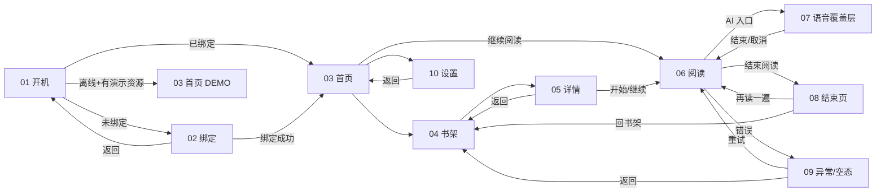
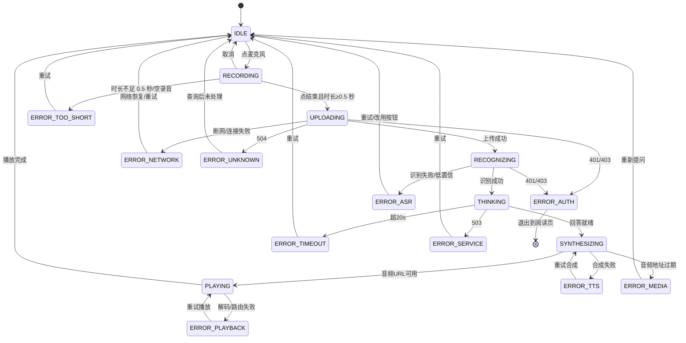

# 知芽 4.3C 硬件端 UI 与交互规范（H04）

## 0. 文档说明、版本与引用依据

| 项目 | 内容 |
| --- | --- |
| 文档编号 | H04 / `hardware/docs/ui-flow.md` |
| 版本 | v0.1（首版设计规范，待团队评审） |
| 分支 | `docs/hw-ui-flow` |
| 基线 | `MumLauds/202610-zhiya` `main` `1e27403`（H03 PR #37 合入后的主线） |
| 设备 | Waveshare ESP32-S3-Touch-LCD-4.3C，SKU 33799，无外壳版；800×480 横屏 RGB565、GT911 触摸、ESP32-S3 N16R8、ESP-IDF v5.5.5 + LVGL |
| 任务边界 | 只输出设计与交互规范，不写固件、不改 `hardware/firmware/`、`hardware/assets/`、`hardware/tools/` 与任何业务代码 |

### 0.1 已核对的事实与依据

| 依据 | 核对到的内容 | 使用方式 |
| --- | --- | --- |
| `README.md`、`docs/requirements/软件需求规格说明书.md` | 角色与权限（家长/幼儿/管理员）、FR-05/08/12/16/17、HW-01～HW-05、NFR-06/10/11、AC-04/07/10/12 | 页面职责、状态与验收编号 |
| `docs/design/api-contract.md`、`api-contract-v0.4.json` | `pageNumber` 从 1 开始、`defaultNextPageNumber` 末页为 null、`coverRef`/`imageRef` 可为 null、`expectedRevision`/`clientEventId`、409/504 语义、`{data,requestId}` 与错误结构 | 数据映射与异常策略 |
| `docs/standards/知芽_项目设计与开发规范_精简版_v1.2.md`、`glossary.md`、`design-change-log.md` | 文档与命名规范、DCL-025 硬件方案变更 | 术语、编号与变更口径 |
| `hardware/README.md`、`hardware/docs/h00-hardware-change-request.md`、`h00-interface-decisions.md` | 真实板卡规格、Flash 布局、H00 待评审设备接口（绑定、投影、撤销均**未实现**） | 设备定位与“不得假装已实现”的边界 |
| `hardware/docs/media-format.md`、`hardware/assets/generated/assets-manifest.json` | 20 本 × `THUMBNAIL`(≤240×160)/`DETAIL`(≤400×300)，40 个 JPEG 共 806,090 B，`decoderVerified=false`，仅封面、无逐页插画 | 素材使用规则 |
| `prototype/README.md`、`prototype/figma/README.md`、`prototype/figma/mobile-plugin/code.js` | 移动端原型页面清单；设计令牌：`forest #214739`、`leaf #63856A`、`sage #DDE8D6`、`cream #F8F3E8`、`paper #FFFDF7`、`gold #E4B94E`、`ink #2B342C`；字体族 Noto Sans SC / Noto Serif SC | 视觉规范 |
| 附件《知芽 ESP32-S3 4.3C 硬件端详细开发设计 v1.1》 | 800×480 横屏重排、56～64 逻辑像素触摸区、半双工短语音、H03 素材流水线、G2 离线 UI 验收 | 布局与语音交互基线 |

### 0.2 未核实事项（明确标注，不作既成事实）

1. **Figma 画布未打开**：`https://www.figma.com/design/cjSoo0RkFSTaBbJiwNXs8D/` 对自动访问返回 robots.txt 拒绝。本文的品牌色与字体来自仓库内 Figma 生成插件的常量（`mobile-plugin/code.js`），**不是逐帧比对画布后的结论**；圆角、阴影、卡片比例等视觉细节按插件与附件推导，属于**设计建议**，需设计负责人复核。
2. **设备专用接口不存在**：绑定码、设备凭证兑换、任务投影、解绑撤销均为 H00 的设计提案，当前 `main` 无对应路由。本文只设计界面与状态，**不声称接口可用**。
3. **JPEG 解码未验证**：`assets-manifest.json` 明确 `decoderVerified=false`，H06 上板前不得假设封面能显示。
4. **没有逐页插画**：`story_pages.json` 的 `image_ref` 是画面描述文本，不是资源键；接口层在无已核验素材时必须序列化为 `imageRef=null`。阅读页只设计占位，不拿封面冒充正文插画。
5. **实板未验证**：触摸方向、刷新率、内存余量、音频通路均无实测数据，本文所有尺寸与预算均为设计目标。

---

## 1. 设备定位与目标用户

### 1.1 定位

知芽 4.3C 是**可选的家庭共读终端**，不是独立的儿童平板，也不承担账号、内容管理、报告等 Web 职责：

- 设备只消费家长在 Web 端已经授权的内容与会话；
- 设备不注册账号、不管理档案、不发布内容、不展示完整家长报告；
- 设备的一切“成功/已同步”表述必须与服务端事实一致，网络异常时如实显示未同步。

### 1.2 两类使用者

| 使用者 | 场景 | 能力与限制 |
| --- | --- | --- |
| 3～6 岁幼儿 | 家长陪伴下共读，或家长开启后的自主阅读 | 会点、会看图画、能听懂短句；不识字或识字很少；不能输入长文本、不能理解抽象错误码；手部精细动作有限 |
| 家长 | 绑定、授权、设置时长、查看小结（Web 为主） | 在设备上只做少量本地操作（音量、亮度、家长锁）；账号与授权仍在手机/网页 |

### 1.3 由此得到的三条硬约束

1. **一屏一主任务**：每页只有一个“最该点的按钮”，其余动作降级为图标或次级按钮。
2. **文字为辅助、图与语音为主**：正文仍必须可读（NFR-10），但提示语短、字号大、不使用专业术语。
3. **设备不承担身份判断**：家长锁只是界面保护，真正的权限由服务端校验；儿童界面不出现家长账号、密码、完整报告。

---

## 2. 原型继承与硬件适配原则

### 2.1 继承什么

| 继承项 | 具体做法 |
| --- | --- |
| 品牌色 | 直接使用 Figma 令牌：森林绿主色、鼠尾草浅底、暖米色背景、纸张白卡片、暖金强调 |
| 字体气质 | 标题用衬线（Noto Serif SC）保留“绘本感”；界面与正文用无衬线（Noto Sans SC）保证小字号清晰 |
| 卡片语言 | 大圆角、纸质感、细边框、极轻阴影；不使用玻璃拟态、渐变霓虹、复杂插画背景 |
| 内容结构 | 绘本馆 → 详情 → 共读 → 小结的链路与移动端一致，仅重排为横屏 |
| 文案口吻 | 对孩子说短句、动词开头（“翻一页”“再读一遍”）；不使用“异常”“失败率”等术语 |

### 2.2 不继承什么

- **不把手机页面等比缩小**：手机竖屏的双列卡片、长列表、滚动表单在 800×480 横屏上会变得又小又挤；本规范按横屏重新分栏。
- **不做移动端的长滚动**：设备页一律单屏完成，超出一屏的内容改为分页或“更多在手机查看”。
- **不做移动端的复杂手势**：双指缩放、长按拖拽、多点手势均不列入首版。
- **不搬运 Web 的家长功能**：档案编辑、推荐理由、历史报告、原创工坊留在 Web。

### 2.3 横屏适配的四条规则

1. 触摸目标 ≥ 56×56 px，主操作 ≥ 64 px 高，儿童高频按钮 72 px 高。
2. 正文 ≥ 24 px / 行高 36 px；辅助文字 ≥ 20 px；16 px 只用于非关键标注。
3. 任意页面在 800×480 内完整呈现，不出现纵向滚动条。
4. 主内容区可点击元素不超过 6 个（阅读页为 5 个按钮 + 1 个页码胶囊；底部导航不计），避免误触。

---

## 3. UI 信息架构与导航总图

### 3.1 层级

```text
HW-UI-01 开机欢迎与网络状态
   ├─(未绑定)─ HW-UI-02 设备绑定 ──(绑定成功)──┐
   ├─(已绑定 / 本地演示)──────────────────────┤
   ▼                                          ▼
HW-UI-03 首页 ──► HW-UI-04 绘本书架 ──► HW-UI-05 绘本详情
   │                                        │
   ├──► HW-UI-10 受限设置（家长锁）           ▼
   │                                   HW-UI-06 绘本阅读
   │                                        ├──► HW-UI-07 AI 语音互动（覆盖层）
   │                                        ├──► HW-UI-08 阅读结束
   │                                        └──► HW-UI-09 异常与空状态（覆盖/整页）
   └────────────────────────────────────────┘
```

### 3.2 导航规则



| 规则 | 说明 |
| --- | --- |
| 返回优先级 | 覆盖层（语音/家长锁/确认框）→ 详情 → 书架 → 首页；阅读页返回必须先确认“结束本次阅读” |
| 首页返回 | 不退出应用，停留首页；长按电源由系统处理，不由 UI 拦截 |
| 阅读页离开 | 只有“结束阅读”按钮与返回确认两条路径，防止儿童误退出丢失进度 |
| 状态保持 | 从阅读页进入语音层再返回，页码、朗读状态、滚动位置保持不变 |
| DEMO 可见性 | DEMO 模式在状态栏常驻 `DEMO` 徽标，所有页面可见，不可关闭 |

---

## 4. 全局组件与页面骨架

所有页面共用以下骨架，页面章节只描述差异部分。

| 组件 | 坐标 (x,y,w,h) | 说明 |
| --- | --- | --- |
| 状态栏 `top_bar` | 0,0,800,40 | 背景 `paper`，底部 1 px `line`；左：24×24 芽形标记 + “知芽”20 px；右：模式徽标 76×24、Wi‑Fi 图标 24×24 |
| 返回按钮 `btn_back` | 16,48,64,56 | 仅图标（左箭头），`paper` 底、圆角 16；点击返回上一级 |
| 页面标题 `lab_title` | 96,56 | 32 px 衬线加粗，`ink`；单行，超长省略 |
| 内容安全区 | x 24..776，y 56..400 | 左右各 24 px，底部预留 80 px 给操作区/导航 |
| 底部导航 `nav_bottom` | 0,408,800,72 | 仅首页/书架/设置使用；3 项各 160×72，图标 28 + 文字 20 |
| 主按钮 `btn_primary` | 高度 64 | `forest` 底、白字 24 px、圆角 20；按下 `forestSoft`；禁用 `sageDeep` + `muted` 字 |
| 次按钮 `btn_secondary` | 高度 64 | `paper` 底、2 px `line` 边、`ink` 字、圆角 20 |
| 图标按钮 `btn_icon` | 64×64 | 圆角 16，`sage` 底；图标 32 px |
| 卡片 `card` | 圆角 20 | `paper` 底、1 px `line`、阴影 `0 2 6 rgba(33,71,57,0.10)` |
| 加载指示 | 32×32 | `lv_spinner`，`forest` 弧线；不使用全屏遮罩动画 |
| 模式徽标 | 76×24，圆角 12 | `ONLINE`：`sage` 底 + `forest` 字；`DEMO`：`peach` 底 + `ink` 字 |

---

## 5. 十个页面的完整设计规范

> 坐标单位均为屏幕像素（800×480，左上原点）。所有按钮的**可触摸区域**等于其绘制区域，不得小于 56×56。

### 5.1 HW-UI-01 开机欢迎与网络状态

**目的与角色**：启动自检、判断网络与绑定状态、给出唯一可行动的下一步。幼儿看状态，家长可重试。

**展示内容与数据来源**

| 内容 | 来源 |
| --- | --- |
| 品牌标记 + 名称 | 本地资源（矢量或位图），非网络 |
| Wi‑Fi 状态 | `esp_wifi` 事件组 |
| 服务可达性 | API-032 `GET /api/v1/health`（契约定义，匿名可读；若当前未挂载则退化为 Wi‑Fi 连通性判断，不伪造“服务正常”） |
| 设备凭证 | NVS 中的绑定凭证是否存在/是否过期（**接口未交付时为“未知”**） |
| 本地演示资源 | `assets-manifest.json` 是否存在且可读 |

**布局**

| 区域 | 坐标 | 内容/样式 |
| --- | --- | --- |
| 品牌标记 | 352,48,96,96 | 芽形 + 展开绘本图形；`forest` 单色 |
| 产品名 | 全宽居中，y=152 | “知芽”40 px 衬线加粗，`forest` |
| 副标题 | 全宽居中，y=200 | “陪孩子读好每一页”20 px，`muted` |
| 状态卡 | 160,240,480,96 | 三行，每行 32：图标 20 + 名称 20 px + 右侧状态文字 20 px |
| 主按钮 | 300,352,200,64 | “重新检查” |
| 演示入口 | 280,428,240,36 | 文本按钮“进入本地演示（DEMO）”，仅离线时出现 |

**按钮与文字**

| 控件 | 文字 | 出现条件 |
| --- | --- | --- |
| `btn_retry` | 重新检查 | 始终 |
| `btn_demo` | 进入本地演示（DEMO） | 离线 且 本地资源可读 |
| `lab_hint` | “请检查家里的 Wi‑Fi，或请家长打开手机上的知芽” | 离线 3 秒后 |

**触摸事件**

- 点“重新检查” → 重新执行自检（不重启设备）。
- 点“进入本地演示” → 进入首页，`mode=DEMO`，状态栏徽标切换为 `DEMO`。
- 无其他可点区域。

**导航与返回**：自检完成且已绑定 → 首页；未绑定 → 绑定页；离线 → 停留本页；本页无返回。

**状态**

| 状态 | 表现 | 后续 |
| --- | --- | --- |
| `CHECKING` | 状态卡第三行显示 spinner + “正在检查…” | 最多 8 秒 |
| `ONLINE_BOUND` | 三项全绿，主按钮文字变“进入首页” | 自动 1.5 秒后进入首页，可点击提前进入 |
| `ONLINE_UNBOUND` | 第三行“未绑定”，按钮变“开始绑定” | 进入 HW-UI-02 |
| `OFFLINE` | Wi‑Fi 行红色 + 服务行灰色；显示提示与演示入口 | 停留，可重试 |
| `FAULT` | 自检项异常（如显示/音频初始化失败）；显示“请重启设备，仍失败请联系家长” | 停留，可重试 |

**业务状态与事件**：只读健康检查，不写任何会话事件；不生成 `clientEventId`。

**儿童限制**：不显示 IP、MAC、错误码；演示入口必须带 `DEMO` 字样，避免被当作正式内容。

**LVGL 组件**：`lv_obj`（屏）、`lv_img`、`lv_label`、`lv_obj`×3（状态行）、`lv_spinner`、`lv_btn`×2。

**对应需求**：FR-12、NFR-06、HW-01（取回授权任务的前置状态）；SRS 6.2 步骤 1–2。

---

### 5.2 HW-UI-02 设备绑定

**目的与角色**：让家长用手机完成绑定，设备只显示一次性绑定码与说明。**儿童不可完成绑定**。

**前置说明（必须体现在界面与文档）**：设备绑定接口在当前 `main` 中**不存在**，属 H00 待评审提案。H06 实现时按“接口未开放”分支处理；页面可在 DEMO 构建中展示静态示意，但不得伪造绑定成功。

**展示内容与数据来源**

| 内容 | 来源 | 当前可用性 |
| --- | --- | --- |
| 6 位绑定码 | `POST /api/v1/devices/pairing-sessions`（提案） | ⚠ 未实现 |
| 有效期倒计时 | 响应中的 `expiresAt` | ⚠ 未实现 |
| 二维码（可选） | 响应中的 `pairingUri`，由设备渲染或后端给位图 | ⚠ 未实现；无则显示文字步骤 |
| 绑定结果 | 轮询或长连接（提案） | ⚠ 未实现 |

**布局**

| 区域 | 坐标 | 内容/样式 |
| --- | --- | --- |
| 标题 | 24,56 | “连接家长账号”32 px |
| 绑定码卡 | 24,112,360,200 | `paper` 卡；标签“绑定码”20 px；码值 6 位，56 px 等宽加粗，字距 8；倒计时 20 px `muted` |
| 说明卡 | 408,112,392,200 | 三步：① 家长在手机打开知芽并登录 ② 进入“设备”页输入绑定码 ③ 看到“已连接”后回到设备 |
| 二维码（可选） | 664,128,96,96 | 虚线框占位；仅在拿到 `pairingUri` 后显示 |
| 刷新按钮 | 24,340,176,64 | “刷新绑定码” |
| 返回按钮 | 216,340,120,64 | “返回”次按钮 |
| 演示入口 | 352,352,200,48 | 文本按钮“先用本地演示”，仅 DEMO 构建可见 |

**触摸事件**

- 刷新 → 请求新码；旧码立即失效（服务端为准）。
- 返回 → 回开机页；若已绑定则回首页。
- 长按码值 3 秒 → 放大显示（方便家长抄写），不触发其他动作。

**导航与返回**：绑定成功 → 首页（`ONLINE`）；刷新失败 → 停留并提示；无网络 → 提示“请先连接 Wi‑Fi”。

**状态**

| 状态 | 表现 | 可用操作 |
| --- | --- | --- |
| `REQUESTING` | 码区 spinner + “正在获取绑定码” | 返回 |
| `CODE_ACTIVE` | 显示 6 位码 + 倒计时（mm:ss） | 刷新、返回、长按放大 |
| `CODE_EXPIRED` | 码值置灰 + “已过期，请刷新” | 刷新、返回 |
| `WAITING_CLAIM` | 码保留，底部“等待家长确认…” + 小 spinner | 返回 |
| `BOUND` | 全屏成功 2 秒：“已连接，可以开始阅读啦” | 自动进首页 |
| `UNSUPPORTED` | “设备绑定服务尚未开放，请先使用本地演示” | 演示、返回 |
| `ERROR` | “暂时无法获取绑定码（错误码仅日志可见）” + 重试 | 重试、返回 |

**业务状态与事件**：绑定成功才写入 NVS 凭证；失败不得写入任何“已绑定”标记；日志不打印绑定码明文与凭证。

**儿童限制**：页面文案面向家长；不出现密码输入框；儿童点击不产生绑定动作（需家长在手机确认）。

**LVGL 组件**：`lv_label`、`lv_obj`（码卡）、`lv_label`×6（每位数字或单标签）、`lv_label`（倒计时）、`lv_btn`×3、`lv_spinner`、`lv_obj`（二维码占位）。

**对应需求**：HW-01；SRS 6.2 步骤 1；H00 待评审“一次性授权与兑换”。

---

### 5.3 HW-UI-03 首页

**目的与角色**：用最少的选择把幼儿带回“继续读”或“挑一本”。家长可进入受限设置。

**展示内容与数据来源**

| 内容 | 来源 |
| --- | --- |
| 最近会话（书名、封面、页码） | API-013 会话 + API-009 版本投影；DEMO 用本地 fixture |
| 书架入口预览 | API-008 前 3 个已发布版本的 `coverRef`；无 `coverRef` 时用本地 THUMBNAIL |
| 设备状态 | Wi‑Fi、DEMO/ONLINE、剩余儿童模式时长（本地计时 + 服务端到期时间） |

**布局**

| 区域 | 坐标 | 内容/样式 |
| --- | --- | --- |
| 问候语 | 24,56 | “早上好”/“下午好”/“晚上好” + 昵称（无昵称时“小朋友”），28 px |
| 继续阅读卡 | 24,96,480,168 | 卡片底 `paper`、圆角 20 |
| ├ 封面 | 24,96,240,168 | `DETAIL` 等比 contain：实际 224×168，左右各留 8 px |
| ├ 书名 | 280,116,208,36 | 28 px 衬线加粗，1 行省略 |
| ├ 页码 | 280,158,208,28 | “上次读到第 12 页”20 px `muted` |
| └ 继续按钮 | 352,200,128,56 | 主按钮，文字“继续” |
| 书架卡 | 520,96,256,168 | `paper`、圆角 20 |
| ├ 卡片标题 | 536,110,224,30 | “我的绘本”24 px |
| ├ 缩略图 ×3 | 536/616/696,136,72,54 | `THUMBNAIL` contain；缺图用小占位 |
| └ 全部绘本 | 536,200,224,30 | “全部绘本 →”20 px `forest` |
| 状态条 | 24,280,752,40 | 左：Wi‑Fi 图标 + “已连接/未连接”；中：`DEMO`/`ONLINE` 徽标；右：儿童模式剩余 `05:00` |
| 主按钮 | 24,336,320,64 | “打开绘本书架” |
| 次按钮 | 360,336,200,64 | “家长设置” |
| 底部导航 | 0,408,800,72 | 首页（选中）/书架/设置 |

> 封面在 240×168 框内按 contain 显示：`DETAIL` 为 4:3，实际绘制 224×168，左右各留 8 px 背景；不裁剪、不拉伸。

**触摸事件**

- 点继续卡/继续按钮 → 恢复会话进入阅读页（`expectedRevision` 用服务端值）。
- 点书架卡或“打开绘本书架” → HW-UI-04。
- 点“家长设置” → HW-UI-10（需家长锁）。
- 底部导航切换：首页/书架/设置。

**导航与返回**：首页为根页面；返回键无效（不退出应用）。

**状态**

| 状态 | 表现 |
| --- | --- |
| `LOADING` | 继续卡显示骨架 + spinner；书架卡显示 3 个灰块 |
| `NO_SESSION` | 继续卡变为“还没有开始读的书”+“去挑一本”按钮 |
| `NO_BOOKS` | 书架卡“家长还没有授权绘本”+“请家长在手机添加” |
| `OFFLINE` | 状态条“未连接”；继续卡仍可打开已缓存会话（只读模式，翻页不写服务端） |
| `DEMO` | 状态条常驻 `DEMO`；继续卡来自本地 fixture，底部小字“演示内容” |

**业务状态与事件**：首页不发写请求；进入阅读由阅读页发 `STARTED`。

**儿童限制**：不展示家长账号、报告、推荐理由长文；“家长设置”需要家长锁。

**LVGL 组件**：`lv_obj`×2（卡）、`lv_img`×4、`lv_label`×8、`lv_btn`×3、`nav_bottom`（3 个 `lv_btn`）。

**对应需求**：FR-03、FR-05、FR-16、HW-01。

---

### 5.4 HW-UI-04 绘本书架

**目的与角色**：在授权范围内挑选绘本；只展示已发布且获准的版本。

**展示内容与数据来源**

| 内容 | 来源 |
| --- | --- |
| 绘本卡（封面、标题、页数） | API-008 `items[]`：`storybookId`、`storyVersionId`、`versionNumber`、`title`、`coverRef`、`pages` |
| 封面 | `coverRef` 非空 → API-024 受控媒体；为空 → 本地 `THUMBNAIL`（按 `storybookId` 查 H03 manifest）；再缺 → 占位 |
| 分页 | 优先使用服务端分页参数；若接口一次返回全部条目，客户端按 4 本/页展示，仅影响呈现，不改变服务端 `page/pageSize` 语义 |
| 计数 | “共 N 本”取当前授权条目总数，不写死 20 |

**布局**

| 区域 | 坐标 | 内容/样式 |
| --- | --- | --- |
| 返回按钮 | 16,48,64,56 | 回首页 |
| 标题 | 96,56 | “绘本书架”32 px |
| 计数 | 640,64 | “共 N 本”20 px `muted`（N 为当前授权数，示例 20） |
| 卡片 1–4 | y=112，x=24/216/408/600，176×200 | 封面区 176×132（y=112，`THUMBNAIL` 等比 contain：213×160 → 约 175×132）；标题 20 px 单行（y=250）；底部“共 N 页”16 px `ink`（y=278） |
| 分页箭头 | 24,344,64,56 与 712,344,64,56 | 上一页/下一页；首末页禁用 |
| 页码点 | 居中 y=356 | 圆点数 = 总页数，最多 5 个；当前页 `forest`，其余 `line`；超过 5 页只显示页码文字 |
| 页码文字 | 居中 y=380 | “第 1 / N 页”20 px `ink` |

**触摸事件**

- 点卡片 → 详情页（携带 `storyVersionId`，不是 `storybookId`）。
- 点箭头/点在页面横向滑动（≥60 px）→ 换页；滑动仅在本页内容区生效。
- 长按卡片 1 秒 → 显示标题全称浮层（不进入详情）。

**导航与返回**：返回首页；进入详情后返回本页并保持页码。

**状态**

| 状态 | 表现 |
| --- | --- |
| `LOADING` | 4 个骨架卡 + spinner |
| `EMPTY` | 中央插画占位 + “还没有可以读的绘本” + “请家长在手机授权” |
| `ERROR` | 中央“书架暂时打不开” + 重试 + 返回 |
| `OFFLINE` | 顶部黄条“网络未连接，显示已缓存绘本”；只展示本地缓存条目 |
| `PARTIAL` | 某本 `coverRef` 为空 → 该卡用本地缩略图；仍缺 → 占位卡，不阻塞其他卡 |

**业务状态与事件**：只读；不产生会话事件。`storybookId` 与 `storyVersionId` 均保留，进入详情只用 `storyVersionId`。

**儿童限制**：不展示 `DRAFT`、未审核、越权版本；接口返回 403/404 的条目直接不渲染，不显示“被拒绝”细节。

**LVGL 组件**：`lv_obj`（滚动容器，关闭滚动）、4 个卡片容器、`lv_img`×4、`lv_label`×8、`lv_btn`×2、`lv_obj`（圆点）。

**对应需求**：FR-03、FR-11（只展示已发布）、HW-01、HW-02。

---

### 5.5 HW-UI-05 绘本详情

**目的与角色**：确认这本书、看适龄信息、开始或继续阅读。

**展示内容与数据来源**

| 内容 | 来源 |
| --- | --- |
| 封面 | `coverRef` → API-024；否则本地 `DETAIL`；否则占位 |
| 标题、适龄、主题、页数 | API-009：`title`、`pages` 中最大 `pageNumber`；适龄/主题来自档案与版本标签（若接口未提供则隐藏该行，不编造） |
| 简介 | 版本 `summary`（若契约未提供，省略该区块，不放占位假文） |
| 会话状态 | API-013：有未完成会话 → 按钮变“继续阅读” |

**布局**

| 区域 | 坐标 | 内容/样式 |
| --- | --- | --- |
| 返回按钮 | 16,48,64,56 | 回书架 |
| 封面 | 24,112,400,300 | `DETAIL` 原生 400×300，圆角 20，`creamDeep` 底（避开顶部返回按钮） |
| 标题 | 456,72,320,88 | 32 px 衬线加粗，最多 2 行 |
| 标签行 | 456,176,320,36 | “4–5 岁”`sage` 胶囊 96×36；“共 N 页”`paper` 胶囊 110×36（N=最大 `pageNumber`） |
| 简介 | 456,228,320,96 | 20 px / 30，最多 3 行；无数据则整块隐藏 |
| 主按钮 | 456,336,320,72 | “开始阅读”/“继续阅读” |
| 次按钮 | 456,416,320,56 | “返回书架” |
| DEMO 标注 | 24,416,272,24 | `DEMO` 构建时显示“演示绘本·非正式发布” |

**触摸事件**

- 开始/继续 → 请求会话（在线：家长已授权会话或设备投影；DEMO：本地会话），成功后进入阅读页。
- 返回 → 书架。
- 长按封面 1 秒 → 无动作（避免儿童误触进入全屏）。

**导航与返回**：开始失败停留本页并提示；阅读页返回本页。

**状态**

| 状态 | 表现 |
| --- | --- |
| `LOADING` | 封面骨架 + 右侧文字骨架 |
| `READY` | 正常展示 |
| `NO_PERMISSION` | 封面占位 + “这本书还没有获得家长授权” + 返回；不显示“403” |
| `WITHDRAWN` | “这本书已下架” + 返回书架 |
| `SESSION_STARTING` | 主按钮转“正在准备…” + spinner，按钮禁用 |
| `SESSION_FAILED` | 提示“暂时无法开始阅读，请稍后再试” + 重试；网络不通时提示检查 Wi‑Fi |

**业务状态与事件**：开始阅读时由控制器统一处理 `STARTED`（`expectedRevision` 取服务端值）；详情页不直接写事件。

**儿童限制**：不显示版本审核状态、内部 ID；“未授权”文案避免指责语气。

**LVGL 组件**：`lv_img`、`lv_label`×6、`lv_obj`×3（胶囊）、`lv_btn`×2、`lv_spinner`。

**对应需求**：FR-03、HW-01、HW-02。

---

### 5.6 HW-UI-06 绘本阅读（重点页，详见第 6 节）

**目的与角色**：呈现当前页图文、支持翻页与朗读、提供受限语音入口、结束阅读。幼儿是主操作者。

**展示内容与数据来源**

| 内容 | 来源 |
| --- | --- |
| 当前页图文 | API-013 `currentPage` + API-009 `pages[]` 的 `text`、`imageRef` |
| 页面图 | `imageRef` 非空 → API-024 受控媒体；为空 → 占位；**不使用 H03 封面顶替** |
| 朗读音频 | 服务端提供的页面音频或本地缓存；没有则禁用朗读，不伪造播放 |
| 页码/总数 | `pageNumber`、`pages` 中最大 `pageNumber`、`defaultNextPageNumber` |
| 进度修订 | API-013 `revision`；API-015 成功后更新 |

**布局（推荐方案 A，见 6.2）**

| 区域 | 坐标 | 内容/样式 |
| --- | --- | --- |
| 书名 | 120,10,480,24 | 状态栏中部，20 px，单行省略；书名过长时省略中间 |
| 图片框 | 24,56,456,342 | `creamDeep` 底、圆角 20；图片 contain 居中，不裁剪（服务端页面图为 4:3 时实际绘制 400×300 居中） |
| 文字面板 | 496,56,280,342 | `paper` 底、圆角 20、内边距 20；正文 24 px / 36，最多 8 行（80 字）；不足 3 行时垂直居中 |
| 上一页 | 24,400,64,68 | 图标按钮，首页禁用 |
| 下一页 | 96,400,64,68 | 图标按钮，末页禁用 |
| 朗读/暂停 | 208,400,112,68 | 图标 + “朗读”/“暂停”；播放中为“暂停” |
| AI 问答 | 336,400,112,68 | 麦克风图标 + “问 AI” |
| 页码 | 480,400,136,68 | `sage` 底、`ink` 字，居中“12 / 26”；长按 2 秒显示气泡 |
| 结束阅读 | 632,400,144,68 | 次按钮“结束” |
| 断网角标 | 32,64,240,28 | 仅断网时叠加在图片框左上角：`peach` 底“未连接，显示已缓存内容” |

**按钮状态**

| 控件 | 正常 | 禁用 | 加载/进行中 |
| --- | --- | --- | --- |
| 上一页 | `forest` 图标 | 首页/会话未就绪：40% 透明 | 翻页请求在途：箭头换 20 px spinner，仍可点但去重 |
| 下一页 | 同上 | 末页（`defaultNextPageNumber=null`） | 同上 |
| 朗读 | “朗读” | 无文本/音频不可用 | 播放中变“暂停”，图标变双竖线 |
| AI 问答 | 麦克风 | 录音/上传中、离线、儿童会话未授权 | 进入语音层后本按钮隐藏 |
| 结束 | “结束” | 会话未就绪 | 提交中显示 spinner，禁止重复点 |

**触摸事件**

- 点翻页 → 视觉立即切换（乐观），同时按 `clientEventId` + `expectedRevision` 上报；服务端未确认前页码角标显示小圆点。
- 在图片区横向滑动（≥60 px，纵向位移 <40 px）→ 下一页/上一页；滑动与点击互斥，翻页后 250 ms 内忽略再次滑动。
- 点朗读 → 播放当前页文本音频；再点暂停；播放结束自动回到“朗读”。
- 点 AI → 打开 HW-UI-07 覆盖层（暂停朗读）。
- 点结束 → 弹确认“要结束这次阅读吗？”（“继续读”/“结束”），确认后进入 HW-UI-08。
- 长按页码 2 秒 → 显示“第 X 页，共 Y 页”气泡，无其他动作。

**导航与返回**：返回键等同“结束阅读”确认；确认后离开；取消则停留原页。

**状态**

| 状态 | 表现 |
| --- | --- |
| `PAGE_LOADING` | 图片框 spinner + 文字面板骨架；按钮禁用 |
| `PAGE_READY` | 图文正常；页码正确 |
| `IMAGE_MISSING` | 图片框显示占位（芽形线稿 + “本页暂无插图”），正文照常显示与朗读 |
| `TEXT_MISSING` | 正文区“本页文字暂缺”，图片照常；朗读禁用 |
| `PAGE_TURNING` | 新页淡入 150 ms（仅透明度，不做位移） |
| `SYNC_PENDING` | 页码旁 8 px 圆点 + 顶部细条“正在同步进度”；不阻断阅读 |
| `SYNC_FAILED` | 顶部黄条“进度未同步，点击重试”；不自动重复提交 |
| `SESSION_CONFLICT` | 弹层“这本书的进度已在另一台设备更新”，按钮“重新读取”/“结束阅读” |
| `SESSION_ENDED` | 弹层“本次阅读已结束”，按钮“返回书架” |
| `OFFLINE` | 左上角断网角标 + AI 禁用；仍可翻已缓存页，但明确标注“未同步”；结束阅读允许本地退出并在 08 显示“未同步” |

**业务状态与事件**

- 进入阅读：仅在**新建**会话时发 `STARTED`（`clientEventId` 为该次开始生成）；恢复既有会话走 API-013 读取，不重复发 `STARTED`。
- 翻页：`PAGE_CHANGED`，`pageNumber` 为目标页，`expectedRevision` 为最近一次服务端确认值。
- 结束：`FINISHED` via API-019，`reason=USER_FINISH`。
- 服务端 `revision` 是权威；本地只做展示缓存，冲突时以 API-013 为准。

**儿童限制**：不能修改时长、不能解绑、不能进入未授权书；结束需确认；不显示服务端错误码原文。

**LVGL 组件**：`lv_obj`（屏）、`lv_img`（页面图/占位）、`lv_label`（正文，启用 `LV_LABEL_LONG_WRAP`）、`lv_label`×2（页码）、`lv_btn`×6、`lv_obj`（横幅/角标）、`lv_spinner`、`lv_obj`（确认弹层）。

**对应需求**：FR-05、FR-06（提问入口）、FR-08、FR-12、FR-16、HW-02、HW-05、NFR-11。

---

### 5.7 HW-UI-07 AI 语音互动

**目的与角色**：让孩子用一句话提问，看到“在听/在想/在说”的明确状态，并可随时取消。

**呈现方式**：覆盖层（`lv_obj` 全屏 + 70% `ink` 底色），底层阅读页保持不动；关闭后回到原页原状态。

**展示内容与数据来源**

| 内容 | 来源 |
| --- | --- |
| 录音上传 | API-022：`file`、`readingSessionId`、`pageNumber`、`revision` |
| 识别文本 | API-022 响应（字段名以契约与实际实现为准） |
| 回答与合成 | API-023 返回文本/音频地址（字段以契约为准；设备不传任意正文） |
| 播放 | API-024 的 `audioUrl`/`resource_key`；过期按 404 处理 |
| 授权 | 会话绑定与 `readingSessionId`；401/403 进入 `ERROR_AUTH` |

**布局**

| 区域 | 坐标 | 内容/样式 |
| --- | --- | --- |
| 面板 | 80,48,640,384 | `paper` 底、圆角 24 |
| 标题 | 104,72 | “问问知芽”24 px；右侧关闭按钮 648,64,48,48 |
| 麦克风主按钮 | 328,100,144,144 | 圆形（半径 72），`forest` 底、白色麦克风 56 px；录音时外圈 4 px `gold` 呼吸（透明度动画 0.4–1.0） |
| 状态文字 | 全宽居中，y=256 | 28 px，如“我在听…”“让我想一想” |
| 副文字 | 全宽居中，y=292 | 20 px `muted`，如“说完再点一下”“最多 15 秒” |
| 识别文本预览 | 120,312,560,36 | 20 px，最多 1 行省略；仅识别成功后显示 |
| 取消按钮 | 240,352,160,56 | “取消”次按钮 |
| 重试/停止按钮 | 400,352,160,56 | 按状态变化（见 7.2） |

**触摸事件**

- 点麦克风：IDLE → 录音开始；RECORDING → 结束录音并上传。
- 点取消：任何可取消状态 → 终止并回到阅读页；上传中取消仅停止本地等待，不保证服务端未处理。
- 点重试：失败态 → 回到 IDLE 重新录音。
- 点停止播放：PLAYING → 停止音频 → IDLE。
- 点关闭（×）：等同取消，仅 IDLE/失败态可用。

**导航与返回**：关闭/取消 → 阅读页；播放完成 → 留在覆盖层显示“还想问点什么？”3 秒后自动关闭（可点关闭立即关闭）。

**状态**：完整状态机见第 7 节。

| 场景 | 本页表现 |
| --- | --- |
| 加载 | 依次显示 UPLOADING/RECOGNIZING/THINKING/SYNTHESIZING 的状态文字 + 单个 spinner |
| 成功 | PLAYING 显示波形与识别文本，播完回 IDLE 并提示“还想问点什么？” |
| 失败 | 对应 `ERROR_*` 态：一句人话 + 重试/取消，阅读页不变 |
| 空数据 | 空录音 → `ERROR_TOO_SHORT`；无可识别文本 → `ERROR_ASR` |

**业务状态与事件**：语音相关请求失败不得写入阅读会话事件；重试必须重新录音，不复用上一次请求体；401/403 视为授权失效。

**儿童限制**：录音有时长上限与可见指示；不后台录音；不连续监听；识别失败提供“换个说法”“先不问了”两个出口。

**LVGL 组件**：`lv_obj`（遮罩 + 面板）、`lv_btn`×4（麦克风/关闭/取消/重试）、`lv_label`×4（标题/状态/副文字/识别预览）、`lv_obj`（波形 5 根 4 px 竖条，`lv_anim` 高度变化）、`lv_spinner`。

**对应需求**：FR-08、AI-05、AI-10、HW-03、HW-04、NFR-11。

---

### 5.8 HW-UI-08 阅读结束

**目的与角色**：给孩子一个温暖的收尾，给家长一个“去手机看小结”的指引；**不显示完整家长报告**。

**展示内容与数据来源**

| 内容 | 来源 |
| --- | --- |
| 本次页数/时长 | 本地会话统计（仅展示，不作为报告） |
| 结束状态 | API-019 返回 `session.status`；失败时显示“进度未同步” |
| 家长小结入口 | 文案指引，不展示 `report` 内容 |

**布局**

| 区域 | 坐标 | 内容/样式 |
| --- | --- | --- |
| 卡片 | 120,88,560,320 | `paper`，圆角 24 |
| 插画 | 352,112,96,96 | 芽形 + 星星线稿，`gold` 点缀 |
| 标题 | 全宽居中，y=224 | “读得真棒！”32 px 衬线 |
| 统计 | 全宽居中，y=272 | “读了 12 页 · 约 6 分钟”24 px |
| 提示 | 全宽居中，y=308 | “家长可以在手机上查看这次共读的小结”20 px `muted` |
| 主按钮 | 152,340,228,64 | “再读一遍” |
| 次按钮 | 420,340,228,64 | “回书架” |

**触摸事件**：再读一遍 → 由控制器创建新会话（在线需家长授权/设备投影，DEMO 为本地新会话），成功后回第 1 页；创建失败停留本页并提示。回书架 → HW-UI-04；无其他可点区域。

**导航与返回**：返回键 = 回书架；本页不自动跳转。

**状态**

| 状态 | 表现 |
| --- | --- |
| `SAVING` | 统计区显示“正在保存本次阅读…” + spinner；按钮禁用 |
| `SAVED` | 正常；“已保存”小字可选 |
| `SAVE_FAILED` | “进度未同步，请检查网络”；提供“重试保存”/“回书架”，**不假装已保存** |
| `DEMO` | 统计正常，但标注“演示记录，未上传服务器” |

**业务状态与事件**：仅 API-019 结束会话；`report` 不渲染（儿童投影下为 null）。

**儿童限制**：不展示家长阅读报告、不展示 AI 评价式结论；不提供“分享”。

**LVGL 组件**：`lv_obj`（卡）、`lv_img`、`lv_label`×4、`lv_btn`×2、`lv_spinner`。

**对应需求**：FR-09（家长在 Web 查看）、FR-16、HW-05、NFR-11。

---

### 5.9 HW-UI-09 异常与空状态

**目的与角色**：把每一种失败变成“看得懂的一句话 + 一个可做的动作”。分两种形态：

- **整页态**：无法继续当前任务（无书、无网、未授权、会话结束）。
- **横幅态**：可继续阅读/浏览，但某项能力降级（图片缺失、音频失败、进度未同步）。

**整页布局**

| 区域 | 坐标 | 内容/样式 |
| --- | --- | --- |
| 图标 | 352,88,96,96 | 线稿风格：云朵断线/锁/空书架/感叹号，`forest` 40% |
| 标题 | 全宽居中，y=208 | 28 px，如“没有找到可以读的书” |
| 说明 | 120,252,560,56 | 20 px / 30，两行内，说明“为什么 + 谁可以解决” |
| 主按钮 | 240,332,160,64 | “重试”/“返回书架”/“请家长帮忙” |
| 次按钮 | 416,332,160,64 | 视场景：返回、重试、打开设置 |
| 底部提示 | 全宽居中，y=420 | 16 px `ink`：“需要帮助？请家长打开手机上的知芽” |

**横幅布局**：`24,y,752,40`，`peach` 底（警告）或 `sage` 底（信息），左侧 20 px 图标，文字 20 px，右侧“重试”文字按钮 88×36。

**状态清单**

| 触发条件 | 形态 | 文案 | 主操作 | 次操作 |
| --- | --- | --- | --- | --- |
| 书架为空 / 无授权 | 整页 | “还没有可以读的绘本” | 重试 | 返回首页 |
| 无网络且无缓存 | 整页 | “网络断开啦” | 重试连接 | 打开设置 |
| 401 凭证失效 | 整页 | “设备需要重新连接家长账号” | 去绑定 | 返回 |
| 403 越权/未授权 | 整页 | “这本书还没有获得家长授权” | 返回书架 | 请家长帮忙 |
| 404 资源撤回/不存在 | 整页 | “这本书暂时不可用” | 返回书架 | 重试 |
| 409 会话冲突 | 弹层 | “进度已在另一台设备更新” | 重新读取 | 结束阅读 |
| 429 限流 | 横幅 | “操作太频繁，稍等一下” | 按 `Retry-After` 重试 | 关闭 |
| 503 依赖不可用 | 横幅 | “服务暂时不可用” | 重试 | 返回 |
| 504 结果未知 | 横幅/弹层 | “这次操作结果未知，正在为你确认” | 查询会话状态 | 返回书架 |
| 图片缺失 | 横幅/占位 | “本页暂无插图” | 继续阅读 | 无 |
| 音频播放失败 | 横幅 | “声音暂时放不出来” | 重试播放 | 继续看文字 |
| 儿童模式到期 | 弹层 | “今天的阅读时间到啦” | 请家长解锁（长按 5 秒） | 返回首页 |
| 设备解绑/凭证吊销 | 整页 | “设备已与家长账号断开” | 去绑定 | 本地演示 |

**业务状态与事件**：错误页不写事件；重试必须复用原 `clientEventId`（当原请求可能已提交时），不得生成新键盲目重写。

**儿童限制**：不显示 HTTP 状态码、堆栈、内部 ID；文案不出现“错误”“失败”作为标题（用“没找到”“断开啦”）。

**LVGL 组件**：整页 `lv_obj` + `lv_img` + `lv_label`×3 + `lv_btn`×2；横幅 `lv_obj` + `lv_label` + `lv_btn`。

**对应需求**：FR-12、NFR-06、HW-02（缺图占位）。

---

### 5.10 HW-UI-10 受限设置与家长锁

**目的与角色**：提供亮度、音量等本地设置，并把绑定、时长、解绑等敏感动作挡在“家长锁”之后，同时明确“锁只是界面保护”。

**展示内容与数据来源**

| 内容 | 来源 | 可修改 |
| --- | --- | --- |
| 屏幕亮度 | 本地背光 PWM，NVS 持久化 | 是（家长锁后） |
| 音量 | 本地音频编解码器，NVS | 是（家长锁后） |
| Wi‑Fi 名称/信号 | `esp_wifi` | 否（仅查看） |
| 设备绑定状态 | NVS + 服务端投影 | 否（解绑在手机端） |
| 儿童模式剩余时长 | 本地计时 + `expiresAt` | 否（延长在手机端） |
| 固件版本 | 编译期常量 | 否 |

**布局**

| 区域 | 坐标 | 内容/样式 |
| --- | --- | --- |
| 返回按钮 | 16,48,64,56 | 回首页 |
| 标题 | 96,56 | “设置”32 px |
| 家长锁标识 | 704,56,72,48 | 锁图标 32 px；未解锁时显示 |
| 亮度行 | 24,104,752,64 | 左图标 32 + “亮度”24 px；右滑条 320×24 |
| 音量行 | 24,176,752,64 | 同上；滑条 320×24 |
| 网络行 | 24,248,752,64 | “Wi‑Fi：ZHIYA-2.4G · 信号良好”；右侧“详情”80×40 文本按钮 |
| 设备行 | 24,320,752,64 | “已绑定：妈妈账号”/“未绑定”；右侧“在手机解绑”20 px 灰字（不可点） |
| 儿童模式行 | 24,392,752,56 | “本次剩余 05:00”；右侧“在手机延长”灰字 |
| 版本行 | 24,448,752,24 | “固件 v0.1 · H04 规范”16 px `ink` |

> 敏感行（设备、儿童模式）在未解锁时整行 40% 透明并禁用点击；点击弹出“请在手机上操作”。

**家长锁流程**

1. 点“设置”入口（首页）或点任一可调行 → 出现 `家长验证` 弹层。
2. 弹层中央：圆形进度环 + “请家长按住 5 秒”。
3. 按住满 5 秒 → 解锁，30 秒无操作自动重新上锁。
4. 松手提前结束 → 取消，不提示失败。
5. 解锁后仅开放亮度、音量；**绑定、解绑、时长、内容范围仍然不可在设备修改**。

**触摸事件**：滑动条拖动（仅解锁后）；点“详情”查看 IP/信号（只读）；长按锁图标无效；点击灰字行 → 提示“请在手机上操作”。

**导航与返回**：返回首页；家长锁弹层可取消。

**状态**

| 状态 | 表现 |
| --- | --- |
| `LOCKED` | 滑条禁用，灰字可见；锁图标闭合 |
| `UNLOCKING` | 进度环随长按填充；松开归零 |
| `UNLOCKED` | 滑条可用；锁图标打开；右上角“已解锁 30s”倒计时 |
| `EXPIRED` | 自动回到 `LOCKED` |
| `UNAVAILABLE` | 音频未初始化 → 音量行禁用并标“音频未就绪” |

**业务状态与事件**：设置只写 NVS，不发网络请求；不改变服务端授权；不产生会话事件。

**儿童限制**：儿童无法通过本页解绑、延长时长、修改内容范围；家长锁不是身份认证，服务端仍是权威。

**LVGL 组件**：`lv_obj`（列表行）×6、`lv_slider`×2、`lv_label`×6、`lv_btn`×2、`lv_obj`（家长锁弹层）+ `lv_arc`（进度环）。

**对应需求**：FR-02（时长由家长设定）、FR-14（解绑在家长侧）、FR-16、NFR-11。

---

## 6. 绘本阅读页重点设计与方案比较

### 6.1 阅读页要解决的问题

1. 4:3 插画要尽量大，但不能挤压文字；正文最长 39 字、中位数 13 字（`story_pages.json` 实测），需要保证 80 字上限内不滚动。
2. 儿童手指粗、易连点，翻页必须大按钮 + 滑动双通道，并做去重。
3. 朗读、AI、结束三个动作不能和翻页混在一起，避免误触。
4. 缺图、断网、会话冲突时必须保留当前页，不得白屏或假装成功。

### 6.2 两套候选布局

**方案 A：左右分栏（图文并列）**

- 图片框 456×342（x=24,y=56），服务端页面图或占位按 contain 居中（4:3 参考 400×300）；文字面板 280×342（x=496）。
- 底部 6 个控件横排（5 个按钮 + 页码胶囊，高 68，见 5.6）。

**方案 B：上图下文（纵向）**

- 图片框 752×282（x=24,y=56），图片按 contain 居中（4:3 → 376×282）。
- 文字面板 752×54（y=346），正文 20 px / 28，仅 2 行（约 37 字/行 × 2）。
- 控件压缩为两行：翻页在图片左右两侧悬浮 56×56；朗读/AI/结束在 y=414 一行。

### 6.3 比较

| 维度 | 方案 A 左右分栏 | 方案 B 上图下文 |
| --- | --- | --- |
| 插画面积 | 456×342 ≈ 155,952 px²（可见图 400×300 = 120,000 px²） | 752×282 ≈ 212,064 px²，但 4:3 实际图 376×282 ≈ 106,032 px² |
| 文字可读性 | 24 px，10 字/行 × 8 行 = 80 字，覆盖实测最长 39 字 | 20 px，2 行 ≈ 74 字，长句需缩小字号或截断 |
| 按钮易用性 | 5 个 68 px 高按钮 + 页码胶囊横排，互不重叠 | 翻页悬浮在图片上，儿童滑动时易误触；朗读/AI 挤在 60 px 行内 |
| 开发复杂度 | 低：两个固定矩形 + 一行按钮；无覆盖布局 | 中：图片区与悬浮按钮叠层、文字区自适应、两行按钮 |
| 缺图表现 | 占位只影响左栏，文字仍完整 | 占位占满上半屏，页面显得空 |
| 分支选项 | 覆盖在文字面板上方，不遮图片 | 覆盖会遮住大半图片 |
| 风险 | 文字栏较窄，需限制 80 字并省略 | 长文本必须滚动或缩字号，破坏一致性 |

**结论：采用方案 A。** 理由：在 800×480 上，A 的图片实际像素更大（120,000 vs 106,032），文字从 24 px 降到 20 px 的代价不可接受；A 的按钮布局更安全，开发也更简单。B 仅作为未来“全屏图 + 字幕”模式的备选，不进入首版。

### 6.4 阅读页关键细节

| 细节 | 规则 |
| --- | --- |
| 页码 | 从 1 开始；显示“当前 / 总数”；总数取 `pages` 中最大 `pageNumber`，不是数组长度 |
| 翻页目标 | 使用当前页的 `defaultNextPageNumber`；为 `null` 即末页，“下一页”禁用；上一页按已访问页栈回退 |
| 不连续页 | 允许 `defaultNextPageNumber` 跳页（分支后续页），不得假定 `pageNumber+1` |
| 末页判定 | 不以“数组最后一项”判定，只看 `defaultNextPageNumber`；缺失时按接口契约视为 null |
| 图片 | `imageRef` 非空 → API-024；为空 → 占位（芽形线稿 + “本页暂无插图”）；**不得用封面顶替** |
| 文字 | 24 px，最多 8 行，超出省略并显示“…”；不滚动 |
| 朗读 | 仅当该页音频可用（服务端返回的页面音频资源或本地缓存）；接口未落地时按钮禁用，不伪造播放 |
| 朗读与录音 | 进入录音前必须先停朗读；录音期间翻页禁用 |
| 分支 | 仅当 `branches` 存在、服务端标记已审核、且当前会话允许时显示；两个选项按钮 288×72，位于 64,140,672,240 覆盖面板内 |
| 断网 | 保留当前页与文字；AI 禁用；结束阅读允许本地退出并在 08 标注“未同步”，不得显示“已保存” |
| 返回 | 必须二次确认，避免误退出 |

### 6.5 分支选项覆盖层（P1，有权限才显示）

| 区域 | 坐标 | 说明 |
| --- | --- | --- |
| 遮罩 | 0,40,800,440 | `ink` 70% |
| 面板 | 64,140,672,240 | `paper`，圆角 24 |
| 问题 | 96,168 | “你想让故事怎么继续？”24 px |
| 选项 A | 96,268,288,72 | 主按钮，文字来自已审核分支 |
| 选项 B | 416,268,288,72 | 次按钮 |
| 关闭 | 688,148,48,48 | 仅家长模式允许关闭；儿童模式隐藏 |
| 说明 | 96,352 | “选一个，故事会接着往下走”20 px `muted` |

---

## 7. AI 语音互动状态机

### 7.1 交互前提（不可假设）

- 半双工短语音：**点击开始、点击结束**；不是实时全双工，不支持语音打断、唤醒词、无限连续对话。
- 录音时长 0.5–15 秒；小于 0.5 秒视为空录音。
- 录音格式以 `backend/app/audio_conversion.py` 的 MIME/大小/时长限制为准；设备端候选为 WAV PCM16 mono 16 kHz，必须实测确认。
- 一次提问对应一次上传；识别文本不要求儿童确认（儿童模式），家长模式可在 Web 修正。

### 7.2 状态定义

| 状态 | 屏幕提示 | 图标/动画 | 可点按钮 | 禁用按钮 | 成功后 | 失败恢复 | 可取消 | 保留阅读页 |
| --- | --- | --- | --- | --- | --- | --- | --- | --- |
| `IDLE` | “想问什么就问吧” | 麦克风静态，无动画 | 麦克风、关闭 | 无 | 点击 → RECORDING | — | 是（关闭） | 是 |
| `RECORDING` | “我在听…” + 计时 `00:07` | 麦克风外圈 `gold` 呼吸（`lv_anim` 透明度 0.4–1.0，800 ms） | 结束录音、取消 | 翻页、朗读、AI | 点击结束且 ≥0.5 s → UPLOADING | 超 15 s 自动结束；<0.5 s → `ERROR_TOO_SHORT` | 是 | 是 |
| `UPLOADING` | “正在上传…” | spinner 32 px + 进度条（可选） | 取消 | 其余 | HTTP 200/202 → RECOGNIZING | 断网 → `ERROR_NETWORK`；409 `REQUEST_IN_PROGRESS` → 按 `Retry-After` 停留；504 → `ERROR_UNKNOWN` | 是（仅停止本地等待） | 是 |
| `RECOGNIZING` | “正在听懂你说的话…” | spinner | 取消 | 其余 | 返回 text → THINKING | 空/不可靠 → `ERROR_ASR`；401/403 → `ERROR_AUTH` | 是 | 是 |
| `THINKING` | “让我想一想…” | 3 个点循环（`lv_anim` 透明度） | 取消 | 其余 | 答案就绪 → SYNTHESIZING | 超 20 s → `ERROR_TIMEOUT`；503 → `ERROR_SERVICE` | 是 | 是 |
| `SYNTHESIZING` | “正在把答案读出来…” | 波形 3 根静态 + spinner | 取消 | 其余 | 拿到 `audioUrl` → PLAYING | `ERROR_TTS`；音频地址过期 → `ERROR_MEDIA` | 是 | 是 |
| `PLAYING` | “知芽在回答” + 识别文本 1 行 | 波形 5 根随音频音量起伏（或固定 300 ms 循环） | 停止播放、关闭 | 其余 | 播放完成 → IDLE（停留 3 s 自动关闭） | `ERROR_PLAYBACK` | 是 | 是 |
| `ERROR_TOO_SHORT` | “没有听清，再说一次吧” | 麦克风图标 + 感叹号 | 重试、取消 | 其余 | 重试 → IDLE → RECORDING | — | 是 | 是 |
| `ERROR_ASR` | “没听清这句话，换个说法试试” | 同上 | 重试、改用按钮选择、取消 | — | 重试 → IDLE | — | 是 | 是 |
| `ERROR_NETWORK` | “网络断开啦，先读故事吧” | 断线云朵 | 重试、取消 | — | 网络恢复 → IDLE | — | 是 | 是 |
| `ERROR_TIMEOUT` | “想得太久啦，再问一次好吗” | 时钟 | 重试、取消 | — | 重试 → IDLE | — | 是 | 是 |
| `ERROR_SERVICE` | “知芽现在有点忙” | 云朵 | 重试、取消 | — | 重试 → IDLE | — | 是 | 是 |
| `ERROR_TTS` | “答案有了，但声音没准备好” | 静音喇叭 | 重试、只看文字、取消 | — | 重试 → SYNTHESIZING | — | 是 | 是 |
| `ERROR_MEDIA` | “声音过期了，再问一次吧” | 静音喇叭 | 重新提问、取消 | — | → IDLE | — | 是 | 是 |
| `ERROR_PLAYBACK` | “声音放不出来，看看文字吧” | 静音喇叭 | 重试播放、取消 | — | 重试 → PLAYING | — | 是 | 是 |
| `ERROR_UNKNOWN` | “这次结果不确定，正在确认…” | spinner | 查询结果、返回阅读 | — | 查询到已处理 → 按结果展示；未处理 → IDLE | 是 | 是 | 是 |
| `ERROR_AUTH` | “需要家长重新连接设备” | 锁 | 返回阅读、去绑定 | 其余 | — | — | 是（强制退出语音） | 是 |

### 7.3 状态图



### 7.4 动画与资源约束

- 呼吸/波形只用 `lv_anim` 改透明度或高度，5 根 4 px 竖条，不做粒子、模糊、全屏渐变。
- spinner 仅一个 32 px；同时最多 1 个 spinner + 1 组波形。
- 遮罩用纯色 + `bg_opa`，不使用实时模糊。

---

## 8. 儿童权限与家长锁

### 8.1 角色边界

| 能力 | 幼儿（设备） | 家长（设备） | 家长（Web） |
| --- | --- | --- | --- |
| 翻页、朗读、结束本次阅读 | ✅ | ✅ | ✅ |
| 受限短语音提问 | ✅（已授权会话内） | ✅ | ✅ |
| 选择已审核故事分支 | ✅（仅家长已开启的儿童模式） | ✅ | ✅ |
| 修改阅读时长 | ❌ | ❌ | ✅ |
| 绑定/解绑设备 | ❌ | ❌ | ✅ |
| 修改档案、内容范围 | ❌ | ❌ | ✅ |
| 查看完整阅读报告 | ❌ | ❌ | ✅ |

### 8.2 家长锁的定位

- 家长锁是**界面保护**：防止幼儿误入设置、误拖亮度/音量、误触敏感入口。
- 它**不是身份认证**：真正的绑定、授权、解绑、时长均由服务端校验，设备不保存家长密码，也不调用家长 Cookie。
- 解锁方式：长按 5 秒 + 进度环，30 秒无操作自动上锁；不设 PIN（设备无安全输入通道，假 PIN 会制造“已认证”的错觉）。

### 8.3 儿童模式到期

1. 到期前 5 分钟：状态栏右侧显示剩余时间，使用 `goldSoft` 胶囊 + `ink` 文字（不直接把黄色字压在米色底上）。
2. 到期时：弹出全屏锁（`ink` 70% 遮罩 + 面板），文案“今天的阅读时间到啦”，只保留“请家长解锁（长按 5 秒）”。
3. 家长长按后：回到设置页，可调整亮度/音量；**延长时长仍显示“请在手机上操作”**。
4. 儿童无法通过返回键、滑动、重启绕过：到期状态由控制器持有，重启后以服务端 `expiresAt` 为准（离线时按本地最后一次同步值 + 单调计时）。

### 8.4 DEMO 模式边界

- 状态栏常驻 `DEMO`，阅读页与结束页额外标注“演示内容/演示记录”。
- DEMO 使用本地 fixture 与 H03 封面，**不上报**任何服务端事件，不写“已同步”。
- DEMO 不展示“已发布”字样；不进入儿童模式的正式授权流程。

---

## 9. 视觉设计规范

### 9.1 色彩（含 RGB565）

转换公式：`R5=(R*31+127)/255`、`G6=(G*63+127)/255`、`B5=(B*31+127)/255`，`value=(R5<<11)|(G6<<5)|B5`。LVGL 需 `LV_COLOR_DEPTH 16`。

| 令牌 | HEX | RGB565 | 用途 |
| --- | --- | --- | --- |
| `forest` | `#214739` | `0x2247` | 主色：主按钮、标题、图标 |
| `forestSoft` | `#3F6653` | `0x432A` | 主按钮按下态 |
| `leaf` | `#63856A` | `0x642D` | 装饰、次级图标（不用于小字） |
| `sage` | `#DDE8D6` | `0xDF3A` | 浅底、页码胶囊、选中态 |
| `sageDeep` | `#C9D9C1` | `0xC6D7` | 禁用底 |
| `cream` | `#F8F3E8` | `0xF79C` | 页面背景 |
| `creamDeep` | `#EFE6D4` | `0xEF3A` | 图片框底、分隔 |
| `paper` | `#FFFDF7` | `0xFFFE` | 卡片、面板 |
| `gold` | `#E4B94E` | `0xE5C9` | 强调、录音外圈、到期提醒 |
| `goldSoft` | `#F3E1AF` | `0xF715` | 强调浅底 |
| `peach` | `#EACB99` | `0xE653` | DEMO 徽标、警告横幅底 |
| `ink` | `#2B342C` | `0x29A5` | 正文文字 |
| `muted` | `#61685C` | `0x634B` | 次要文字（较 Figma `#70766A` 加深，保证 AA；仍仅用于非关键信息） |
| `line` | `#DED4C0` | `0xDE97` | 描边、分割线 |
| `danger` | `#B75A48` | `0xB2C9` | 严重错误（少量使用） |
| `info` | `#4B7E9B` | `0x4BF3` | 信息性提示 |

### 9.2 对比度（WCAG 2.x，实算）

| 前景/背景 | 对比度 | 结论 |
| --- | --- | --- |
| `ink` / `cream` | 11.64:1 | AAA，正文首选 |
| `ink` / `paper` | 12.66:1 | AAA |
| `white` / `forest` | 10.37:1 | AAA，主按钮 |
| `white` / `forestSoft` | 6.49:1 | AA |
| `muted` / `cream` | 5.21:1 | AA（≥20 px 次要文字可用；关键信息仍用 `ink`） |
| `gold` / `forest` | 5.60:1 | AA，可用于强调标签 |
| `danger` / `paper` | 4.52:1 | AA，正文可用 |
| `white` / `leaf` | 4.12:1 | 不用于文字；`leaf` 只做装饰 |

> 说明：Figma 令牌中的 `muted #70766A` 在 `cream` 上仅 4.23:1，未达 AA。本文将其加深为 `#61685C`（5.21:1），属于为可读性做的**有意偏离**，需设计负责人确认；其余色值保持与原令牌一致。

### 9.3 字体与字号

| 层级 | 字体 | 字号/行高 | 用途 |
| --- | --- | --- | --- |
| Display | Noto Serif SC Bold | 40/48 | 开机产品名 |
| H1 | Noto Serif SC Bold | 32/44 | 页面标题、绘本标题 |
| H2 | Noto Sans SC Medium | 28/38 | 问候语、状态大标题 |
| Body-L | Noto Sans SC Regular | 24/36 | 阅读正文、按钮文字 |
| Body-M | Noto Sans SC Regular | 20/30 | 说明、卡片标题 |
| Caption | Noto Sans SC Regular | 16/24 | 版本号、页数等非关键信息（用 `ink`，不用 `muted`） |
| Number | Noto Sans SC Bold | 24–56 | 页码、绑定码、计时 |

字体落地要求：

- LVGL 需要点阵字体，中文必须**子集化**：按种子 110 页正文 + 20 本标题 + 固定 UI 文案统计字符，生成 16/20/24/28/32/40/56 七档；不要整包 Noto Sans SC（全量数 MB）。
- 图标使用 LVGL 内置符号或 24/32 px 单色位图，不引入彩色图标集。
- 数字与英文可用 Montserrat（LVGL 内置），中文走子集字体；混排时行高以中文为准。

### 9.4 间距、圆角与阴影

- 基础单位 8 px；常用间距 8/16/24/32。
- 页面边距 24；卡片内边距 16–20；按钮间距 ≥12。
- 圆角：按钮 20、卡片 20–24、胶囊 999（按高度取半）、输入类无。
- 阴影：仅卡片 `0 2 6 rgba(33,71,57,0.10)`；按钮无阴影（减少重绘）。
- 描边：1 px `line`；选中态用 2 px `forest` 或 `sage` 底，不叠加阴影。

### 9.5 图标

- 线性、圆角、单色 `forest`；尺寸 24/28/32/56。
- 必备集合：左箭头、右箭头、麦克风、暂停、播放、喇叭、Wi‑Fi、锁、云朵断线、书本、芽形、感叹号。
- 不使用 emoji（渲染不一致、字体膨胀）。

---

## 10. 触摸交互规范

### 10.1 尺寸

| 类型 | 最小 | 建议 | 说明 |
| --- | --- | --- | --- |
| 主操作 | 64×64 | 高 68–72，宽 ≥160 | 开始阅读、结束、重试 |
| 图标按钮 | 56×56 | 64×64 | 翻页、返回、关闭 |
| 列表行 | 高 56 | 高 64 | 设置行 |
| 滑条热区 | 高 40 | 高 48 | 视觉轨道 24，热区外扩 |

> 4.3 英寸 800×480 的像素密度约 217 ppi，1 px ≈ 0.117 mm；64 px ≈ 7.5 mm，56 px ≈ 6.6 mm，满足儿童手指点击。以上为按面板尺寸的换算，不是实测触摸精度。

### 10.2 手势

| 手势 | 适用 | 判定 |
| --- | --- | --- |
| 点击 | 所有按钮、卡片 | 按下与抬起位移 ≤8 px，时长 <600 ms |
| 长按 | 家长锁（5 s）、绑定码放大（3 s）、页码提示（2 s） | 按住 ≥阈值且位移 ≤8 px |
| 横向滑动 | 书架翻页、阅读页翻页 | 水平位移 ≥60 px、垂直 ≤40 px、时长 ≤500 ms |
| 纵向滑动 | 不使用（无滚动页面） | — |
| 双指/多点 | 首版不支持 | — |

### 10.3 冲突处理

1. 滑动只在图片区/书架内容区生效；按钮区域不参与滑动判定。
2. 滑动被识别后，抬起不再触发点击（`LV_EVENT_GESTURE` 与 `LV_EVENT_CLICKED` 互斥）。
3. 翻页后 250 ms 冷却，忽略第二次滑动与重复点击。
4. 录音、上传、播放期间禁用翻页与朗读，避免状态交叉。
5. 页面切换动画期间（150 ms）不接受输入。
6. 长按与点击：长按触发后，抬起不触发点击。

### 10.4 控件状态

| 状态 | 视觉 |
| --- | --- |
| 正常 | 设计色 |
| 按下 | 底色加深 8%（`forest`→`forestSoft`），100 ms 内反馈 |
| 禁用 | 40% 透明 + `muted` 文字；不响应事件 |
| 加载 | 文字替换为 20 px spinner + 保留按钮宽度，禁止重复点击 |
| 选中 | `sage` 底 + 2 px `forest` 左边条（用于导航） |

### 10.5 反馈统一

- 成功不弹 toast（避免遮挡），用状态变化表达；需要确认的写操作才弹一次。
- 失败统一“一句人话 + 一个动作”，不显示错误码；错误码仅写日志。
- 缺图、断网、授权失败分别使用固定占位/横幅/整页，不临时拼文案。

---

## 11. 素材与字体使用规则

### 11.1 H03 资源映射

| 页面/位置 | 使用资源 | 显示尺寸 | 说明 |
| --- | --- | --- | --- |
| HW-UI-03 继续阅读卡 | `DETAIL` | 224×168（contain） | 4:3 源图，框 240×168，左右留 8 px |
| HW-UI-04 书架卡 | `THUMBNAIL` | 约 176×132 | 213×160 在 176×132 框内 contain（实际约 175×132），不裁剪 |
| HW-UI-05 详情封面 | `DETAIL` | 400×300 | 原生尺寸，不放大 |
| HW-UI-06 阅读页 | 服务端 `imageRef` | 400×300 或 contain 至 456×342 | **不使用封面**；无图用占位 |
| HW-UI-08 结束页 | 不使用封面 | — | 线稿插画 |
| 所有缺图位置 | 本地占位 | 按容器 | 芽形线稿 + 文案，不用封面顶替 |

- 设备文件名以 H03 manifest 的 `devicePath` 为准（如 `/assets/covers/book-b002-thumb.jpg`），H06 可映射到分区挂载点。
- `assetPath`/`devicePath` **不是** API-024 的 `resource_key`；线上受控媒体必须走服务端返回的键。
- 不改 H03 图片、映射与脚本；不新增图片资产（本次只写文档）。

> H03 实测汇总（`assets-manifest.json`）：40 个资源（20 本 × `THUMBNAIL`/`DETAIL`），`assetBytes` 806,090 B，`sourceBytes` 117,248,465 B，`compressionRatio=0.006875`（= 806,090 / 117,248,465）。这是**文件体积**，不是解码后内存；RGB565 解码内存需按 `宽×高×2` 另算，不能把压缩比当内存比。

### 11.2 服务端媒体

- `coverRef`/`imageRef` 非空 → `GET /api/v1/media/{resource_key}`；读取前校验会话与版本权限，失败按 404 显示占位。
- 图片缓存按“版本 + 资源键”失效；解绑、撤回、过期必须清除。
- 当前 `imageRef` 在种子中为文本描述，接口层应返回 null；设备端不得把描述文本当路径。

### 11.3 字体与许可

- Noto Sans SC / Noto Serif SC 为 OFL 许可，可子集嵌入；需在固件文档保留字体许可说明。
- 子集化后记录字符集来源与字号档位，避免 H06 自行裁剪导致缺字。
- 中文标点（，。！？：“”）必须包含在子集里；省略号用 `…`。

---

## 12. 数据接口及业务状态映射

### 12.1 页面与接口

| 页面 | 读接口 | 写接口 | 关键字段 | 当前状态 |
| --- | --- | --- | --- | --- |
| 01 开机 | API-032 `/health`（契约定义；未挂载则降级为 Wi‑Fi 探测） | — | 503/`retryable` | 契约已定义；实际挂载由 H06 联调确认 |
| 02 绑定 | 绑定会话（提案） | 兑换（提案） | `code`、`expiresAt` | ⚠ 未实现 |
| 03 首页 | API-013、API-008 | — | `readingSessionId`、`currentPage`、`coverRef` | 契约已定义（家长 Web 路径）；设备投影待定 |
| 04 书架 | API-008 | — | `items[]`、`storyVersionId`、`coverRef` | 契约已定义（家长 Web 路径）；设备受限投影待定 |
| 05 详情 | API-009、API-013；API-011（家长创建会话） | API-011 | `pages`、`coverRef`、`summary` | 契约已定义（家长 Web 路径）；`coverRef=null`；设备投影待定 |
| 06 阅读 | API-009、API-013 | API-015 | `pageNumber`、`defaultNextPageNumber`、`revision` | 契约已定义；设备写权限待评审 |
| 07 语音 | — | API-022、API-023 | `file`、`readingSessionId`、`pageNumber`、`revision` | 家长 Web 路由存在（H00 记录）；设备认证待定 |
| 07 播放 | API-024 | — | `audioUrl`/`resource_key` | 音频分支存在（H00 记录）；图片分派未实现 |
| 08 结束 | — | API-019 | `reason`、`expectedRevision`、`clientEventId` | 契约已定义；设备调用待评审 |
| 09 异常 | 视场景 | — | 错误 `code`、`retryable` | ✅ 契约已定义 |
| 10 设置 | 无 | 无 | 本地 NVS | ✅ 本地 |

### 12.2 字段与状态约束（必须体现在控制器）

1. `storybookId` 与 `storyVersionId` 不等价：书架卡片携带两者，进入详情/会话只用 `storyVersionId`。
2. `versionNumber` 与 `revision` 不等价：前者是内容版本号，后者是会话修订号；UI 不把 `revision` 当“第几版”。
3. `pageNumber` 从 1 开始；总页数取 `pages` 中最大 `pageNumber`，不按数组长度。
4. `defaultNextPageNumber=null` 表示末页；翻页目标用它，不假定连续。
5. `coverRef`/`imageRef` 可为 null；null 必须显示占位，不得请求空路径。
6. 会话 `status`、`currentPage`、`revision` 以服务端为准；本地只缓存展示。
7. `409 SESSION_CONFLICT`：先 API-013 重读；确认本次事件是否已被记录，未被记录再按最新 `revision` 提交（键是否复用按 DCL-007 执行），不得直接覆盖。
8. `504 REQUEST_OUTCOME_UNKNOWN`：先查询会话，保留原 `clientEventId`，不自动创建新请求。
9. `REQUEST_IN_PROGRESS`：按 `Retry-After` 用原键重发。
10. 401/403/404：不得重试登录；分别提示“重新绑定/未授权/已下架”。

### 12.3 前端状态机归属

- LVGL 事件回调只做一件事：把事件投递给应用控制器（队列/消息），**不直接发起阻塞式网络请求、不直接解码大图、不直接写 NVS**。
- 控制器负责：请求、超时、重试、幂等键、状态迁移；UI 线程只做渲染。
- 任何写操作在 UI 上显示“进行中”，完成后由控制器回传结果更新界面。

---

## 13. 异常处理与降级设计

### 13.1 分层

| 层 | 处理 |
| --- | --- |
| 网络层 | 连接失败、TLS 失败、超时 → 统一映射为可读文案；保留当前页面 |
| 接口层 | 401/403/404/409/429/503/504 → 按 12.2 分流 |
| 媒体层 | 图片解码失败、音频解码失败 → 占位/静音提示，不中断阅读 |
| 会话层 | 冲突、结束、撤回 → 重读或退出，不覆盖本地未同步状态 |
| UI 层 | 禁用重复点击、显示进行中、二次确认 |

### 13.2 降级矩阵

| 场景 | 是否可继续阅读 | 页面表现 | 数据一致性 |
| --- | --- | --- | --- |
| 断网（已缓存当前页） | ✅ | 左上角断网角标；AI 禁用；翻页仅本地；结束可本地退出 | 明确“未同步”，恢复后重试 |
| 断网（无缓存） | ❌ | 整页“网络断开啦” | 不写任何事件 |
| 图片 404/解码失败 | ✅ | 图片框占位 + 正文 | 不影响会话 |
| 音频 404/解码失败 | ✅ | 朗读按钮禁用 + 横幅 | 不伪造播放成功 |
| ASR 失败 | ✅ | 语音层错误态 + 重试/改用按钮 | 不写会话事件 |
| TTS 失败 | ✅ | 可只显示文字答案（若接口返回文本） | 不播放静音冒充成功 |
| 模型超时（>20 s） | ✅ | 错误态 + 重试 | 不重放已提交请求 |
| 409 冲突 | ⚠ | 弹层“重新读取/结束” | 以 API-013 为准 |
| 504 未知 | ⚠ | 弹层“正在确认” | 查 API-013，不新建键 |
| 凭证失效 | ❌ | 整页“需要重新连接家长账号” | 清本地会话缓存 |
| 儿童模式到期 | ❌ | 全屏锁 | 本地计时 + `expiresAt` |
| 解绑/撤回 | ❌ | 整页“已断开/已下架” | 清受控媒体缓存 |

### 13.3 提示文案规则

- 一句话说明现状（≤18 字），一句话给出动作。
- 不用“错误”“失败”“异常”作标题；用“没找到”“断开啦”“时间到啦”。
- 不展示 HTTP 码、堆栈、资源键、家庭 ID；这些只进日志（并脱敏）。

---

## 14. H06 开发交接表

> 控件名为建议命名，H06 可调整；事件一律投递给控制器，不在回调内做网络/解码。

| 页面编号 | LVGL 控件（类型/对象名） | 数据来源 | 用户事件 | 状态更新 | 异常处理 | 验收方法 |
| --- | --- | --- | --- | --- | --- | --- |
| 01 | `lv_obj` 状态行×3 / `row_wifi`、`row_svc`、`row_cred` | Wi‑Fi 事件、API-032、NVS | 点“重新检查” | CHECKING→ONLINE/OFFLINE/FAULT | 8 s 超时→OFFLINE；503→“服务未就绪” | 断网/恢复各 3 次，状态 5 s 内变化；不显示 IP |
| 01 | `lv_btn` `btn_demo` | 本地 manifest 可读 | 点击 | 进入首页 `mode=DEMO` | 资源缺失→按钮不出现 | 关 Wi‑Fi 仍能进书架并显示 DEMO 徽标 |
| 02 | `lv_label` `lab_code` + `lab_countdown` | 绑定会话（⚠未实现） | 刷新、长按 3 s 放大 | REQUESTING→CODE_ACTIVE→EXPIRED | 接口 404/501→`UNSUPPORTED` | 用 mock server 验证 6 位码与倒计时；真机未见接口时显示“未开放” |
| 03 | 卡片 `card_continue` + `btn_continue` | API-013 + API-009 | 点击继续 | 进入阅读（恢复 `currentPage`） | 无会话→空卡；403→“未授权” | 有/无未完成会话各测一次 |
| 03 | 卡片 `card_shelf` + `img_thumb`×3 | API-008 `coverRef`/H03 THUMBNAIL | 点击 | 进入书架 | 缺图→占位，不空白 | 3 本封面全部显示或占位 |
| 04 | 容器 `grid_shelf` + `card_book`×4 | API-008 已发布条目 | 点卡、滑动 | 换页、进入详情 | 403/404 条目不渲染 | 授权 N 本按 4/页分页；末页无越界 |
| 04 | `lv_btn` `btn_prev_page`/`btn_next_page` | 客户端分页 | 点击 | 页码点与文字更新 | 首末页禁用 | 连点 10 次不越界、不重复加载 |
| 05 | `lv_img` `img_detail` | `coverRef`→API-024 或 H03 DETAIL | 点击开始/继续 | 进入阅读 | 404→占位；401→整页提示 | 断网时仍显示本地 DETAIL |
| 05 | `lv_btn` `btn_start` | API-013/011 或设备投影（⚠待定） | 点击 | `SESSION_STARTING`→阅读 | 失败停留并提示；不伪造成功 | 断开服务端，按钮恢复且不跳转 |
| 06 | `lv_img` `img_page` | `imageRef`→API-024；null→占位 | 无（由翻页触发） | 解码完成/失败 | 解码失败→占位 + 正文 | 用损坏 JPEG 测占位；不得用封面替代 |
| 06 | `lv_label` `lab_body`（WRAP） | API-009 `text` | 无 | 换页更新 | 空文本→“本页文字暂缺” | 39 字长句完整显示，不滚动 |
| 06 | `lv_btn` `btn_prev`/`btn_next` | `pageNumber`、`defaultNextPageNumber` | 点击、滑动 | 乐观换页 + `PAGE_CHANGED` | 409→弹层重读；504→查询 | 首页向前、末页向后均禁用；409 注入测试 |
| 06 | `lv_btn` `btn_read` | 页面音频/`audioRef` | 点击 | 朗读↔暂停 | 音频失败→禁用 + 横幅 | 播放中切页自动停止；不重叠播放 |
| 06 | `lv_btn` `btn_ai` | 会话授权 | 点击 | 打开 07 覆盖层 | 离线/未授权→禁用 | 录音期间翻页不可用 |
| 06 | 覆盖层 `branch_sheet` | `branches`（已审核） | 选项 A/B | 跳到分支后续页 | 无权限→不显示 | mock 分支数据验证两个不同后续页 |
| 06 | `lv_btn` `btn_end` + 确认层 | API-019 | 点击 | `FINISHED`→08 | 504→查询；失败→“未同步” | 结束两次：第二次同键重放不重复计数 |
| 07 | `lv_btn` `btn_mic` + `lab_state` | API-022 | 点开始/点结束/取消 | 核心 8 状态 + 错误态（第 7 节） | 断网/超时/ASR/TTS/播放失败各有态 | 每种失败注入一次，按钮可用性符合 7.2 |
| 07 | `lv_obj` 波形 `wave_bars` | 播放回调 | 无 | PLAYING 动画 | 播放失败→ERROR_PLAYBACK | 动画不影响翻页响应（主观观察 + 帧计数） |
| 07 | `lv_btn` `btn_stop_audio` | API-024 音频 | 点击 | PLAYING→IDLE | 停止失败→仍回 IDLE | 停止后 1 s 内无声 |
| 08 | `lv_btn` `btn_again`/`btn_shelf` | API-019 结果 | 点击 | 重读/回书架 | 保存失败→“未同步”+重试 | 断网结束：显示未同步，不显示已保存 |
| 09 | 整页 `page_error` / 横幅 `banner` | 错误码 | 重试/返回 | 按 13.2 | 不显示错误码 | 注入 401/403/404/409/503/504 各一次 |
| 10 | `lv_slider` `sld_bright`/`sld_volume` | 本地 NVS | 拖动 | 立即生效并保存 | 音频未就绪→禁用 | 重启后亮度/音量保持 |
| 10 | `lv_obj` `lock_overlay` + `lv_arc` | 本地状态 | 长按 5 s | LOCKED→UNLOCKED→30 s 后锁定 | 提前松开→取消 | 儿童无法进入敏感项；解锁后仍不能解绑 |

---

## 15. UI 验收用例

| 编号 | 前置 | 步骤 | 预期 | 关联 |
| --- | --- | --- | --- | --- |
| UI-AC-01 | 已绑定、网络正常 | 开机等待自检 | 8 s 内进入首页；状态栏 `ONLINE` | FR-12 |
| UI-AC-02 | 无网络、有本地资源 | 开机 → 点“进入本地演示” | 首页可进；状态栏 `DEMO` 常驻；无任何“已同步” | DEMO 边界 |
| UI-AC-03 | 无网络、无本地资源 | 开机 | 停留 01，显示“网络断开啦”+重试；不进入书架 | FR-12 |
| UI-AC-04 | 已绑定的书架 | 打开书架 | 仅显示已发布/已授权；4 本/页；封面清晰不变形 | FR-03、FR-11 |
| UI-AC-05 | 书架第 1 页 | 连点下一页 5 次 | 最多到末页，不越界、不重复请求 | HW-02 |
| UI-AC-06 | 任意绘本详情 | 点开始阅读 | 进入阅读页第 `currentPage`（新会话为 1） | FR-05、HW-01 |
| UI-AC-07 | 阅读页第 1 页 | 点上一页 | 按钮禁用，无请求、无提示错误 | HW-02 |
| UI-AC-08 | 阅读页末页（`defaultNextPageNumber=null`） | 点下一页/右滑 | 禁用且不越界；左滑仍可回上一页 | HW-02 |
| UI-AC-09 | 阅读页缺图页 | 进入该页 | 图片框占位 + 正文完整；朗读仍可用（有音频时） | HW-02 |
| UI-AC-10 | 阅读中拔网 | 翻一页 | 页面切换成功但标“未同步”；不显示“已保存” | NFR-06 |
| UI-AC-11 | 网络恢复 | 点重试同步 | 进度补写成功，角标消失 | FR-12 |
| UI-AC-12 | 语音正常 | 点 AI → 点麦克风开始 → 说一句 → 点结束 | 依次看到 上传/识别/思考/合成/播放；结束后回阅读页 | FR-08、HW-03/04 |
| UI-AC-13 | 语音空录音 | 点开始后 0.3 s 点结束 | 提示“没有听清，再说一次”，可重试 | FR-08 |
| UI-AC-14 | ASR 失败注入 | 说一句后服务端返回失败 | 提示“没听清，换个说法”；提供“改用按钮选择” | FR-08 |
| UI-AC-15 | 模型超时 20 s | 提问后等待 | `ERROR_TIMEOUT`，可重试；页面仍在原页 | NFR-06 |
| UI-AC-16 | 录音中 | 点取消 | 立即停止录音，回到阅读页；不上传 | HW-03 |
| UI-AC-17 | 会话冲突注入 | 翻页时服务端返回 409 | 弹“进度已在另一台设备更新”，提供重新读取 | API 契约 |
| UI-AC-18 | 儿童模式剩余 1 分钟 | 等待到期 | 全屏“时间到啦”；儿童无法延长；家长长按可回设置 | FR-16、NFR-11 |
| UI-AC-19 | 家长锁 | 点设置 → 长按 5 s | 解锁亮度/音量；解绑/时长仍显示“请在手机上操作” | NFR-11 |
| UI-AC-20 | 结束阅读 | 点结束 → 确认 | 进入 08；显示页数/时长；无完整报告 | HW-05 |
| UI-AC-21 | 结束时会话已结束（同键重放） | 重复结束 | 同键重放不重复计数；提示已结束 | API 契约 |
| UI-AC-22 | 设备解绑后 | 打开书架 | 整页“设备已与家长账号断开”，无缓存内容 | FR-14、HW-05 |

---

## 16. 当前风险、未确认事项及待办

### 16.1 阻塞项

| 编号 | 事项 | 影响 | 责任方 |
| --- | --- | --- | --- |
| R-01 | 设备绑定/兑换/投影/撤销接口未实现 | 02 只能显示“未开放”，无法真正绑定 | 业务后端 + 团队评审（H00） |
| R-02 | 设备身份与家长 Cookie 隔离方案未定 | 06/07 无法确定写权限与超时策略 | 后端 + 安全评审 |
| R-03 | `imageRef` 图片媒体未落地 | 阅读页只能占位，无法展示正文插画 | 后端媒体 + 内容负责人 |
| R-04 | JPEG 解码未验证（H03 `decoderVerified=false`） | 封面可能无法显示 | H06 实板验证 |
| R-05 | 字体子集与许可未定稿 | 中文缺字或 Flash 超预算 | H06 + 设计 |
| R-06 | Figma 画布未逐帧核对 | 圆角/阴影/间距可能偏离设计稿 | 设计负责人复核 |
| R-07 | 分支内容未审核/未生成 | 6.5 覆盖层只能隐藏 | 内容 + 业务 |

### 16.2 需要确认的设计决策

1. 阅读页方案 A 是否最终采用（本文推荐，需设计与 H06 确认）。
2. 首页是否保留“继续阅读”大卡，还是在儿童模式下直接进书架。
3. 家长锁 5 秒长按是否足够；是否允许“双击 + 长按”组合。
4. 语音超时阈值（20 s）与录音上限（15 s）是否与后端限制一致。
5. 是否允许儿童模式下“结束阅读”无需家长确认（当前设计为二次确认，任何人可结束）。
6. **页数口径需对齐**：SRS 写“104 页”，当前 `story_pages.json` 为 21 个版本共 110 行；本文按服务端版本的 `pages` 与最大 `pageNumber` 取数，未把任一数字写死为总页数。
7. 亮度滑条是否由 H02 的背光 PWM 支持；若只有开关，需降级为三档。

### 16.3 后续待办（不属于 H04）

- H06：按第 14 节实现控件与控制器，先做 G2 离线 UI，再接真实接口。
- H06：实测触摸方向、刷新率、PSRAM 余量、音频通路，回填本文“未验证”条目。
- 设计：在 Figma 中补一套 800×480 画板，与本文坐标逐项对齐。
- 后端：冻结设备接口后再更新 02/06/07 的“⚠”状态。
